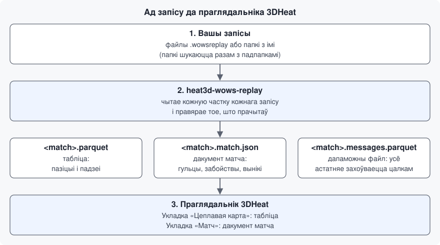

# Запісы 3DHeat World of Warships {#dheat-world-of-warships-replays}

**Што гэта?** World of Warships можа захоўваць кожны ваш бой як файл запісу.
Гэты інструмент ператварае такія файлы ў табліцу і дакумент матча (кароткі
змест бою), якія [праглядальнік 3DHeat](https://holdi601.github.io/3DHeat/)
паказвае ў 3D: куды плыў кожны карабель, дзе страляў і дзе ў яго трапілі.

**Навошта гэта мне?** Каб зноў паглядзець бой зверху, з усімі караблямі
адразу; каб бачыць цеплавыя карты таго, дзе вы і іншыя плаваеце, б'яцеся і
тонеце за сотні баёў; каб бачыць, куды ляцелі снарады і тарпеды; або каб
чытаць запіс сваімі скрыптамі, бо вывад - звычайныя Parquet і JSON.

**Прыклад:** на ўваходзе адзін файл запісу, на выхадзе табліца і дакумент матча:



## Хуткі старт {#quick-start}

Вы новічок у камандным радку? Спачатку прачытайце [Перад пачаткам](before-you-start.md).

```bash
git clone https://github.com/Holdi601/3DHeat-Ext-WoWs.git
cd 3DHeat-Ext-WoWs
pip install -e .
heat3d-wows-replay "<World of Warships>/replays" -o out
```

Вы павінны ўбачыць па радку на кожны запіс, які заканчваецца файлам, што ён
запісаў: `... -> out/<map>/<match>.parquet`. Адкрыйце гэты файл і
`<match>.match.json` побач з ім у праглядальніку 3DHeat.

## Гэта дакументацыя {#this-documentation}

| Старонка | Пра што яна |
|---|---|
| [Перад пачаткам](before-you-start.md) | Python, тэрмінал і як выглядае поспех |
| [Усталёўка](installing.md) | усталёўка, праверка, абнаўленні |
| [Канвертаванне запісаў](converting.md) | крок за крокам, кожны параметр, паведамленні, статус выхаду |
| [Табліца](table.md) | кожны слупок і падзея `<match>.parquet` |
| [Дакумент матча](match-document.md) | кожны ключ `<match>.match.json` |
| [Як чытаецца запіс](how-it-reads.md) | фармат і як правярана чытанне |
| [Паўната](completeness.md) | дапаможны файл і самаправерка |
| [Умовы і ліцэнзія](terms.md) | што ён чытае, ліцэнзія, крыніцы |
| [Даведнік каманд](../cli-reference.md), [Спіс слупкоў](../columns.md) | ствараюцца з кода |

## Частка 3DHeat {#part-of-3dheat}

Гэты канвертар - адзін з інструментаў [3DHeat](https://github.com/Holdi601/3DHeat),
праглядальніка 3D-тэлеметрыі і запісаў у рэальным часе ([дакументацыя](https://holdi601.github.io/3DHeat/)).
Праглядальнік адкрывае табліцу на ўкладцы «Цеплавая карта», а дакумент матча - на ўкладцы
«Матч». Ён можа спакаваць файлы матча ў адзін файл:
[One file a match](https://holdi601.github.io/3DHeat/container.html). Што павінен
захоўваць кожны канвертар: [Converters keep everything](https://holdi601.github.io/3DHeat/converters.html).

Кожны модуль чытання гульні - асобны невялікі праект са сваім файлам ліцэнзіі,
выпускамі і трэкерам задач, таму яго можна ўсталёўваць, абнаўляць,
падтрымліваць - або адклікаць па запыце праваўладальніка - асобна, не
закранаючы праграму прагляду і іншыя інструменты. Watcher запускае гэты
канвертар, калі ён усталяваны, і працуе без яго. Што чытае канвертар: [Умовы і
ліцэнзія](terms.md).

| Інструмент | Што робіць | Крыніца | Дакументацыя |
|---|---|---|---|
| Праглядальнік 3DHeat | паказвае дадзеныя ў 3D: цеплавыя карты, запісы, аналіз гонак | [3DHeat](https://github.com/Holdi601/3DHeat) | [сайт](https://holdi601.github.io/3DHeat/) |
| GameFiles | трасы і ўзроўні з файлаў, якія пастаўляюць гульні | [3DHeat-GameFiles](https://github.com/Holdi601/3DHeat-GameFiles) | [сайт](https://holdi601.github.io/3DHeat-GameFiles/) |
| GameCapture | тэлеметрыя кругоў і ўзроўні, адноўленыя з відэа гульні | [3DHeat-GameCapture](https://github.com/Holdi601/3DHeat-GameCapture) | [сайт](https://holdi601.github.io/3DHeat-GameCapture/) |
| Unreal Exporter | убудова Unreal Editor, якая экспартуе ўзровень | [3DHeat-UnrealExporter](https://github.com/Holdi601/3DHeat-UnrealExporter) | [сайт](https://holdi601.github.io/3DHeat-UnrealExporter/) |
| CS2 | дэмо і карты Counter-Strike 2 | [3DHeat-CS2](https://github.com/Holdi601/3DHeat-CS2) | [сайт](https://holdi601.github.io/3DHeat-CS2/) |
| Watcher | запісвае тое, што гульні публікуюць, пакуль вы гуляеце | [3DHeat-Watcher](https://github.com/Holdi601/3DHeat-Watcher) | [сайт](https://holdi601.github.io/3DHeat-Watcher/) |
| Рэплеі War Thunder | рэплеі `.wrpl` і ўзроўні War Thunder | [3DHeat-Ext-WarThunder](https://github.com/Holdi601/3DHeat-Ext-WarThunder) | [сайт](https://holdi601.github.io/3DHeat-Ext-WarThunder/) |
| Рэплеі World of Tanks | рэплеі `.wotreplay` | [3DHeat-Ext-WoT](https://github.com/Holdi601/3DHeat-Ext-WoT) | [сайт](https://holdi601.github.io/3DHeat-Ext-WoT/) |
| Рэплеі World of Warships | рэплеі `.wowsreplay` | [3DHeat-Ext-WoWs](https://github.com/Holdi601/3DHeat-Ext-WoWs) | [сайт](https://holdi601.github.io/3DHeat-Ext-WoWs/) |
| Дэмо Squad | дэмо сервера Squad | [3DHeat-Ext-Squad](https://github.com/Holdi601/3DHeat-Ext-Squad) | [сайт](https://holdi601.github.io/3DHeat-Ext-Squad/) |
| Карты DCS | карты DCS World як 3D-узроўні | [3DHeat-Ext-DCS](https://github.com/Holdi601/3DHeat-Ext-DCS) | [сайт](https://holdi601.github.io/3DHeat-Ext-DCS/) |
| Карты IL-2 | карты IL-2 Great Battles як 3D-узроўні | [3DHeat-Ext-IL2](https://github.com/Holdi601/3DHeat-Ext-IL2) | [сайт](https://holdi601.github.io/3DHeat-Ext-IL2/) |

---

Крыніца: [3DHeat-Ext-WoWs](https://github.com/Holdi601/3DHeat-Ext-WoWs).
