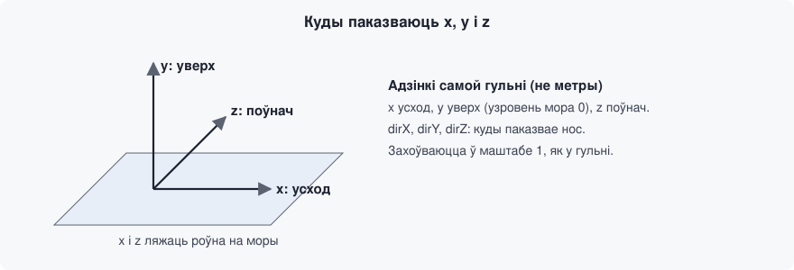

# Табліца {#the-table}

Адзін радок на адлік або падзею ў `<match>.parquet`: 31 калонка
([Спіс калонак](../columns.md), ствараецца з кода).

| Калонка | Што |
|---|---|
| `match`, `map` | id бою; карта (`spaces/99_testmap` на малюнках) |
| `time` | секунды ад пачатку запісу (адлік перад боем уключаны) |
| `battleTime` | секунды ад пачатку бою; адмоўны падчас адліку |
| `event` | чым з'яўляецца радок (ніжэй) |
| `player`, `team`, `own` | імя гульца; `ally` або `enemy` для гульца, які вядзе запіс; `1` у радках гульца, які вядзе запіс |
| `vehicle`, `type` | карабель гульца, які вядзе запіс, па назве (`PASB018-Iowa-1944`), астатнія - па нумары карабля ў гульні (`4253956080`), калі іх не называе `--ship-names`; `battleship`, `cruiser`, `destroyer`, `aircraft carrier`, `submarine`, калі назва гэта кажа, інакш `ship` |
| `x`, `y`, `z` | сусветныя адзінкі гульні: x усход, y уверх (узровень мора 0), z поўнач |
| `dirX`, `dirY`, `dirZ` | куды паказвае нос, адзінкавы вектар у той жа сістэме (`dirY` 0: толькі курс); для снарада ці тарпеды - куды ён ішоў |
| `other`, `reason` | другі карабель падзеі (забойца, ахвяра, нападнік); нумар прычыны патапленння ў гульні (без назвы), тып трапленння для ўдару, канал для чата |
| `value`, `health` | лік падзеі (урон, хуткасць снарада ці тарпеды ў сусветных адзінках у секунду); здароўе карабля пасля трапленння |
| `text` | радок чата |
| `shot`, `params` | id залпу; тып снарада ці тарпеды як нумар параметра гульні |
| `entity` | id карабля ў запісе |
| `otherVehicle`, `otherType` | у `impact` па караблі: гэты карабель і яго клас |
| `hitLocalX`, `hitLocalY`, `hitLocalZ` | у `impact` па караблі: дзе снарад скончыўся ва ўласнай сістэме гэтага карабля, у метрах (сусветныя адзінкі, памножаныя на 15): x наперад, y уверх ад мора, z управа |
| `pitch`, `roll` | у пазіцыі - тангаж і крэн карабля (радыяны), як іх дасылае гульня: карабель нахіляецца ў павароце |

| `event` | У радку | Што |
|---|---|---|
| `position` | кожны карабель | пакуль яго бачыў кліент |
| `death`, `kill` | ахвяра, забойца | кожнае патапленне двойчы: дзе карабель патануў і дзе быў яго забойца |
| `hurt`, `damage` | ахвяра, нападнік | трапленне: `value` урон, `health` што засталося |
| `shot` | стралок | адзін радок на снарад, ля гарматы, у напрамку палёту |
| `torpedo` | стралок | адзін радок на тарпеду, дзе яна запушчана, у напрамку ходу |
| `impact` | стралок | дзе снарад скончыўся (трапленне, прамах у ваду, ...); `reason` - нумар тыпу трапленння; па караблі (любы тып, акрамя 0 вада, 8, 32, 64 суша, у межах 6 адзінак ад карабля) `other`/`otherVehicle`/`otherType` - карабель, а `hitLocalX/Y/Z` - пункт у яго сістэме (вышэй) |
| `chat` | адпраўнік | `text` - радок, `reason` - канал (`battle_team`, `battle_common`) |

**Адзінкі.** Сусветная адзінка - не метр. Лінкор на ходу праходзіць каля 2,4
з іх у секунду, а карта мае каля 1 200 у папярочніку. Параўнаная з геаметрыяй
корпусаў караблёў, адзінка роўная 15 м; уласныя дадзеныя гульні пра дальнасці
даюць 30 м (landaire/wows-toolkit, `crates/wows-core/src/units.rs`, MIT, які
пакідае гэтыя два значэнні неўзгодненымі). Табліца трымае сусветныя адзінкі
ў маштабе 1, як кожная крыніца 3DHeat трымае ўласныя адзінкі сваёй гульні,
таму ўзровень, экспартаваны ў тых жа адзінках, супадае. Падказкі `heat3d`
калонтытула: Y уверх, Z перакулены (каб карта не была люстраной), карабель
даўжынёй 12 адзінак, `player` як чалавек, `team` як група, `match` як сесія.

---

Частка [3DHeat](https://github.com/Holdi601/3DHeat) ([дакументацыя](https://holdi601.github.io/3DHeat/)). Крыніца: [3DHeat-Ext-WoWs](https://github.com/Holdi601/3DHeat-Ext-WoWs).
