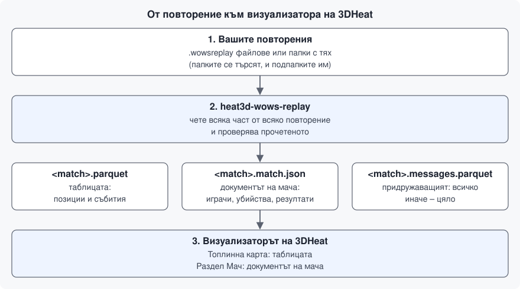

# 3DHeat репликите на World of Warships {#dheat-world-of-warships-replays}

**Какво е това?** World of Warships може да запише всяка битка, която играете, като файл с повторение. Този инструмент
превръща тези файлове в таблица и документ на мача (обобщението на битката), които
[3DHeat визуализаторът](https://holdi601.github.io/3DHeat/) показва в 3D: къде е плавал всеки кораб,
къде е стрелял и къде е бил уцелен.

**Защо да го използвам?** За да гледате отново битка отгоре, всеки кораб едновременно; за да видите топлинни карти
на това къде вие и други плавате, се биете и потъвате, при стотици битки; за да видите къде са отишли
снарядите и торпедите; или за да четете повторение със собствени скриптове, тъй като резултатът е обикновен Parquet и JSON.

**Пример:** един файл с повторение на входа, една таблица и един документ на мача на изхода:



## Бърз старт {#quick-start}

Нов ли сте в командния ред? Първо прочетете [Преди да започнете](before-you-start.md).

```bash
git clone https://github.com/Holdi601/3DHeat-Ext-WoWs.git
cd 3DHeat-Ext-WoWs
pip install -e .
heat3d-wows-replay "<World of Warships>/replays" -o out
```

За всяко повторение ще видите по един ред, който завършва с файла, който е записал:
`... -> out/<map>/<match>.parquet`. Отворете този файл и `<match>.match.json` до него
във 3DHeat визуализатора.

## Тази документация {#this-documentation}

| Страница | Какво разглежда |
|---|---|
| [Преди да започнете](before-you-start.md) | Python, терминал и как изглежда успехът |
| [Инсталиране](installing.md) | инсталиране, проверка, обновявания |
| [Преобразуване на повторенията](converting.md) | стъпка по стъпка, всяка опция, съобщения, код на изход |
| [Таблицата](table.md) | всяка колона и всяко събитие на `<match>.parquet` |
| [Документът на мача](match-document.md) | всеки ключ на `<match>.match.json` |
| [Как се чете повторението](how-it-reads.md) | форматът и как е проверено четенето |
| [Пълнота](completeness.md) | придружаващият файл и самопроверката |
| [Условия и лиценз](terms.md) | какво чете, лиценз, източници |
| [Справка за командите](../cli-reference.md), [Списък на колоните](../columns.md) | генерирани от кода |

## Част от 3DHeat {#part-of-3dheat}

Този преобразувател е един от инструментите на [3DHeat](https://github.com/Holdi601/3DHeat),
реалновремева 3D визуализация на телеметрия и повторения ([документация](https://holdi601.github.io/3DHeat/)).
Визуализаторът отваря таблицата в своя раздел Топлинна карта, а документа на мача – в раздела си Мач. Той може да събере файловете на един мач в един файл:
[Един файл за мач](https://holdi601.github.io/3DHeat/container.html). Какво трябва да запазва всеки преобразувател:
[Преобразувателите запазват всичко](https://holdi601.github.io/3DHeat/converters.html).

Всеки четец за игра е отделен малък проект със собствен лицензен файл, издания
и система за проследяване на проблеми, затова може да бъде инсталиран,
обновяван, поддържан - или оттеглен по искане на носител на права -
самостоятелно, без това да засяга визуализатора или другите инструменти.
Watcher стартира този преобразувател, когато е инсталиран, и работи и без
него. Какво чете преобразувателят: [Условия и лиценз](terms.md).

| Инструмент | Какво прави | Източник | Документация |
|---|---|---|---|
| 3DHeat визуализатор | показва данните в 3D: топлинни карти, повторения, анализ на състезания | [3DHeat](https://github.com/Holdi601/3DHeat) | [сайт](https://holdi601.github.io/3DHeat/) |
| GameFiles | трасета и нива от файловете, които игрите носят | [3DHeat-GameFiles](https://github.com/Holdi601/3DHeat-GameFiles) | [сайт](https://holdi601.github.io/3DHeat-GameFiles/) |
| GameCapture | телеметрия от обиколки и нива, възстановени от видеозаписи на играта | [3DHeat-GameCapture](https://github.com/Holdi601/3DHeat-GameCapture) | [сайт](https://holdi601.github.io/3DHeat-GameCapture/) |
| Unreal Exporter | приставка за Unreal Editor, която експортира нива | [3DHeat-UnrealExporter](https://github.com/Holdi601/3DHeat-UnrealExporter) | [сайт](https://holdi601.github.io/3DHeat-UnrealExporter/) |
| CS2 | демота и карти на Counter-Strike 2 | [3DHeat-CS2](https://github.com/Holdi601/3DHeat-CS2) | [сайт](https://holdi601.github.io/3DHeat-CS2/) |
| Watcher | записва това, което игрите публикуват, докато играете | [3DHeat-Watcher](https://github.com/Holdi601/3DHeat-Watcher) | [сайт](https://holdi601.github.io/3DHeat-Watcher/) |
| War Thunder повторения | повторения `.wrpl` и нива на War Thunder | [3DHeat-Ext-WarThunder](https://github.com/Holdi601/3DHeat-Ext-WarThunder) | [сайт](https://holdi601.github.io/3DHeat-Ext-WarThunder/) |
| World of Tanks повторения | повторения `.wotreplay` | [3DHeat-Ext-WoT](https://github.com/Holdi601/3DHeat-Ext-WoT) | [сайт](https://holdi601.github.io/3DHeat-Ext-WoT/) |
| World of Warships повторения | повторения `.wowsreplay` | [3DHeat-Ext-WoWs](https://github.com/Holdi601/3DHeat-Ext-WoWs) | [сайт](https://holdi601.github.io/3DHeat-Ext-WoWs/) |
| Squad демота | демота от сървъри на Squad | [3DHeat-Ext-Squad](https://github.com/Holdi601/3DHeat-Ext-Squad) | [сайт](https://holdi601.github.io/3DHeat-Ext-Squad/) |
| DCS карти | карти на DCS World като 3D нива | [3DHeat-Ext-DCS](https://github.com/Holdi601/3DHeat-Ext-DCS) | [сайт](https://holdi601.github.io/3DHeat-Ext-DCS/) |
| IL-2 карти | карти на IL-2 Great Battles като 3D нива | [3DHeat-Ext-IL2](https://github.com/Holdi601/3DHeat-Ext-IL2) | [сайт](https://holdi601.github.io/3DHeat-Ext-IL2/) |

---

Източник: [3DHeat-Ext-WoWs](https://github.com/Holdi601/3DHeat-Ext-WoWs).
