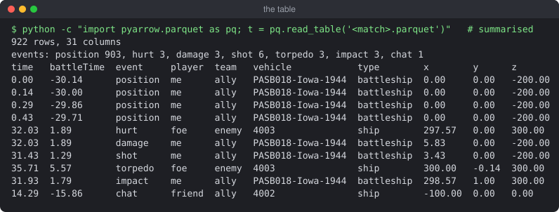
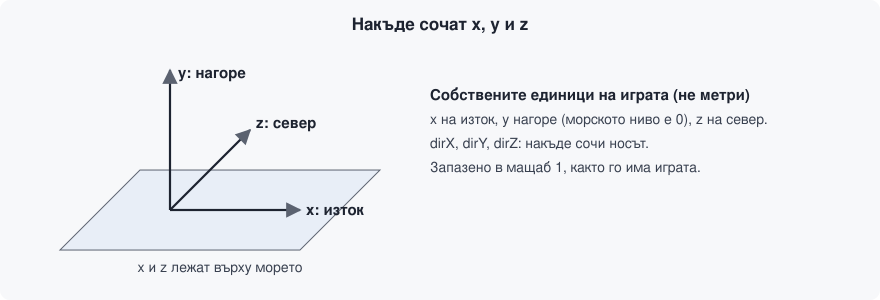

# Таблицата {#the-table}

По един ред за всяка проба или събитие, в `<match>.parquet`: 31 колони
([Списък на колоните](../columns.md), генериран от кода).

| Колона | Какво е |
|---|---|
| `match`, `map` | идентификаторът на битката; картата (`spaces/99_testmap` на картинките) |
| `time` | секунди от началото на записа (в него е и обратното броене) |
| `battleTime` | секунди от началото на битката; отрицателни по време на обратното броене |
| `event` | какво е редът (по-долу) |
| `player`, `team`, `own` | името на играча; `ally` или `enemy` спрямо записващия играч; `1` на редовете на записващия играч |
| `vehicle`, `type` | корабът на записващия играч по име (`PASB018-Iowa-1944`), останалите – по номера на кораба в играта (`4253956080`), освен ако `--ship-names` ги назове; `battleship`, `cruiser`, `destroyer`, `aircraft carrier`, `submarine`, когато името го казва, иначе `ship` |
| `x`, `y`, `z` | единиците на света на играта: x на изток, y нагоре (морското ниво 0), z на север |
| `dirX`, `dirY`, `dirZ` | накъде сочи носът, единичен вектор в същата координатна система (`dirY` 0: само курс); при снаряд или торпедо – накъде са тръгнали |
| `other`, `reason` | другият кораб на събитие (убиец, жертва, нападател); номерът на причината на играта за потопяване (не е назована), видът на попадението при удар, каналът при чат |
| `value`, `health` | числото на събитието (щета, скорост на снаряд или торпедо в единици на света в секунда); здравето на кораба след попадение |
| `text` | ред от чата |
| `shot`, `params` | идентификаторът на залпа; типът на снаряда или торпедото като номер на параметър в играта |
| `entity` | идентификаторът на кораба в повторението |
| `otherVehicle`, `otherType` | при `impact` върху кораб: този кораб и неговият клас |
| `hitLocalX`, `hitLocalY`, `hitLocalZ` | при `impact` върху кораб: къде е спрял снарядът в собствената координатна система на този кораб, в метри (единици на света по 15): x напред, y нагоре от морето, z надясно |
| `pitch`, `roll` | при позиция: наклонът и кренът на кораба (радиани), както ги изпраща играта: корабът се накланя в завой |

| `event` | На реда на | Какво е |
|---|---|---|
| `position` | всеки кораб | докато клиентът го вижда |
| `death`, `kill` | жертвата, убиеца | всяко потопяване два пъти: къде е потънал корабът и къде е бил убиецът му |
| `hurt`, `damage` | жертвата, нападателя | попадение: `value` – щетата, `health` – какво е останало |
| `shot` | стрелецът | по един ред за всеки снаряд, при оръдието, в посоката, в която е летял |
| `torpedo` | стрелецът | по един ред за всяко торпедо, там, където е изстреляно, в посоката, в която е плавало |
| `impact` | стрелецът | където е спрял снарядът (попадение, пропуск във водата, ...); `reason` – номерът на вида попадение; върху кораб (всеки тип, освен 0 вода, 8, 32, 64 суша, в рамките на 6 единици от кораб) `other`/`otherVehicle`/`otherType` – кораба, а `hitLocalX/Y/Z` – точката в неговата координатна система (по-горе) |
| `chat` | изпращача | `text` – редът, `reason` – каналът (`battle_team`, `battle_common`) |

**Единиците.** Единицата на света не е метър. Боен кораб с ход покрива около 2.4
от тях в секунда, а картата е около 1200 от край до край. Спрямо геометрията на корпусите на корабите една единица е 15 m; обхватите на играта
ѝ дават 30 m (landaire/wows-toolkit, `crates/wows-core/src/units.rs`, MIT, който оставя
двете неуеднаквени). Таблицата пази единиците на света в мащаб 1, както всеки източник на 3DHeat
пази собствените единици на играта си, така че ниво, експортирано в същите единици, съвпада. Подсказките в футъра `heat3d`: Y нагоре, Z обърнато (така картата не е огледална),
кораб с дължина 12 единици, `player` като човека, `team` като групата, `match` като
сесията.

---

Част от [3DHeat](https://github.com/Holdi601/3DHeat) ([документация](https://holdi601.github.io/3DHeat/)). Източник: [3DHeat-Ext-WoWs](https://github.com/Holdi601/3DHeat-Ext-WoWs).
