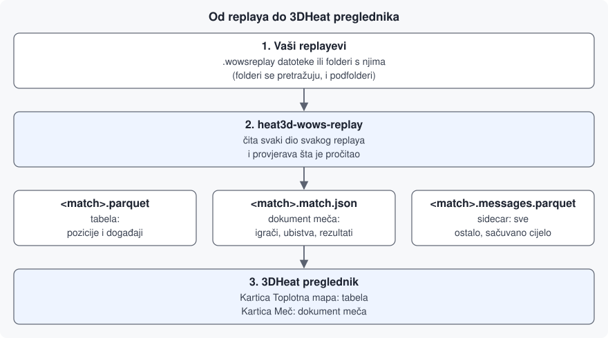

# 3DHeat World of Warships replayevi {#dheat-world-of-warships-replays}

**Šta je to?** World of Warships može spremiti svaku bitku koju odigrate kao replay
datoteku. Ovaj alat pretvara te datoteke u tabelu i dokument meča (sažetak
bitke) koje
[3DHeat preglednik](https://holdi601.github.io/3DHeat/) prikazuje u 3D-u: gdje je svaki
brod plovio, pucao i bio pogođen.

**Zašto bih ga koristio?** Da ponovo pogledate bitku odozgo, svaki brod
istovremeno; da vidite toplotne mape gdje vi i drugi plovite, borite se i tonete kroz
stotine bitaka; da vidite kamo su išle granate i torpeda; ili da čitate replay vlastitim skriptama, jer su
izlaz obični Parquet i JSON.

**Primjer:** jedna replay datoteka na ulazu, tabela i dokument meča na izlazu:



## Brzi početak {#quick-start}

Niste navikli na komandnu liniju? Prvo pročitajte [Prije nego počnete](before-you-start.md).

```bash
git clone https://github.com/Holdi601/3DHeat-Ext-WoWs.git
cd 3DHeat-Ext-WoWs
pip install -e .
heat3d-wows-replay "<World of Warships>/replays" -o out
```

Trebali biste vidjeti jedan red po replayu, koji završava datotekom koju je napisao:
`... -> out/<map>/<match>.parquet`. Otvorite tu datoteku i
`<match>.match.json` pored nje u 3DHeat pregledniku.

## Ova dokumentacija {#this-documentation}

| Stranica | Šta pokriva |
|---|---|
| [Prije nego počnete](before-you-start.md) | Python, terminal i kako izgleda uspjeh |
| [Instalacija](installing.md) | instalacija, provjera, ažuriranja |
| [Pretvaranje replayeva](converting.md) | korak po korak, sve opcije, poruke, izlazni status |
| [Tabela](table.md) | svaka kolona i događaj u `<match>.parquet` |
| [Dokument meča](match-document.md) | svaki ključ u `<match>.match.json` |
| [Kako čita replay](how-it-reads.md) | format i kako je čitanje provjereno |
| [Potpunost](completeness.md) | sidecar i samoprovjera |
| [Uvjeti i licenca](terms.md) | šta čita, licenca, izvori |
| [Referenca naredbi](../cli-reference.md), [Lista kolona](../columns.md) | generisano iz koda |

## Dio 3DHeata {#part-of-3dheat}

Ovaj konverter je jedan od alata [3DHeata](https://github.com/Holdi601/3DHeat),
3D preglednika telemetrije i replayeva u stvarnom vremenu ([dokumentacija](https://holdi601.github.io/3DHeat/)).
Preglednik otvara tabelu u kartici Toplotna mapa, a dokument meča u kartici
Meč. Može spakirati datoteke jednog meča u jednu datoteku:
[Jedna datoteka po meču](https://holdi601.github.io/3DHeat/container.html). Šta svaki
konverter mora zadržati: [Konverteri čuvaju sve](https://holdi601.github.io/3DHeat/converters.html).

Svaki čitač igre je zaseban mali projekat s vlastitim fajlom licence,
izdanjima i sistemom za praćenje problema, pa se može instalirati, ažurirati,
održavati - ili povući na zahtjev nosioca prava - zasebno, bez uticaja na
preglednik ili druge alate. Watcher pokreće ovaj konverter kada je instaliran
i radi i bez njega. Šta konverter čita: [Uvjeti i licenca](terms.md).

| Alat | Šta radi | Izvor | Dokumentacija |
|---|---|---|---|
| 3DHeat preglednik | prikazuje podatke u 3D-u: toplotne mape, replayeve, analizu utrka | [3DHeat](https://github.com/Holdi601/3DHeat) | [stranica](https://holdi601.github.io/3DHeat/) |
| GameFiles | staze i nivoi iz datoteka koje igre isporučuju | [3DHeat-GameFiles](https://github.com/Holdi601/3DHeat-GameFiles) | [stranica](https://holdi601.github.io/3DHeat-GameFiles/) |
| GameCapture | telemetrija krugova i nivoi rekonstruirani iz video snimka igranja | [3DHeat-GameCapture](https://github.com/Holdi601/3DHeat-GameCapture) | [stranica](https://holdi601.github.io/3DHeat-GameCapture/) |
| Unreal Exporter | dodatak za Unreal Editor koji izvozi nivo | [3DHeat-UnrealExporter](https://github.com/Holdi601/3DHeat-UnrealExporter) | [stranica](https://holdi601.github.io/3DHeat-UnrealExporter/) |
| CS2 | Counter-Strike 2 demo snimci i mape | [3DHeat-CS2](https://github.com/Holdi601/3DHeat-CS2) | [stranica](https://holdi601.github.io/3DHeat-CS2/) |
| Watcher | bilježi ono što igre objavljuju dok igrate | [3DHeat-Watcher](https://github.com/Holdi601/3DHeat-Watcher) | [stranica](https://holdi601.github.io/3DHeat-Watcher/) |
| War Thunder replayevi | `.wrpl` replayevi i War Thunder nivoi | [3DHeat-Ext-WarThunder](https://github.com/Holdi601/3DHeat-Ext-WarThunder) | [stranica](https://holdi601.github.io/3DHeat-Ext-WarThunder/) |
| World of Tanks replayevi | `.wotreplay` replayevi | [3DHeat-Ext-WoT](https://github.com/Holdi601/3DHeat-Ext-WoT) | [stranica](https://holdi601.github.io/3DHeat-Ext-WoT/) |
| World of Warships replayevi | `.wowsreplay` replayevi | [3DHeat-Ext-WoWs](https://github.com/Holdi601/3DHeat-Ext-WoWs) | [stranica](https://holdi601.github.io/3DHeat-Ext-WoWs/) |
| Squad demo snimci | Squad serverski demo snimci | [3DHeat-Ext-Squad](https://github.com/Holdi601/3DHeat-Ext-Squad) | [stranica](https://holdi601.github.io/3DHeat-Ext-Squad/) |
| DCS mape | DCS World mape kao 3D nivoi | [3DHeat-Ext-DCS](https://github.com/Holdi601/3DHeat-Ext-DCS) | [stranica](https://holdi601.github.io/3DHeat-Ext-DCS/) |
| IL-2 mape | IL-2 Great Battles mape kao 3D nivoi | [3DHeat-Ext-IL2](https://github.com/Holdi601/3DHeat-Ext-IL2) | [stranica](https://holdi601.github.io/3DHeat-Ext-IL2/) |

---

Izvor: [3DHeat-Ext-WoWs](https://github.com/Holdi601/3DHeat-Ext-WoWs).
