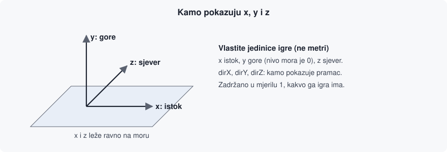

# Tabela {#the-table}

Jedan red po uzorku ili događaju, u `<match>.parquet`: 31 kolona
([Lista kolona](../columns.md), generisana iz koda).

| Kolona | Šta |
|---|---|
| `match`, `map` | id bitke; mapa (`spaces/99_testmap` na slikama) |
| `time` | sekunde od početka snimanja (odbrojavanje je uključeno) |
| `battleTime` | sekunde od početka bitke; negativno tokom odbrojavanja |
| `event` | šta je red (dolje) |
| `player`, `team`, `own` | ime igrača; `ally` ili `enemy` u odnosu na igrača koji snima; `1` na redovima igrača koji snima |
| `vehicle`, `type` | brod igrača koji snima po imenu (`PASB018-Iowa-1944`), ostali po broju broda u igri (`4253956080`) osim ako ih `--ship-names` ne imenuje; `battleship`, `cruiser`, `destroyer`, `aircraft carrier`, `submarine` gdje ime to kaže, inače `ship` |
| `x`, `y`, `z` | jedinice svijeta igre: x istok, y gore (nivo mora 0), z sjever |
| `dirX`, `dirY`, `dirZ` | kamo pokazuje pramac, jedinični vektor u istom okviru (`dirY` 0: samo heading); na granati ili torpedu smjer kojim je išla |
| `other`, `reason` | drugi brod događaja (ubica, žrtva, napadač); broj uzroka u igri za potonuće (nije imenovan), tip pogotka za udar, kanal za čet |
| `value`, `health` | broj događaja (šteta, brzina granate ili torpeda u jedinicama svijeta u sekundi); zdravlje broda poslije pogotka |
| `text` | red četa |
| `shot`, `params` | id plotuna; tip granate ili torpeda, kao broj parametra igre |
| `entity` | id broda u replayu |
| `otherVehicle`, `otherType` | na `impact` na brodu: taj brod i njegova klasa |
| `hitLocalX`, `hitLocalY`, `hitLocalZ` | na `impact` na brodu: gdje je granata završila u vlastitom okviru tog broda, u metrima (jedinice svijeta puta 15): x naprijed, y gore od mora, z desno |
| `pitch`, `roll` | na poziciji, pitch i roll broda (radijani) kako ih igra šalje: brod se naginje u zavoju |

| `event` | Na redu od | Šta |
|---|---|---|
| `position` | svaki brod | dok ga je klijent vidio |
| `death`, `kill` | žrtva, ubica | svako potonuće dvaput: gdje je brod potonuo i gdje je bio njegov ubica |
| `hurt`, `damage` | žrtva, napadač | pogodak: `value` šteta, `health` šta je ostalo |
| `shot` | strijelac | jedan red po granati, na topu, u smjeru kojim je letjela |
| `torpedo` | strijelac | jedan red po torpedu, gdje je lansirano, u smjeru kojim je išlo |
| `impact` | strijelac | gdje je granata završila (pogodak, promašaj u vodu, ...); `reason` broj tipa pogotka; na brodu (bilo koji tip osim 0 voda, 8, 32, 64 kopno, unutar 6 jedinica od broda) `other`/`otherVehicle`/`otherType` brod i `hitLocalX/Y/Z` tačka u njegovom okviru (gore) |
| `chat` | pošiljalac | `text` red, `reason` kanal (`battle_team`, `battle_common`) |

**Jedinice.** Jedinica svijeta nije metar. Bojni brod pri brzini prelazi oko 2,4
njih u sekundi, a mapa je široka oko 1.200. Postavljena prema geometriji
trupova brodova, jedinica je 15 m; vlastite brojke dometa igre daju 30 m
(landaire/wows-toolkit, `crates/wows-core/src/units.rs`, MIT, koji ostavlja
to dvoje neusklađenim). Tabela drži jedinice svijeta u mjerilu 1, kao što svaki 3DHeat
izvor drži vlastite jedinice svoje igre, pa se nivo izvezen u istim jedinicama
poklapa. Upute `heat3d` u podnožju: Y gore, Z preokrenut (da mapa nije zrcaljena),
brod dug 12 jedinica, `player` kao osoba, `team` kao grupa, `match` kao
sesija.

---

Dio [3DHeata](https://github.com/Holdi601/3DHeat) ([dokumentacija](https://holdi601.github.io/3DHeat/)). Izvor: [3DHeat-Ext-WoWs](https://github.com/Holdi601/3DHeat-Ext-WoWs).
