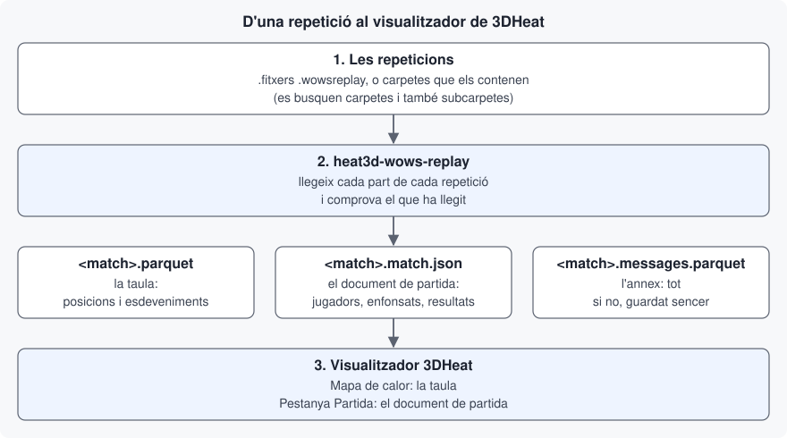

# Repeticions de World of Warships per a 3DHeat {#dheat-world-of-warships-replays}

**Què és?** World of Warships pot desar cada batalla que jugues com a fitxer de repetició. Aquesta
eina converteix aquests fitxers en una taula i un document de partida (el resum de la batalla) que el
[visualitzador de 3DHeat](https://holdi601.github.io/3DHeat/) mostra en 3D: on va navegar, disparar i
rebre impactes cada vaixell.

**Per què la faria servir?** Per tornar a veure una batalla des de dalt, tots els vaixells alhora; per
veure mapes de calor de on navegueu, lluiteu i enfonseu tu i els altres en centenars de batalles; per
veure on van anar els obusos i els torpedes; o per llegir una repetició amb els teus propis scripts, ja
que la sortida és Parquet i JSON normals.

**Exemple:** entra un fitxer de repetició i en surten una taula i un document de partida:



## Inici ràpid {#quick-start}

No n'has fet mai servir la línia d'ordres? Llegeix primer [Abans de començar](before-you-start.md).

```bash
git clone https://github.com/Holdi601/3DHeat-Ext-WoWs.git
cd 3DHeat-Ext-WoWs
pip install -e .
heat3d-wows-replay "<World of Warships>/replays" -o out
```

Hauries de veure una línia per repetició, que acaba amb el fitxer que ha escrit:
`... -> out/<mapa>/<partida>.parquet`. Obre aquest fitxer i el `<partida>.match.json` que hi ha al costat
al visualitzador de 3DHeat.

## Aquesta documentació {#this-documentation}

| Pàgina | Què cobreix |
|---|---|
| [Abans de començar](before-you-start.md) | Python, un terminal i com és l'èxit |
| [Instal·lació](installing.md) | instal·lació, comprovació, actualitzacions |
| [Conversió de repeticions](converting.md) | pas a pas, cada opció, els missatges, l'estat de sortida |
| [La taula](table.md) | cada columna i cada esdeveniment de `<partida>.parquet` |
| [El document de partida](match-document.md) | cada clau de `<partida>.match.json` |
| [Com llegeix una repetició](how-it-reads.md) | el format, i com es va comprovar la lectura |
| [Completesa](completeness.md) | l'annex i l'autocomprovació |
| [Condicions i llicència](terms.md) | les condicions de Wargaming, la llicència, les fonts |
| [Referència d'ordres](../cli-reference.md), [Llista de columnes](../columns.md) | generades a partir del codi |

## Part de 3DHeat {#part-of-3dheat}

Aquest convertidor és una de les eines de [3DHeat](https://github.com/Holdi601/3DHeat),
un visualitzador en 3D, en temps real, de telemetria i repeticions
([documentació](https://holdi601.github.io/3DHeat/)). El visualitzador obre la taula a la seva pestanya
Mapa de calor i el document de partida a la seva pestanya Partida. Pot empaquetar els fitxers d'una partida
en un de sol: [Un fitxer per partida](https://holdi601.github.io/3DHeat/container.html). La regla que ha de complir
tot convertidor: [Els convertidors ho guarden tot](https://holdi601.github.io/3DHeat/converters.html).

El convertidor es manté apart del Watcher de 3DHeat a propòsit: les repeticions estan xifrades, i les
condicions de Wargaming són àmplies ([Condicions i llicència](terms.md)). Si algun dia ha de desaparèixer,
no se'n va res més. El Watcher l'executa quan està instal·lat i funciona sense ell.

| Eina | Què fa | Font | Documentació |
|---|---|---|---|
| Visualitzador de 3DHeat | mostra les dades en 3D: mapes de calor, repeticions, anàlisi de curses | [3DHeat](https://github.com/Holdi601/3DHeat) | [web](https://holdi601.github.io/3DHeat/) |
| GameFiles | recorreguts i nivells extrets dels fitxers que distribueixen els jocs | [3DHeat-GameFiles](https://github.com/Holdi601/3DHeat-GameFiles) | [web](https://holdi601.github.io/3DHeat-GameFiles/) |
| GameCapture | telemetria de volta, i nivells reconstruïts a partir del vídeo de la partida | [3DHeat-GameCapture](https://github.com/Holdi601/3DHeat-GameCapture) | [web](https://holdi601.github.io/3DHeat-GameCapture/) |
| Exportador per a Unreal | un connector de l'Editor d'Unreal que exporta un nivell | [3DHeat-UnrealExporter](https://github.com/Holdi601/3DHeat-UnrealExporter) | [web](https://holdi601.github.io/3DHeat-UnrealExporter/) |
| CS2 | demos i mapes de Counter-Strike 2 | [3DHeat-CS2](https://github.com/Holdi601/3DHeat-CS2) | [web](https://holdi601.github.io/3DHeat-CS2/) |
| Watcher | registra el que publiquen els jocs mentre hi jugues | [3DHeat-Watcher](https://github.com/Holdi601/3DHeat-Watcher) | [web](https://holdi601.github.io/3DHeat-Watcher/) |
| Repeticions de War Thunder | repeticions `.wrpl` i nivells de War Thunder | [3DHeat-Ext-WarThunder](https://github.com/Holdi601/3DHeat-Ext-WarThunder) | [web](https://holdi601.github.io/3DHeat-Ext-WarThunder/) |
| Repeticions de World of Tanks | repeticions `.wotreplay` | [3DHeat-Ext-WoT](https://github.com/Holdi601/3DHeat-Ext-WoT) | [web](https://holdi601.github.io/3DHeat-Ext-WoT/) |
| Repeticions de World of Warships | repeticions `.wowsreplay` | [3DHeat-Ext-WoWs](https://github.com/Holdi601/3DHeat-Ext-WoWs) | [web](https://holdi601.github.io/3DHeat-Ext-WoWs/) |
| Demos de Squad | demos de servidor de Squad | [3DHeat-Ext-Squad](https://github.com/Holdi601/3DHeat-Ext-Squad) | [web](https://holdi601.github.io/3DHeat-Ext-Squad/) |
| Mapes de DCS | mapes del món de DCS com a nivells 3D | [3DHeat-Ext-DCS](https://github.com/Holdi601/3DHeat-Ext-DCS) | [web](https://holdi601.github.io/3DHeat-Ext-DCS/) |
| Mapes d'IL-2 | mapes d'IL-2 Great Battles com a nivells 3D | [3DHeat-Ext-IL2](https://github.com/Holdi601/3DHeat-Ext-IL2) | [web](https://holdi601.github.io/3DHeat-Ext-IL2/) |

---

Font: [3DHeat-Ext-WoWs](https://github.com/Holdi601/3DHeat-Ext-WoWs).
