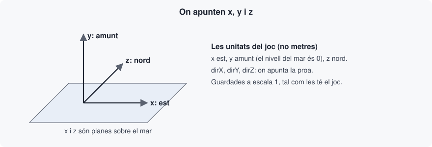

# La taula {#the-table}

Una fila per mostra o esdeveniment, a `<partida>.parquet`: 31 columnes ([Llista de columnes](../columns.md),
generada a partir del codi).

| Columna | Què és |
|---|---|
| `match`, `map` | l'identificador de la batalla; el mapa (`spaces/99_testmap` a les imatges) |
| `time` | segons des que va començar la gravació (la compte enrere hi és) |
| `battleTime` | segons des que va començar la batalla; negatius durant la compte enrere |
| `event` | què és la fila (més avall) |
| `player`, `team`, `own` | el nom del jugador; `ally` o `enemy` del jugador que grava; `1` a les files del jugador que grava |
| `vehicle`, `type` | el vaixell del jugador que grava pel nom (`PASB018-Iowa-1944`), els altres pel número de vaixell del joc (`4253956080`) tret que `--ship-names` els nomeni; `battleship`, `cruiser`, `destroyer`, `aircraft carrier`, `submarine` quan el nom ho indica, si no `ship` |
| `x`, `y`, `z` | les unitats de món del joc: x est, y amunt (nivell del mar 0), z nord |
| `dirX`, `dirY`, `dirZ` | cap on apunta la proa, un vector unitari al mateix marc (`dirY` 0: només heading); en un obús o torpede, el camí que va seguir |
| `other`, `reason` | l'altre vaixell d'un esdeveniment (assassí, víctima, atacant); el número de causa del joc per a un enfonsament (sense nom), el tipus d'impacte per a un impacte, el canal per al xat |
| `value`, `health` | el número de l'esdeveniment (dany, velocitat d'un obús o torpede en unitats de món per segon); la salut del vaixell després d'un impacte |
| `text` | una línia de xat |
| `shot`, `params` | l'identificador d'una salba; el tipus de l'obús o torpede, com el número de paràmetre del joc |
| `entity` | l'identificador del vaixell a la repetició |
| `otherVehicle`, `otherType` | en un `impact` sobre un vaixell: aquell vaixell i la seva classe |
| `hitLocalX`, `hitLocalY`, `hitLocalZ` | en un `impact` sobre un vaixell: on va acabar l'obús en el marc propi d'aquell vaixell, en metres (unitats de món per 15): x endavant, y amunt des del mar, z dreta |
| `pitch`, `roll` | en una posició, la inclinació i el roll del vaixell (radians) tal com els envia el joc: un vaixell s'inclina en un gir |

| `event` | A la fila de | Què és |
|---|---|---|
| `position` | cada vaixell | mentre el client el veia |
| `death`, `kill` | la víctima, l'assassí | cada enfonsament dues vegades: on es va enfonsar el vaixell, i on era el seu assassí |
| `hurt`, `damage` | la víctima, l'atacant | un impacte: `value` el dany, `health` el que queda |
| `shot` | el tirador | una fila per obús, al canó, en la direcció que va volar |
| `torpedo` | el tirador | una fila per torpede, on va ser llançat, en la direcció que va córrer |
| `impact` | el tirador | on va acabar un obús (impacte, caiguda a l'aigua, ...); `reason` el número del tipus d'impacte; en un vaixell (qualsevol tipus excepte 0 aigua, 8, 32, 64 terra, a menys de 6 unitats d'un vaixell) `other`/`otherVehicle`/`otherType` el vaixell i `hitLocalX/Y/Z` el punt en el seu marc (més amunt) |
| `chat` | qui envia | `text` la línia, `reason` el canal (`battle_team`, `battle_common`) |

**Unitats.** Una unitat de món no és un metre. Un cuirassat a velocitat recorre unes 2,4 d'elles per segon, i un
mapa fa uns 1.200 d'extensió. Comparada amb la geometria dels cascos dels vaixells, una unitat fa 15 m; les xifres
d'abast del joc la fan de 30 m (landaire/wows-toolkit, `crates/wows-core/src/units.rs`, MIT, que deixa les dues
sense conciliar). La taula guarda les unitats de món a escala 1, com totes les fonts de 3DHeat guarden les unitats
del seu propi joc, de manera que un nivell exportat en les mateixes unitats quadra. Les indicacions del peu,
`heat3d`: Y amunt, Z invertida (de manera que el mapa no es reflecteix), un vaixell de 12 unitats de llarg,
`player` com la persona, `team` com el grup, `match` com la sessió.

---

Part de [3DHeat](https://github.com/Holdi601/3DHeat) ([documentació](https://holdi601.github.io/3DHeat/)). Font: [3DHeat-Ext-WoWs](https://github.com/Holdi601/3DHeat-Ext-WoWs).
