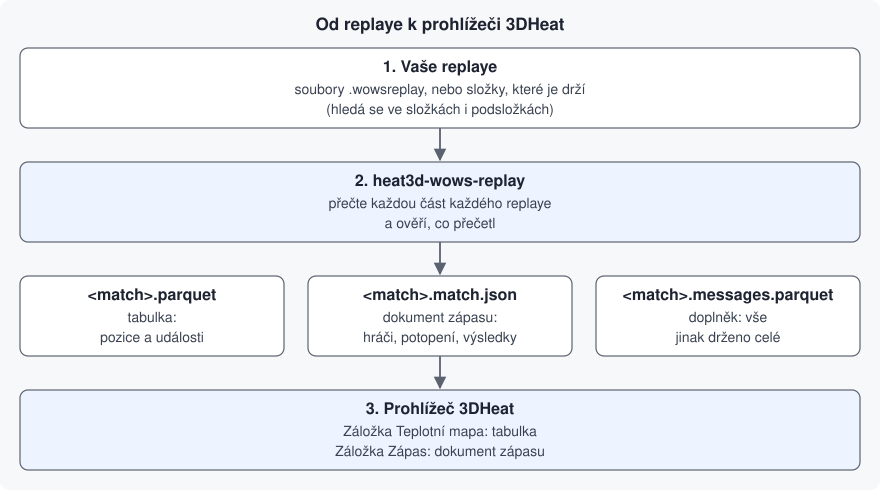

# 3DHeat replaye z World of Warships {#dheat-world-of-warships-replays}

**Co to je?** World of Warships umí uložit každou bitvu, kterou odehrajete, jako soubor replaye. Tento nástroj
tyto soubory převede na tabulku a dokument zápasu (souhrn bitvy), které
[prohlížeč 3DHeat](https://holdi601.github.io/3DHeat/) ukáže ve 3D: kam každá loď plula, kde střílela a kde byla zasažena.

**Proč bych to používal?** Abyste si bitvu znovu prohlédli shora, všechny lodě najednou; abyste viděli teplotní
mapy toho, kde vy i ostatní plujete, bojujete a potápíte se přes stovky bitev; abyste viděli, kam dopadly granáty
a torpéda; nebo abyste replay četli vlastními skripty, protože výstup je prostý Parquet a JSON.

**Příklad:** jeden soubor replaye na vstupu, tabulka a dokument zápasu na výstupu:



## Rychlý start {#quick-start}

Nikdy jste nepracovali s příkazovým řádkem? Nejdříve si přečtěte [Než začnete](before-you-start.md).

```bash
git clone https://github.com/Holdi601/3DHeat-Ext-WoWs.git
cd 3DHeat-Ext-WoWs
pip install -e .
heat3d-wows-replay "<World of Warships>/replays" -o out
```

Uvidíte jeden řádek na replay, který končí souborem, který zapsal: `... -> out/<map>/<match>.parquet`. Otevřete
tento soubor a vedle něj `<match>.match.json` v prohlížeči 3DHeat.

## Tato dokumentace {#this-documentation}

| Stránka | Co obsahuje |
|---|---|
| [Než začnete](before-you-start.md) | Python, terminál a jak vypadá úspěch |
| [Instalace](installing.md) | instalace, ověření, aktualizace |
| [Převod replayů](converting.md) | krok za krokem, každá volba, hlášení, stav ukončení |
| [Tabulka](table.md) | každý sloupec a každá událost v `<match>.parquet` |
| [Dokument zápasu](match-document.md) | každý klíč v `<match>.match.json` |
| [Jak se replay čte](how-it-reads.md) | formát a jak bylo čtení ověřeno |
| [Úplnost](completeness.md) | doplněk a vlastní kontrola |
| [Podmínky a licence](terms.md) | co čte, licence, zdroje |
| [Přehled příkazů](../cli-reference.md), [Seznam sloupců](../columns.md) | generováno z kódu |

## Součást 3DHeat {#part-of-3dheat}

Tento převodník je jedním z nástrojů [3DHeat](https://github.com/Holdi601/3DHeat),
prohlížeče 3D telemetrie a replayů v reálném čase ([dokumentace](https://holdi601.github.io/3DHeat/)).
Prohlížeč otevře tabulku na své záložce Teplotní mapa a dokument zápasu na záložce Zápas. Může zabalit soubory
zápasu do jednoho: [Jeden soubor na zápas](https://holdi601.github.io/3DHeat/container.html). Co musí
každý převodník zachovat: [Převodníky zachovávají vše](https://holdi601.github.io/3DHeat/converters.html).

Každá čtečka hry je samostatný malý projekt s vlastním souborem licence,
vydáními a evidencí problémů, takže ji lze instalovat, aktualizovat,
udržovat - nebo na žádost držitele práv stáhnout - samostatně, bez vlivu na
prohlížeč a ostatní nástroje. Watcher tento převodník spouští, když je
nainstalovaný, a funguje i bez něj. Co převodník čte: [Podmínky a
licence](terms.md).

| Nástroj | Co dělá | Zdroj | Dokumentace |
|---|---|---|---|
| prohlížeč 3DHeat | ukazuje data ve 3D: teplotní mapy, replaye, analýzu závodu | [3DHeat](https://github.com/Holdi601/3DHeat) | [web](https://holdi601.github.io/3DHeat/) |
| GameFiles | tratě a úrovně z souborů, které hry obsahují | [3DHeat-GameFiles](https://github.com/Holdi601/3DHeat-GameFiles) | [web](https://holdi601.github.io/3DHeat-GameFiles/) |
| GameCapture | telemetrie z kol a úrovně rekonstruované z herního videa | [3DHeat-GameCapture](https://github.com/Holdi601/3DHeat-GameCapture) | [web](https://holdi601.github.io/3DHeat-GameCapture/) |
| Unreal Exporter | zásuvný modul Unreal Editoru, který exportuje úroveň | [3DHeat-UnrealExporter](https://github.com/Holdi601/3DHeat-UnrealExporter) | [web](https://holdi601.github.io/3DHeat-UnrealExporter/) |
| CS2 | dema a mapy Counter-Strike 2 | [3DHeat-CS2](https://github.com/Holdi601/3DHeat-CS2) | [web](https://holdi601.github.io/3DHeat-CS2/) |
| Watcher | zaznamenává, co hry zveřejňují, když hrajete | [3DHeat-Watcher](https://github.com/Holdi601/3DHeat-Watcher) | [web](https://holdi601.github.io/3DHeat-Watcher/) |
| replaye War Thunder | replaye `.wrpl` a úrovně War Thunder | [3DHeat-Ext-WarThunder](https://github.com/Holdi601/3DHeat-Ext-WarThunder) | [web](https://holdi601.github.io/3DHeat-Ext-WarThunder/) |
| replaye World of Tanks | replaye `.wotreplay` | [3DHeat-Ext-WoT](https://github.com/Holdi601/3DHeat-Ext-WoT) | [web](https://holdi601.github.io/3DHeat-Ext-WoT/) |
| replaye World of Warships | replaye `.wowsreplay` | [3DHeat-Ext-WoWs](https://github.com/Holdi601/3DHeat-Ext-WoWs) | [web](https://holdi601.github.io/3DHeat-Ext-WoWs/) |
| dema Squad | dema ze serverů Squad | [3DHeat-Ext-Squad](https://github.com/Holdi601/3DHeat-Ext-Squad) | [web](https://holdi601.github.io/3DHeat-Ext-Squad/) |
| mapy DCS | mapy DCS World jako 3D úrovně | [3DHeat-Ext-DCS](https://github.com/Holdi601/3DHeat-Ext-DCS) | [web](https://holdi601.github.io/3DHeat-Ext-DCS/) |
| mapy IL-2 | mapy IL-2 Great Battles jako 3D úrovně | [3DHeat-Ext-IL2](https://github.com/Holdi601/3DHeat-Ext-IL2) | [web](https://holdi601.github.io/3DHeat-Ext-IL2/) |

---

Zdroj: [3DHeat-Ext-WoWs](https://github.com/Holdi601/3DHeat-Ext-WoWs).
