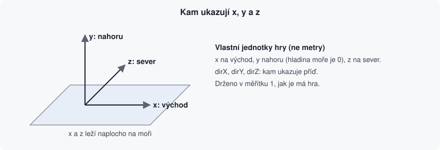

# Tabulka {#the-table}

Jeden řádek na vzorek nebo událost, v `<match>.parquet`: 31 sloupců
([Seznam sloupců](../columns.md), generovaný z kódu).

| Sloupec | Co |
|---|---|
| `match`, `map` | id bitvy; mapa (`spaces/99_testmap` na obrázcích) |
| `time` | sekundy od začátku nahrávání (odpočet je v něm) |
| `battleTime` | sekundy od začátku bitvy; během odpočtu záporné |
| `event` | co řádek je (níže) |
| `player`, `team`, `own` | jméno hráče; `ally` nebo `enemy` hráče, který nahrával; `1` na řádcích hráče, který nahrával |
| `vehicle`, `type` | loď hráče, který nahrával, podle jména (`PASB018-Iowa-1944`), ostatní podle čísla lodi ve hře (`4253956080`), pokud je `--ship-names` nepojmenuje; `battleship`, `cruiser`, `destroyer`, `aircraft carrier`, `submarine`, kde to říká název, jinak `ship` |
| `x`, `y`, `z` | světové jednotky hry: x na východ, y nahoru (hladina moře 0), z na sever |
| `dirX`, `dirY`, `dirZ` | kam ukazuje příď, jednotkový vektor ve stejném rámci (`dirY` 0: jen kurz); u granátu nebo torpéda, kam šel |
| `other`, `reason` | druhá loď události (zabiják, oběť, útočník); číslo příčiny hry u potopení (nepojmenované), typ zásahu u dopadu, kanál u chatu |
| `value`, `health` | číslo události (poškození, rychlost granátu nebo torpéda ve světových jednotkách za vteřinu); zdraví lodi po zásahu |
| `text` | řádek chatu |
| `shot`, `params` | id salvy; typ granátu nebo torpéda jako číslo parametru hry |
| `entity` | id lodi v replayi |
| `otherVehicle`, `otherType` | u `impact` na lodi: ta loď a její třída |
| `hitLocalX`, `hitLocalY`, `hitLocalZ` | u `impact` na lodi: kde granát skončil v rámci té lodi, v metrech (světové jednotky krát 15): x dopředu, y nahoru od hladiny, z doprava |
| `pitch`, `roll` | u pozice sklon a náklon lodi (radiány), tak, jak je hra posílá: loď se v zatáčce naklání |

| `event` | Na řádku | Co |
|---|---|---|
| `position` | každé lodi | dokud ji klient viděl |
| `death`, `kill` | oběti, zabijáka | každé potopení dvakrát: kde loď klesla, a kde byl její zabiják |
| `hurt`, `damage` | oběti, útočníka | zásah: `value` poškození, `health` co zbývá |
| `shot` | střelce | jeden řádek na granát, u děla, ve směru, kterým letěl |
| `torpedo` | střelce | jeden řádek na torpédo, kde bylo vypuštěno, ve směru, kterým běželo |
| `impact` | střelce | kde granát skončil (zásah, minutí do vody, ...); `reason` číslo typu zásahu; na lodi (jakýkoli typ kromě 0 voda, 8, 32, 64 souš, do 6 jednotek od lodi) `other`/`otherVehicle`/`otherType` loď a `hitLocalX/Y/Z` bod v jejím rámci (výše) |
| `chat` | odesílatele | `text` řádek, `reason` kanál (`battle_team`, `battle_common`) |

**Jednotky.** Světová jednotka není metr. Bitevní loď při plné rychlosti urazí asi 2,4 z nich za vteřinu a mapa je
široká asi 1 200. Porovnáno s geometrií trupů lodí je jednotka 15 m; herní údaje o dostřelech z ní dělají 30 m
(landaire/wows-toolkit, `crates/wows-core/src/units.rs`, MIT, který obojí nesmiřuje). Tabulka drží světové jednotky
v měřítku 1, jako každý zdroj 3DHeat drží vlastní jednotky své hry, takže úroveň exportovaná ve stejných jednotkách
pasuje. Zápatí `heat3d` nápovědy: Y nahoru, Z obrácené (takže mapa není zrcadlena), loď dlouhá 12 jednotek,
`player` jako osoba, `team` jako skupina, `match` jako relace.

---

Součást [3DHeat](https://github.com/Holdi601/3DHeat) ([dokumentace](https://holdi601.github.io/3DHeat/)). Zdroj: [3DHeat-Ext-WoWs](https://github.com/Holdi601/3DHeat-Ext-WoWs).
