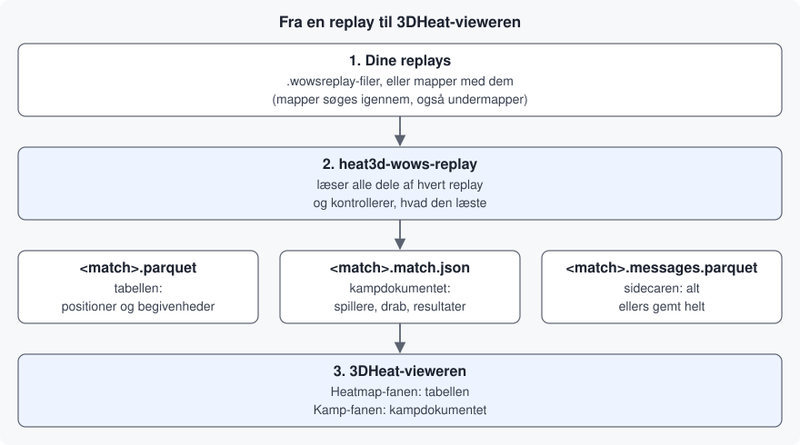

# 3DHeat World of Warships-replays {#dheat-world-of-warships-replays}

**Hvad er det?** World of Warships kan gemme hver kamp, du spiller, som en replay-fil. Dette værktøj
laver disse filer om til en tabel og et kampdokument (kampens resumé), som
[3DHeat-vieweren](https://holdi601.github.io/3DHeat/) viser i 3D: hvor hvert skib sejlede, skød og blev
ramt.

**Hvorfor skulle jeg bruge det?** For at se en kamp igen oppefra, alle skibe på én gang; for at se
varmekort over, hvor du og andre sejler, kæmper og synker over hundredvis af kampe; for at se, hvor
granater og torpedoer tog hen; eller for at læse et replay med dine egne scripts, da resultatet er
almindelig Parquet og JSON.

**Eksempel:** én replay-fil ind, en tabel og et kampdokument ud:



## Hurtig start {#quick-start}

Ny til kommandolinjen? Læs [Før du går i gang](before-you-start.md) først.

```bash
git clone https://github.com/Holdi601/3DHeat-Ext-WoWs.git
cd 3DHeat-Ext-WoWs
pip install -e .
heat3d-wows-replay "<World of Warships>/replays" -o out
```

Du bør se én linje pr. replay, som ender med filen, den skrev:
`... -> out/<map>/<match>.parquet`. Åbn den fil og `<match>.match.json` ved siden af den i
3DHeat-vieweren.

## Denne dokumentation {#this-documentation}

| Side | Hvad den dækker |
|---|---|
| [Før du går i gang](before-you-start.md) | Python, en terminal, og hvordan succes ser ud |
| [Installation](installing.md) | installation, kontrol, opdateringer |
| [Konvertering af replays](converting.md) | trin for trin, alle valg, meddelelser, afslutningsstatus |
| [Tabellen](table.md) | hver kolonne og begivenhed i `<match>.parquet` |
| [Kampdokumentet](match-document.md) | hver nøgle i `<match>.match.json` |
| [Sådan læses et replay](how-it-reads.md) | formatet, og hvordan læsningen blev kontrolleret |
| [Fuldstændighed](completeness.md) | sidecaren og selvkontrollen |
| [Vilkår og licens](terms.md) | hvad den læser, licens, kilder |
| [Kommandoreference](../cli-reference.md), [Kolonneliste](../columns.md) | genereret ud fra koden |

## Del af 3DHeat {#part-of-3dheat}

Denne konverter er et af værktøjerne i [3DHeat](https://github.com/Holdi601/3DHeat),
en realtids-3D-viewer til telemetri og replays ([dokumentation](https://holdi601.github.io/3DHeat/)).
Vieweren åbner tabellen på sin Heatmap-fane og kampdokumentet på sin Kamp-fane. Den kan pakke en kamps
filer i én fil: [En fil pr. kamp](https://holdi601.github.io/3DHeat/container.html). Hvad enhver
konverter skal bevare: [Konvertere bevarer alt](https://holdi601.github.io/3DHeat/converters.html).

Hver spillæser er sit eget lille projekt med sin egen licensfil, sine egne
udgivelser og sin egen issue-tracker, så den kan installeres, opdateres,
vedligeholdes - eller trækkes tilbage på en rettighedshavers anmodning - for
sig selv, uden at det påvirker vieweren eller de andre værktøjer. Watcher
kører denne konverter, når den er installeret, og virker uden den. Hvad
konverteren læser: [Vilkår og licens](terms.md).

| Værktøj | Hvad det gør | Kilde | Dokumentation |
|---|---|---|---|
| 3DHeat-viewer | viser data i 3D: varmekort, replays, løbsanalyse | [3DHeat](https://github.com/Holdi601/3DHeat) | [side](https://holdi601.github.io/3DHeat/) |
| GameFiles | baner og niveauer ud af de filer, spil udgiver | [3DHeat-GameFiles](https://github.com/Holdi601/3DHeat-GameFiles) | [side](https://holdi601.github.io/3DHeat-GameFiles/) |
| GameCapture | telemetri fra omgange, og niveauer genskabt ud fra spilvideo | [3DHeat-GameCapture](https://github.com/Holdi601/3DHeat-GameCapture) | [side](https://holdi601.github.io/3DHeat-GameCapture/) |
| Unreal Exporter | et plugin til Unreal Editor, der eksporterer et niveau | [3DHeat-UnrealExporter](https://github.com/Holdi601/3DHeat-UnrealExporter) | [side](https://holdi601.github.io/3DHeat-UnrealExporter/) |
| CS2 | Counter-Strike 2-demoer og baner | [3DHeat-CS2](https://github.com/Holdi601/3DHeat-CS2) | [side](https://holdi601.github.io/3DHeat-CS2/) |
| Watcher | optager det, spil udgiver, mens du spiller | [3DHeat-Watcher](https://github.com/Holdi601/3DHeat-Watcher) | [side](https://holdi601.github.io/3DHeat-Watcher/) |
| War Thunder-replays | `.wrpl`-replays og War Thunder-baner | [3DHeat-Ext-WarThunder](https://github.com/Holdi601/3DHeat-Ext-WarThunder) | [side](https://holdi601.github.io/3DHeat-Ext-WarThunder/) |
| World of Tanks-replays | `.wotreplay`-replays | [3DHeat-Ext-WoT](https://github.com/Holdi601/3DHeat-Ext-WoT) | [side](https://holdi601.github.io/3DHeat-Ext-WoT/) |
| World of Warships-replays | `.wowsreplay`-replays | [3DHeat-Ext-WoWs](https://github.com/Holdi601/3DHeat-Ext-WoWs) | [side](https://holdi601.github.io/3DHeat-Ext-WoWs/) |
| Squad-demoer | demoer fra Squad-servere | [3DHeat-Ext-Squad](https://github.com/Holdi601/3DHeat-Ext-Squad) | [side](https://holdi601.github.io/3DHeat-Ext-Squad/) |
| DCS-kort | DCS World-kort som 3D-baner | [3DHeat-Ext-DCS](https://github.com/Holdi601/3DHeat-Ext-DCS) | [side](https://holdi601.github.io/3DHeat-Ext-DCS/) |
| IL-2-kort | IL-2 Great Battles-kort som 3D-baner | [3DHeat-Ext-IL2](https://github.com/Holdi601/3DHeat-Ext-IL2) | [side](https://holdi601.github.io/3DHeat-Ext-IL2/) |

---

Kilde: [3DHeat-Ext-WoWs](https://github.com/Holdi601/3DHeat-Ext-WoWs).
