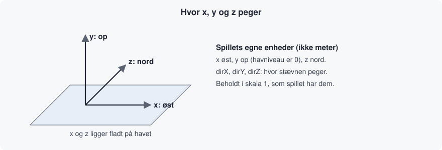

# Tabellen {#the-table}

Én række pr. sample eller begivenhed, i `<match>.parquet`: 31 kolonner
([Kolonneliste](../columns.md), genereret ud fra koden).

| Kolonne | Hvad |
|---|---|
| `match`, `map` | kampens id; kortet (`spaces/99_testmap` på billederne) |
| `time` | sekunder siden optagelsen begyndte (nedtællingen er med) |
| `battleTime` | sekunder siden kampen begyndte; negativ under nedtællingen |
| `event` | hvad rækken er (nedenfor) |
| `player`, `team`, `own` | spillerens navn; `ally` eller `enemy` for den optagende spiller; `1` på den optagende spillers rækker |
| `vehicle`, `type` | den optagende spillers skib ved navn (`PASB018-Iowa-1944`), de andre ved spillets skibsnummer (`4253956080`), medmindre `--ship-names` navngiver dem; `battleship`, `cruiser`, `destroyer`, `aircraft carrier`, `submarine`, hvor navnet siger det, ellers `ship` |
| `x`, `y`, `z` | spillets verdensenheder: x øst, y op (havniveau 0), z nord |
| `dirX`, `dirY`, `dirZ` | hvor stævnen peger, en enhedsvektor i samme ramme (`dirY` 0: kun heading); ved en granat eller torpedo den vej, den gik |
| `other`, `reason` | det andet skib i en begivenhed (dræber, offer, angriber); spillets årsagsnummer for en søenkning (ikke navngivet), trætypen for et nedslag, kanalen for chat |
| `value`, `health` | begivenhedens tal (skade, en granats eller torpedos hastighed i verdensenheder pr. sekund); skibets liv efter et træf |
| `text` | en chatlinje |
| `shot`, `params` | en salves id; granatens eller torpedoens type, som spillets parameternummer |
| `entity` | skibets id i replayet |
| `otherVehicle`, `otherType` | ved et `impact` på et skib: det skib og dets klasse |
| `hitLocalX`, `hitLocalY`, `hitLocalZ` | ved et `impact` på et skib: hvor granaten endte i det skibs egen ramme, i meter (verdensenheder gange 15): x fremad, y op fra havet, z højre |
| `pitch`, `roll` | på en position, skibets pitch og rulning (radianer), som spillet sender dem: et skib krænger i en drejning |

| `event` | På rækken for | Hvad |
|---|---|---|
| `position` | hvert skib | mens klienten så det |
| `death`, `kill` | offeret, dræberen | hver søenkning to gange: hvor skibet sank, og hvor dets dræber var |
| `hurt`, `damage` | offeret, angriberen | et træf: `value` skaden, `health` hvad der er tilbage |
| `shot` | skytten | én række pr. granat, ved kanonen, i den retning den fløj |
| `torpedo` | skytten | én række pr. torpedo, hvor den blev affyret, i den retning den løb |
| `impact` | skytten | hvor en granat endte (træf, bom i vandet, ...); `reason` trætypens nummer; på et skib (enhver type undtagen 0 vand, 8, 32, 64 land, inden for 6 enheder af et skib) `other`/`otherVehicle`/`otherType` skibet og `hitLocalX/Y/Z` punktet i dets ramme (ovenfor) |
| `chat` | afsenderen | `text` linjen, `reason` kanalen (`battle_team`, `battle_common`) |

**Enheder.** En verdensenhed er ikke en meter. Et slagskib i fart dækker ca. 2,4 af dem i sekundet, og et kort er ca. 1.200
på tværs. Målt mod skibenes skrogegeometri er en enhed 15 m; spillets egne rækkeviddetal gør den til 30 m
(landaire/wows-toolkit, `crates/wows-core/src/units.rs`, MIT, som lader de to stå uforenede). Tabellen beholder
verdensenheder i skala 1, ligesom alle 3DHeat-kilder beholder deres spils egne enheder, så en bane eksporteret i samme
enheder flugter. Fodnotens `heat3d`-hints: y op, z vendt (så kortet ikke spejles), et skib 12 enheder langt, `player` som
personen, `team` som gruppen, `match` som sessionen.

---

Del af [3DHeat](https://github.com/Holdi601/3DHeat) ([dokumentation](https://holdi601.github.io/3DHeat/)). Kilde: [3DHeat-Ext-WoWs](https://github.com/Holdi601/3DHeat-Ext-WoWs).
