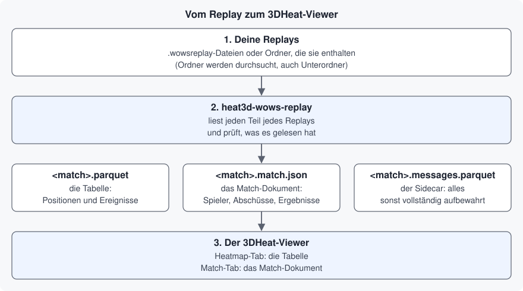

# 3DHeat-World-of-Warships-Replays {#dheat-world-of-warships-replays}

**Was ist das?** World of Warships kann jedes Gefecht, das du spielst, als Replay-Datei
speichern. Dieses Werkzeug macht aus diesen Dateien eine Tabelle und ein Match-Dokument
(die Zusammenfassung des Gefechts), die der [3DHeat-Viewer](https://holdi601.github.io/3DHeat/)
in 3D zeigt: wohin jedes Schiff gefahren ist, geschossen hat und getroffen wurde.

**Wozu braucht man das?** Um ein Gefecht noch einmal von oben zu sehen, alle Schiffe
zugleich; um Heatmaps zu sehen, wo du und andere über hunderte Gefechte hinweg fahren,
kämpfen und versenkt werden; um zu sehen, wohin Granaten und Torpedos gingen; oder um ein
Replay mit eigenen Skripten zu lesen, denn die Ausgabe ist einfaches Parquet und JSON.

**Beispiel:** Eine Replay-Datei hinein, eine Tabelle und ein Match-Dokument heraus:



## Schnellstart {#quick-start}

Neu auf der Kommandozeile? Lies zuerst [Bevor du anfängst](before-you-start.md).

```bash
git clone https://github.com/Holdi601/3DHeat-Ext-WoWs.git
cd 3DHeat-Ext-WoWs
pip install -e .
heat3d-wows-replay "<World of Warships>/replays" -o out
```

Du solltest pro Replay eine Zeile sehen, die mit der geschriebenen Datei endet:
`... -> out/<map>/<match>.parquet`. Öffne diese Datei und die daneben liegende
`<match>.match.json` im 3DHeat-Viewer.

## Diese Dokumentation {#this-documentation}

| Seite | Was sie behandelt |
|---|---|
| [Bevor du anfängst](before-you-start.md) | Python, ein Terminal und wie Erfolg aussieht |
| [Installation](installing.md) | Installation, Prüfung, Aktualisierungen |
| [Replays umwandeln](converting.md) | Schritt für Schritt, jede Option, Meldungen, Exit-Status |
| [Die Tabelle](table.md) | jede Spalte und jedes Ereignis von `<match>.parquet` |
| [Das Match-Dokument](match-document.md) | jeder Schlüssel von `<match>.match.json` |
| [So liest es ein Replay](how-it-reads.md) | das Format und wie das Lesen geprüft wurde |
| [Vollständigkeit](completeness.md) | der Sidecar und die Selbstprüfung |
| [Begriffe und Lizenz](terms.md) | Bedingungen von Wargaming, Lizenz, Quellen |
| [Befehlsreferenz](../cli-reference.md), [Spaltenliste](../columns.md) | aus dem Code erzeugt |

## Teil von 3DHeat {#part-of-3dheat}

Dieser Umwandler ist eines der Werkzeuge von [3DHeat](https://github.com/Holdi601/3DHeat),
eines Viewers für 3D-Telemetrie und Replays in Echtzeit ([Dokumentation](https://holdi601.github.io/3DHeat/)).
Der Viewer öffnet die Tabelle im Reiter Heatmap und das Match-Dokument im Reiter Match. Er kann die
Dateien eines Matches in eine einzige Datei packen:
[Eine Datei pro Match](https://holdi601.github.io/3DHeat/container.html). Was jeder
Umwandler behalten muss: [Umwandler behalten alles](https://holdi601.github.io/3DHeat/converters.html).

Der Umwandler ist mit Absicht vom 3DHeat-Watcher getrennt: Die Replays sind verschlüsselt,
und die Bedingungen von Wargaming sind weit gefasst ([Begriffe und Lizenz](terms.md)).
Falls er einmal wegfallen muss, geht nichts anderes mit. Der Watcher startet ihn, wenn er
installiert ist, und arbeitet auch ohne ihn.

| Werkzeug | Was es tut | Quelle | Dokumentation |
|---|---|---|---|
| 3DHeat-Viewer | zeigt die Daten in 3D: Heatmaps, Replays, Rennanalyse | [3DHeat](https://github.com/Holdi601/3DHeat) | [Seite](https://holdi601.github.io/3DHeat/) |
| GameFiles | Strecken und Level aus den Dateien, die Spiele mitliefern | [3DHeat-GameFiles](https://github.com/Holdi601/3DHeat-GameFiles) | [Seite](https://holdi601.github.io/3DHeat-GameFiles/) |
| GameCapture | Rundentelemetrie und Level, die aus Spielvideos nachgebaut werden | [3DHeat-GameCapture](https://github.com/Holdi601/3DHeat-GameCapture) | [Seite](https://holdi601.github.io/3DHeat-GameCapture/) |
| Unreal Exporter | ein Plugin für den Unreal Editor, das ein Level exportiert | [3DHeat-UnrealExporter](https://github.com/Holdi601/3DHeat-UnrealExporter) | [Seite](https://holdi601.github.io/3DHeat-UnrealExporter/) |
| CS2 | Demos und Karten von Counter-Strike 2 | [3DHeat-CS2](https://github.com/Holdi601/3DHeat-CS2) | [Seite](https://holdi601.github.io/3DHeat-CS2/) |
| Watcher | nimmt auf, was Spiele veröffentlichen, während du spielst | [3DHeat-Watcher](https://github.com/Holdi601/3DHeat-Watcher) | [Seite](https://holdi601.github.io/3DHeat-Watcher/) |
| War-Thunder-Replays | `.wrpl`-Replays und Level von War Thunder | [3DHeat-Ext-WarThunder](https://github.com/Holdi601/3DHeat-Ext-WarThunder) | [Seite](https://holdi601.github.io/3DHeat-Ext-WarThunder/) |
| World-of-Tanks-Replays | `.wotreplay`-Replays | [3DHeat-Ext-WoT](https://github.com/Holdi601/3DHeat-Ext-WoT) | [Seite](https://holdi601.github.io/3DHeat-Ext-WoT/) |
| World-of-Warships-Replays | `.wowsreplay`-Replays | [3DHeat-Ext-WoWs](https://github.com/Holdi601/3DHeat-Ext-WoWs) | [Seite](https://holdi601.github.io/3DHeat-Ext-WoWs/) |
| Squad-Demos | Demos von Squad-Servern | [3DHeat-Ext-Squad](https://github.com/Holdi601/3DHeat-Ext-Squad) | [Seite](https://holdi601.github.io/3DHeat-Ext-Squad/) |
| DCS-Karten | Karten von DCS World als 3D-Level | [3DHeat-Ext-DCS](https://github.com/Holdi601/3DHeat-Ext-DCS) | [Seite](https://holdi601.github.io/3DHeat-Ext-DCS/) |
| IL-2-Karten | Karten von IL-2 Great Battles als 3D-Level | [3DHeat-Ext-IL2](https://github.com/Holdi601/3DHeat-Ext-IL2) | [Seite](https://holdi601.github.io/3DHeat-Ext-IL2/) |

---

Quelle: [3DHeat-Ext-WoWs](https://github.com/Holdi601/3DHeat-Ext-WoWs).
