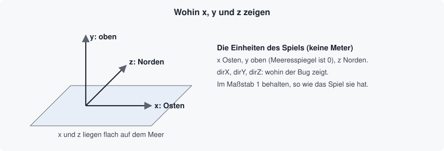

# Die Tabelle {#the-table}

Eine Zeile je Messwert oder Ereignis, in `<match>.parquet`: 31 Spalten
([Spaltenliste](../columns.md), aus dem Code erzeugt).

| Spalte | Was |
|---|---|
| `match`, `map` | die Kennung des Gefechts; die Karte (`spaces/99_testmap` in den Bildern) |
| `time` | Sekunden seit Beginn der Aufnahme (der Countdown ist darin enthalten) |
| `battleTime` | Sekunden seit Beginn des Gefechts; negativ während des Countdowns |
| `event` | was die Zeile ist (unten) |
| `player`, `team`, `own` | der Name des Spielers; `ally` oder `enemy` des aufnehmenden Spielers; `1` auf den Zeilen des aufnehmenden Spielers |
| `vehicle`, `type` | das Schiff des aufnehmenden Spielers mit Namen (`PASB018-Iowa-1944`), die übrigen mit der Schiffsnummer des Spiels (`4253956080`), außer `--ship-names` benennt sie; `battleship`, `cruiser`, `destroyer`, `aircraft carrier`, `submarine`, wo der Name es sagt, sonst `ship` |
| `x`, `y`, `z` | die Welteinheiten des Spiels: x Osten, y oben (Meeresspiegel 0), z Norden |
| `dirX`, `dirY`, `dirZ` | wohin der Bug zeigt, ein Einheitsvektor im selben Koordinatensystem (`dirY` 0: nur der Kurs); bei einer Granate oder einem Torpedo, wohin sie flogen |
| `other`, `reason` | das andere Schiff eines Ereignisses (Killer, Opfer, Angreifer); die Ursachennummer des Spiels bei einer Versenkung (nicht benannt), die Trefferart bei einem Einschlag, der Kanal bei Chat |
| `value`, `health` | die Zahl des Ereignisses (Schaden, Geschwindigkeit einer Granate oder eines Torpedos in Welteinheiten pro Sekunde); die Lebenspunkte des Schiffs nach einem Treffer |
| `text` | eine Chatzeile |
| `shot`, `params` | die ID einer Salve; die Art der Granate oder des Torpedos, als Parameternummer des Spiels |
| `entity` | die ID des Schiffs im Replay |
| `otherVehicle`, `otherType` | bei einem `impact` auf ein Schiff: dieses Schiff und seine Klasse |
| `hitLocalX`, `hitLocalY`, `hitLocalZ` | bei einem `impact` auf ein Schiff: wo die Granate im eigenen Koordinatensystem dieses Schiffs endete, in Metern (Welteinheiten mal 15): x vorwärts, y oben über dem Meer, z rechts |
| `pitch`, `roll` | bei einer Position das Nicken und Rollen des Schiffs (Radiant), so wie das Spiel sie sendet: Ein Schiff neigt sich in einer Kurve |

| `event` | Auf der Zeile von | Was |
|---|---|---|
| `position` | jedem Schiff | solange der Client es sah |
| `death`, `kill` | dem Opfer, dem Killer | jede Versenkung zweimal: wo das Schiff sank, und wo sein Killer stand |
| `hurt`, `damage` | dem Opfer, dem Angreifer | ein Treffer: `value` der Schaden, `health` was übrig ist |
| `shot` | dem Schützen | eine Zeile je Granate, am Geschütz, in der Richtung, in die sie flog |
| `torpedo` | dem Schützen | eine Zeile je Torpedo, dort, wo er abgefeuert wurde, in der Richtung, in die er lief |
| `impact` | dem Schützen | wo eine Granate endete (Treffer, Fehlschuss ins Wasser, ...); `reason` die Nummer der Trefferart; auf einem Schiff (jede Art außer 0 Wasser, 8, 32, 64 Land, innerhalb von 6 Einheiten eines Schiffs) `other`/`otherVehicle`/`otherType` das Schiff und `hitLocalX/Y/Z` der Punkt in dessen Koordinatensystem (siehe oben) |
| `chat` | den Absender | `text` die Zeile, `reason` der Kanal (`battle_team`, `battle_common`) |

**Einheiten.** Eine Welteinheit ist kein Meter. Ein Schlachtschiff legt bei Fahrt etwa 2,4 davon pro
Sekunde zurück, und eine Karte ist etwa 1.200 breit. An der Geometrie der Schiffsrümpfe gemessen, ist eine
Einheit 15 m; die eigenen Reichweitenangaben des Spiels machen sie 30 m (landaire/wows-toolkit,
`crates/wows-core/src/units.rs`, MIT, das die beiden nicht abgleicht). Die Tabelle behält die Welteinheiten
im Maßstab 1, wie jede Quelle von 3DHeat die eigenen Einheiten ihres Spiels behält, sodass ein Level, das in
denselben Einheiten exportiert wurde, passt. Die Hinweise `heat3d` der Fußzeile: Y oben, Z gespiegelt (damit
die Karte nicht seitenverkehrt ist), ein Schiff 12 Einheiten lang, `player` als die Person, `team` als die
Gruppe, `match` als die Sitzung.

---

Teil von [3DHeat](https://github.com/Holdi601/3DHeat) ([Dokumentation](https://holdi601.github.io/3DHeat/)). Quelle: [3DHeat-Ext-WoWs](https://github.com/Holdi601/3DHeat-Ext-WoWs).
