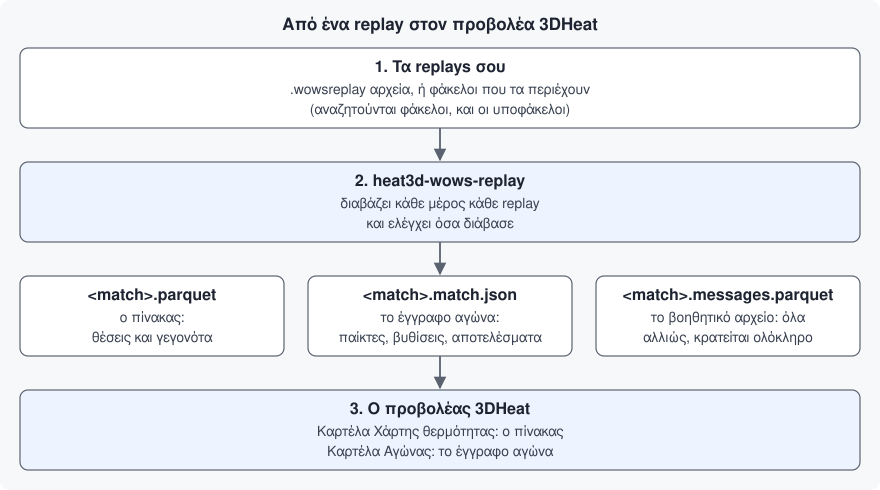

# Replays World of Warships της 3DHeat {#dheat-world-of-warships-replays}

**Τι είναι;** Το World of Warships μπορεί να αποθηκεύσει κάθε μάχη που παίζετε ως αρχείο
replay. Αυτό το εργαλείο μετατρέπει αυτά τα αρχεία σε έναν πίνακα και σε ένα έγγραφο
αγώνα (την περίληψη της μάχης) που ο
[προβολέας 3DHeat](https://holdi601.github.io/3DHeat/) δείχνει σε 3D: πού έπλευσε, πού
πυροβόλησε και πού χτυπήθηκε κάθε πλοίο.

**Γιατί να το χρησιμοποιήσω;** Για να ξαναδείτε μια μάχη από ψηλά, με όλα τα πλοία μαζί·
για να δείτε χάρτες θερμότητας του σημείου όπου πλέετε, πολεμάτε και βυθίζεστε εσείς και
οι άλλοι, σε εκατοντάδες μάχες· για να δείτε πού πήγαν τα βλήματα και οι τορπίλες· ή για να διαβάσετε ένα replay με τα δικά σας σενάρια,
αφού το αποτέλεσμα είναι απλό Parquet και JSON.

**Παράδειγμα:** ένα αρχείο replay μέσα, ένας πίνακας και ένα έγγραφο αγώνα έξω:



## Γρήγορη εκκίνηση {#quick-start}

Είστε νέος στη γραμμή εντολών; Διαβάστε πρώτα το [Πριν ξεκινήσετε](before-you-start.md).

```bash
git clone https://github.com/Holdi601/3DHeat-Ext-WoWs.git
cd 3DHeat-Ext-WoWs
pip install -e .
heat3d-wows-replay "<World of Warships>/replays" -o out
```

Θα δείτε μία γραμμή για κάθε replay, που τελειώνει με το αρχείο που έγραψε:
`... -> out/<map>/<match>.parquet`. Ανοίξτε αυτό το αρχείο και το δίπλα του
`<match>.match.json` στον προβολέα 3DHeat.

## Αυτή η τεκμηρίωση {#this-documentation}

| Σελίδα | Τι καλύπτει |
|---|---|
| [Πριν ξεκινήσετε](before-you-start.md) | Python, ένα τερματικό, και πώς είναι η επιτυχία |
| [Εγκατάσταση](installing.md) | εγκατάσταση, έλεγχος, ενημερώσεις |
| [Μετατροπή replay](converting.md) | βήμα προς βήμα, κάθε επιλογή, μηνύματα, κωδικός εξόδου |
| [Ο πίνακας](table.md) | κάθε στήλη και κάθε γεγονός του `<match>.parquet` |
| [Το έγγραφο αγώνα](match-document.md) | κάθε κλειδί του `<match>.match.json` |
| [Πώς διαβάζει ένα replay](how-it-reads.md) | η μορφή, και πώς ελέγχθηκε η ανάγνωση |
| [Πληρότητα](completeness.md) | το βοηθητικό αρχείο και ο αυτοέλεγχος |
| [Όροι και άδεια](terms.md) | οι όροι της Wargaming, η άδεια, οι πηγές |
| [Αναφορά εντολών](../cli-reference.md), [Λίστα στηλών](../columns.md) | παράγονται από τον κώδικα |

## Μέρος του 3DHeat {#part-of-3dheat}

Αυτός ο μετατροπέας είναι ένα από τα εργαλεία του [3DHeat](https://github.com/Holdi601/3DHeat),
ενός προβολέα τηλεμετρίας και replay σε 3D σε πραγματικό χρόνο ([τεκμηρίωση](https://holdi601.github.io/3DHeat/)).
Ο προβολέας ανοίγει τον πίνακα στην καρτέλα Χάρτης θερμότητας και το έγγραφο αγώνα στην
καρτέλα Αγώνας. Μπορεί να συσκευάσει τα αρχεία ενός αγώνα σε ένα αρχείο:
[Ένα αρχείο ανά αγώνα](https://holdi601.github.io/3DHeat/container.html). Τι πρέπει να
κρατά κάθε μετατροπέας: [Οι μετατροπείς κρατούν τα πάντα](https://holdi601.github.io/3DHeat/converters.html).

Ο μετατροπέας είναι χωριστός από τον 3DHeat Watcher επίτηδες: τα replays είναι
κρυπτογραφημένα, και οι όροι της Wargaming είναι ευρείς ([Όροι και άδεια](terms.md)).
Αν χρειαστεί ποτέ να αφαιρεθεί, δεν φεύγει μαζί του τίποτα άλλο. Ο Watcher τον τρέχει όταν
είναι εγκατεστημένος και λειτουργεί χωρίς αυτόν.

| Εργαλείο | Τι κάνει | Πηγή | Τεκμηρίωση |
|---|---|---|---|
| Προβολέας 3DHeat | δείχνει τα δεδομένα σε 3D: χάρτες θερμότητας, replays, ανάλυση αγώνα | [3DHeat](https://github.com/Holdi601/3DHeat) | [σελίδα](https://holdi601.github.io/3DHeat/) |
| GameFiles | διαδρομές και επίπεδα από τα αρχεία που στέλνουν τα παιχνίδια | [3DHeat-GameFiles](https://github.com/Holdi601/3DHeat-GameFiles) | [σελίδα](https://holdi601.github.io/3DHeat-GameFiles/) |
| GameCapture | τηλεμετρία γύρων, και επίπεδα ξαναχτισμένα από βίντεο παιχνιδιού | [3DHeat-GameCapture](https://github.com/Holdi601/3DHeat-GameCapture) | [σελίδα](https://holdi601.github.io/3DHeat-GameCapture/) |
| Unreal Exporter | ένα πρόσθετο του Unreal Editor που εξάγει ένα επίπεδο | [3DHeat-UnrealExporter](https://github.com/Holdi601/3DHeat-UnrealExporter) | [σελίδα](https://holdi601.github.io/3DHeat-UnrealExporter/) |
| CS2 | demos και χάρτες του Counter-Strike 2 | [3DHeat-CS2](https://github.com/Holdi601/3DHeat-CS2) | [σελίδα](https://holdi601.github.io/3DHeat-CS2/) |
| Watcher | καταγράφει όσα δημοσιεύουν τα παιχνίδια όσο παίζετε | [3DHeat-Watcher](https://github.com/Holdi601/3DHeat-Watcher) | [σελίδα](https://holdi601.github.io/3DHeat-Watcher/) |
| Replays War Thunder | αρχεία `.wrpl` και επίπεδα του War Thunder | [3DHeat-Ext-WarThunder](https://github.com/Holdi601/3DHeat-Ext-WarThunder) | [σελίδα](https://holdi601.github.io/3DHeat-Ext-WarThunder/) |
| Replays World of Tanks | αρχεία `.wotreplay` | [3DHeat-Ext-WoWs](https://github.com/Holdi601/3DHeat-Ext-WoWs) | [σελίδα](https://holdi601.github.io/3DHeat-Ext-WoWs/) |
| Replays World of Warships | αρχεία `.wowsreplay` | [3DHeat-Ext-WoWs](https://github.com/Holdi601/3DHeat-Ext-WoWs) | [σελίδα](https://holdi601.github.io/3DHeat-Ext-WoWs/) |
| Demos του Squad | demos διακομιστών του Squad | [3DHeat-Ext-Squad](https://github.com/Holdi601/3DHeat-Ext-Squad) | [σελίδα](https://holdi601.github.io/3DHeat-Ext-Squad/) |
| Χάρτες DCS | χάρτες του DCS World ως 3D επίπεδα | [3DHeat-Ext-DCS](https://github.com/Holdi601/3DHeat-Ext-DCS) | [σελίδα](https://holdi601.github.io/3DHeat-Ext-DCS/) |
| Χάρτες IL-2 | χάρτες του IL-2 Great Battles ως 3D επίπεδα | [3DHeat-Ext-IL2](https://github.com/Holdi601/3DHeat-Ext-IL2) | [σελίδα](https://holdi601.github.io/3DHeat-Ext-IL2/) |

---

Πηγή: [3DHeat-Ext-WoWs](https://github.com/Holdi601/3DHeat-Ext-WoWs).
