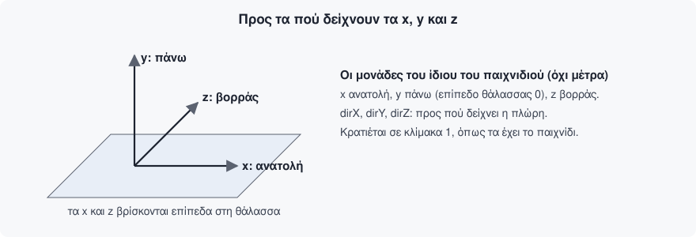

# Ο πίνακας {#the-table}

Μία γραμμή ανά δείγμα ή γεγονός, στο `<match>.parquet`: 31 στήλες
([Λίστα στηλών](../columns.md), παράγεται από τον κώδικα).

| Στήλη | Τι είναι |
|---|---|
| `match`, `map` | το αναγνωριστικό της μάχης· ο χάρτης (`spaces/99_testmap` στις εικόνες) |
| `time` | δευτερόλεπτα από την αρχή της εγγραφής (η αντίστροφη μέτρηση είναι μέσα σε αυτό) |
| `battleTime` | δευτερόλεπτα από την αρχή της μάχης· αρνητικά κατά την αντίστροφη μέτρηση |
| `event` | τι είναι η γραμμή (παρακάτω) |
| `player`, `team`, `own` | το όνομα του παίκτη· `ally` ή `enemy` του παίκτη που καταγράφει· `1` στις γραμμές του παίκτη που καταγράφει |
| `vehicle`, `type` | το πλοίο του παίκτη που καταγράφει με το όνομά του (`PASB018-Iowa-1944`), τα υπόλοιπα με τον αριθμό πλοίου του παιχνιδιού (`4253956080`), εκτός αν το `--ship-names` τα ονομάζει· `battleship`, `cruiser`, `destroyer`, `aircraft carrier`, `submarine` όπου το λέει το όνομα, αλλιώς `ship` |
| `x`, `y`, `z` | οι μονάδες του κόσμου του παιχνιδιού: x ανατολή, y πάνω (επίπεδο θάλασσας 0), z βορράς |
| `dirX`, `dirY`, `dirZ` | προς πού δείχνει η πλώρη, μοναδιαίο διάνυσμα στο ίδιο σύστημα (`dirY` 0: μόνο heading)· σε βλήμα ή τορπίλη, ο δρόμος που ακολούθησε |
| `other`, `reason` | το άλλο πλοίο ενός γεγονότος (σκοτωτής, θύμα, επιτιθέμενος)· ο αριθμός αιτίας του παιχνιδιού για μια βύθιση (χωρίς όνομα), ο τύπος χτυπήματος για μια πρόσκρουση, το κανάλι για τη συνομιλία |
| `value`, `health` | ο αριθμός του γεγονότος (ζημιά, η ταχύτητα ενός βλήματος ή τορπίλης σε μονάδες κόσμου το δευτερόλεπτο)· η υγεία του πλοίου μετά από ένα χτύπημα |
| `text` | μια γραμμή συνομιλίας |
| `shot`, `params` | το αναγνωριστικό μιας βολής (salvo)· ο τύπος του βλήματος ή της τορπίλης, ως ο αριθμός παραμέτρου του παιχνιδιού |
| `entity` | το αναγνωριστικό του πλοίου στο replay |
| `otherVehicle`, `otherType` | σε `impact` σε πλοίο: το πλοίο αυτό και η κλάση του |
| `hitLocalX`, `hitLocalY`, `hitLocalZ` | σε `impact` σε πλοίο: πού τελείωσε το βλήμα στο δικό του σύστημα του πλοίου, σε μέτρα (μονάδες κόσμου επί 15): x μπροστά, y πάνω από τη θάλασσα, z δεξιά |
| `pitch`, `roll` | σε μια θέση, η κλίση και το roll του πλοίου (ακτίνια) όπως τα στέλνει το παιχνίδι· ένα πλοίο γέρνει στη στροφή |

| `event` | Στη γραμμή του | Τι είναι |
|---|---|---|
| `position` | κάθε πλοίου | όσο το έβλεπε ο πελάτης |
| `death`, `kill` | του θύματος, του σκοτωτή | κάθε βύθιση δύο φορές: πού βυθίστηκε το πλοίο, και πού ήταν ο σκοτωτής του |
| `hurt`, `damage` | του θύματος, του επιτιθέμενου | ένα χτύπημα: `value` η ζημιά, `health` τι απέμεινε |
| `shot` | του σκοπευτή | μία γραμμή για κάθε βλήμα, στο πυροβόλο, προς την κατεύθυνση που πέταξε |
| `torpedo` | του σκοπευτή | μία γραμμή για κάθε τορπίλη, πού εκτοξεύτηκε, προς την κατεύθυνση που έτρεξε |
| `impact` | του σκοπευτή | πού τελείωσε ένα βλήμα (χτύπημα, αστοχία στο νερό, ...)· `reason` ο αριθμός τύπου χτυπήματος· σε πλοίο (οποιοσδήποτε τύπος εκτός από 0 νερό, 8, 32, 64 έδαφος, μέσα σε 6 μονάδες από ένα πλοίο) `other`/`otherVehicle`/`otherType` το πλοίο και `hitLocalX/Y/Z` το σημείο στο σύστημά του (παραπάνω) |
| `chat` | του αποστολέα | `text` η γραμμή, `reason` το κανάλι (`battle_team`, `battle_common`) |

**Μονάδες.** Μία μονάδα κόσμου δεν είναι μέτρο. Ένα θωρηκτό σε ταχύτητα διανύει περίπου 2,4
από αυτές το δευτερόλεπτο, και ένας χάρτης έχει περίπου 1.200 εγκάρσια. Συγκρινόμενη με τη
γεωμετρία του σκάφους, μία μονάδα είναι 15 m· τα δικά του εύρη του παιχνιδιού την κάνουν 30 m
(landaire/wows-toolkit, `crates/wows-core/src/units.rs`, MIT, που δεν τα συμφιλιώνει). Ο πίνακας
κρατά τις μονάδες κόσμου σε κλίμακα 1, όπως κρατά κάθε πηγή του 3DHeat τις δικές της μονάδες
του παιχνιδιού, ώστε ένα επίπεδο που εξάγεται στις ίδιες μονάδες να ευθυγραμμίζεται. Οι οδηγίες του υποσέλιδου `heat3d`: y πάνω, z αναποδογυρισμένο (ώστε ο χάρτης να μη
καθρεφτίζεται), ένα πλοίο 12 μονάδες μήκος, το `player` ως το άτομο, το `team` ως η ομάδα, το
`match` ως η συνεδρία.

---

Μέρος του [3DHeat](https://github.com/Holdi601/3DHeat) ([τεκμηρίωση](https://holdi601.github.io/3DHeat/)). Πηγή: [3DHeat-Ext-WoWs](https://github.com/Holdi601/3DHeat-Ext-WoWs).
