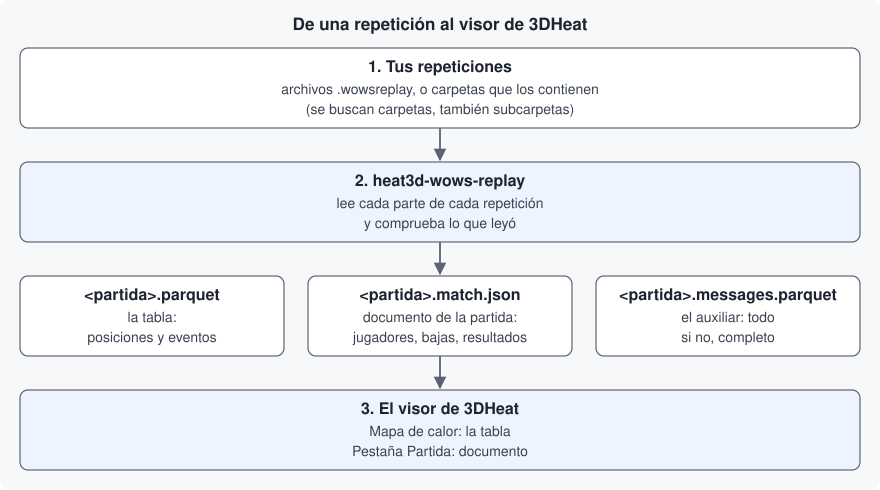

# Repeticiones de World of Warships de 3DHeat {#dheat-world-of-warships-replays}

**¿Qué es?** World of Warships puede guardar cada batalla que juegas como archivo de
repetición. Esta herramienta convierte esos archivos en una tabla y un documento de la
partida (el resumen de la batalla) que el
[visor de 3DHeat](https://holdi601.github.io/3DHeat/) muestra en 3D: por dónde navegó
cada barco, disparó y fue alcanzado.

**¿Para qué lo usaría?** Para volver a ver una batalla desde arriba, con todos los
barcos a la vez; para ver mapas de calor de dónde navegas, combates y hundes tú y otros
en cientos de batallas; para ver adónde fueron los obuses y torpedos; o para leer una repetición
con tus propios scripts, ya que la salida son archivos Parquet y JSON sencillos.

**Ejemplo:** entra un archivo de repetición y salen una tabla y un documento de la partida:



## Inicio rápido {#quick-start}

¿Es tu primera vez con la línea de comandos? Lee primero [Antes de empezar](before-you-start.md).

```bash
git clone https://github.com/Holdi601/3DHeat-Ext-WoWs.git
cd 3DHeat-Ext-WoWs
pip install -e .
heat3d-wows-replay "<World of Warships>/replays" -o out
```

Deberías ver una línea por repetición, terminando en el archivo que escribió:
`... -> out/<mapa>/<partida>.parquet`. Abre ese archivo y el
`<partida>.match.json` que está junto a él en el visor de 3DHeat.

## Esta documentación {#this-documentation}

| Página | Qué contiene |
|---|---|
| [Antes de empezar](before-you-start.md) | Python, una terminal y cómo es un resultado correcto |
| [Instalación](installing.md) | instalar, comprobar, actualizaciones |
| [Convertir repeticiones](converting.md) | paso a paso, cada opción, mensajes, estado de salida |
| [La tabla](table.md) | cada columna y cada evento de `<partida>.parquet` |
| [El documento de la partida](match-document.md) | cada clave de `<partida>.match.json` |
| [Cómo lee una repetición](how-it-reads.md) | el formato, y cómo se comprobó la lectura |
| [Completitud](completeness.md) | el archivo auxiliar y la autocomprobación |
| [Términos y licencia](terms.md) | qué lee, licencia, fuentes |
| [Referencia de comandos](../cli-reference.md), [Lista de columnas](../columns.md) | generadas a partir del código |

## Parte de 3DHeat {#part-of-3dheat}

Este convertidor es una de las herramientas de [3DHeat](https://github.com/Holdi601/3DHeat),
un visor de telemetría y repeticiones 3D en tiempo real ([documentación](https://holdi601.github.io/3DHeat/)).
El visor abre la tabla en su pestaña Mapa de calor y el documento de la partida en su
pestaña Partida. Puede empaquetar los archivos de una partida en uno solo:
[Un archivo por partida](https://holdi601.github.io/3DHeat/container.html). Lo que todo
convertidor debe conservar: [Los convertidores lo conservan todo](https://holdi601.github.io/3DHeat/converters.html).

Cada lector de juego es un pequeño proyecto propio, con su propio archivo de
licencia, sus versiones y su gestor de incidencias, de modo que se puede
instalar, actualizar, mantener - o retirar a petición de un titular de
derechos - por separado, sin afectar al visor ni a las demás herramientas. El
Watcher ejecuta este convertidor cuando está instalado y funciona sin él. Qué
lee el convertidor: [Términos y licencia](terms.md).

| Herramienta | Qué hace | Código | Documentación |
|---|---|---|---|
| Visor de 3DHeat | muestra los datos en 3D: mapas de calor, repeticiones, análisis de carrera | [3DHeat](https://github.com/Holdi601/3DHeat) | [sitio](https://holdi601.github.io/3DHeat/) |
| GameFiles | recorridos y niveles de los archivos que traen los juegos | [3DHeat-GameFiles](https://github.com/Holdi601/3DHeat-GameFiles) | [sitio](https://holdi601.github.io/3DHeat-GameFiles/) |
| GameCapture | telemetría de vueltas, y niveles reconstruidos a partir de vídeo de juego | [3DHeat-GameCapture](https://github.com/Holdi601/3DHeat-GameCapture) | [sitio](https://holdi601.github.io/3DHeat-GameCapture/) |
| Unreal Exporter | un complemento del editor de Unreal que exporta un nivel | [3DHeat-UnrealExporter](https://github.com/Holdi601/3DHeat-UnrealExporter) | [sitio](https://holdi601.github.io/3DHeat-UnrealExporter/) |
| CS2 | demos y mapas de Counter-Strike 2 | [3DHeat-CS2](https://github.com/Holdi601/3DHeat-CS2) | [sitio](https://holdi601.github.io/3DHeat-CS2/) |
| Watcher | registra lo que publican los juegos mientras juegas | [3DHeat-Watcher](https://github.com/Holdi601/3DHeat-Watcher) | [sitio](https://holdi601.github.io/3DHeat-Watcher/) |
| Repeticiones de War Thunder | repeticiones `.wrpl` y niveles de War Thunder | [3DHeat-Ext-WarThunder](https://github.com/Holdi601/3DHeat-Ext-WarThunder) | [sitio](https://holdi601.github.io/3DHeat-Ext-WarThunder/) |
| Repeticiones de World of Tanks | repeticiones `.wotreplay` | [3DHeat-Ext-WoT](https://github.com/Holdi601/3DHeat-Ext-WoT) | [sitio](https://holdi601.github.io/3DHeat-Ext-WoT/) |
| Repeticiones de World of Warships | repeticiones `.wowsreplay` | [3DHeat-Ext-WoWs](https://github.com/Holdi601/3DHeat-Ext-WoWs) | [sitio](https://holdi601.github.io/3DHeat-Ext-WoWs/) |
| Demos de Squad | demos de servidor de Squad | [3DHeat-Ext-Squad](https://github.com/Holdi601/3DHeat-Ext-Squad) | [sitio](https://holdi601.github.io/3DHeat-Ext-Squad/) |
| Mapas de DCS | mapas del mundo de DCS como niveles 3D | [3DHeat-Ext-DCS](https://github.com/Holdi601/3DHeat-Ext-DCS) | [sitio](https://holdi601.github.io/3DHeat-Ext-DCS/) |
| Mapas de IL-2 | mapas de IL-2 Great Battles como niveles 3D | [3DHeat-Ext-IL2](https://github.com/Holdi601/3DHeat-Ext-IL2) | [sitio](https://holdi601.github.io/3DHeat-Ext-IL2/) |
| Mapa de Dota 2 | el mapa de Dota 2 de tu propia instalación como nivel 3D | [3DHeat-Ext-Dota](https://github.com/Holdi601/3DHeat-Ext-Dota) | [sitio](https://holdi601.github.io/3DHeat-Ext-Dota/) |
| Repeticiones de Dota 2 | repeticiones de Dota 2 | [3DHeat-Ext-DotaReplay](https://github.com/Holdi601/3DHeat-Ext-DotaReplay) | [sitio](https://holdi601.github.io/3DHeat-Ext-DotaReplay/) |
| Repeticiones de Riot | repeticiones de League of Legends y VALORANT (lo que contienen sin cifrar) | [3DHeat-Ext-Riot](https://github.com/Holdi601/3DHeat-Ext-Riot) | [sitio](https://holdi601.github.io/3DHeat-Ext-Riot/) |
| Mapas de Forza | recorridos, carreras y coches de Forza de tu propia instalación | [3DHeat-Ext-Forza](https://github.com/Holdi601/3DHeat-Ext-Forza) | [sitio](https://holdi601.github.io/3DHeat-Ext-Forza/) |
| Mapas de Battlefield | niveles de Battlefield (Frostbite) como niveles 3D | [3DHeat-Ext-Battlefield](https://github.com/Holdi601/3DHeat-Ext-Battlefield) | [sitio](https://holdi601.github.io/3DHeat-Ext-Battlefield/) |
| Mapas de BeamNG | recorridos de BeamNG.drive | [3DHeat-Ext-BeamNG](https://github.com/Holdi601/3DHeat-Ext-BeamNG) | [sitio](https://holdi601.github.io/3DHeat-Ext-BeamNG/) |
| Mapas de AC Rally | etapas de Assetto Corsa Rally como recorridos | [3DHeat-Ext-ACRally](https://github.com/Holdi601/3DHeat-Ext-ACRally) | [sitio](https://holdi601.github.io/3DHeat-Ext-ACRally/) |
| Mapas de Reforger | mundos de Arma Reforger (Enfusion) como niveles 3D | [3DHeat-Ext-Reforger](https://github.com/Holdi601/3DHeat-Ext-Reforger) | [sitio](https://holdi601.github.io/3DHeat-Ext-Reforger/) |
| Repeticiones de R6 | repeticiones de partidas de Rainbow Six Siege | [3DHeat-Ext-R6](https://github.com/Holdi601/3DHeat-Ext-R6) | [sitio](https://holdi601.github.io/3DHeat-Ext-R6/) |

---

Código fuente: [3DHeat-Ext-WoWs](https://github.com/Holdi601/3DHeat-Ext-WoWs).
