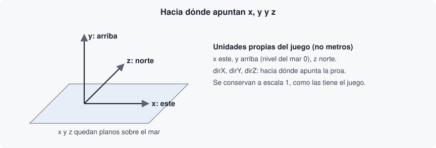

# La tabla {#the-table}

Una fila por muestra o evento, en `<partida>.parquet`: 31 columnas
([Lista de columnas](../columns.md), generada a partir del código).

| Columna | Qué es |
|---|---|
| `match`, `map` | el id de la batalla; el mapa (`spaces/99_testmap` en las imágenes) |
| `time` | segundos desde que empezó la grabación (la cuenta atrás está incluida) |
| `battleTime` | segundos desde que empezó la batalla; negativo durante la cuenta atrás |
| `event` | qué es la fila (abajo) |
| `player`, `team`, `own` | el nombre del jugador; `ally` o `enemy` del jugador que graba; `1` en las filas del jugador que graba |
| `vehicle`, `type` | el barco del jugador que graba por su nombre (`PASB018-Iowa-1944`), los demás por el número de barco del juego (`4253956080`) salvo que `--ship-names` les dé nombre; `battleship`, `cruiser`, `destroyer`, `aircraft carrier`, `submarine` cuando lo indica el nombre; si no, `ship` |
| `x`, `y`, `z` | las unidades de mundo del juego: x este, y arriba (nivel del mar 0), z norte |
| `dirX`, `dirY`, `dirZ` | hacia dónde apunta la proa, un vector unitario en el mismo sistema (`dirY` 0: solo rumbo); en un obús o torpedo, el camino que siguió |
| `other`, `reason` | el otro barco de un evento (asesino, víctima, atacante); el número de causa del juego para un hundimiento (sin nombre), el tipo de impacto para un impacto, el canal para el chat |
| `value`, `health` | el número del evento (daño, velocidad de un obús o torpedo en unidades de mundo por segundo); la vida del barco tras un impacto |
| `text` | una línea de chat |
| `shot`, `params` | el id de una salva; el tipo del obús o torpedo, como número de parámetro del juego |
| `entity` | el id del barco en la repetición |
| `otherVehicle`, `otherType` | en un `impact` sobre un barco: ese barco y su clase |
| `hitLocalX`, `hitLocalY`, `hitLocalZ` | en un `impact` sobre un barco: dónde terminó el obús en el sistema propio de ese barco, en metros (unidades de mundo por 15): x adelante, y arriba desde el mar, z derecha |
| `pitch`, `roll` | en una posición, el cabeceo y el balanceo del barco (radianes) tal como los envía el juego: un barco escora en un giro |

| `event` | En la fila de | Qué es |
|---|---|---|
| `position` | cada barco | mientras el cliente lo veía |
| `death`, `kill` | la víctima, el asesino | cada hundimiento dos veces: donde se hundió el barco, y donde estaba su asesino |
| `hurt`, `damage` | la víctima, el atacante | un impacto: `value` el daño, `health` lo que queda |
| `shot` | el tirador | una fila por obús, en el cañón, en la dirección en que voló |
| `torpedo` | el tirador | una fila por torpedo, donde se lanzó, en la dirección en que corrió |
| `impact` | el tirador | dónde terminó un obús (impacto, fallo en el agua, ...); `reason` el número del tipo de impacto; sobre un barco (cualquier tipo salvo 0 agua, 8, 32, 64 tierra, a menos de 6 unidades de un barco) `other`/`otherVehicle`/`otherType` el barco y `hitLocalX/Y/Z` el punto en su sistema (arriba) |
| `chat` | quien envía | `text` la línea, `reason` el canal (`battle_team`, `battle_common`) |

**Unidades.** Una unidad de mundo no es un metro. Un acorazado a velocidad recorre unas 2,4
de ellas por segundo, y un mapa mide unas 1.200 de lado. Medida contra la geometría del casco de
los barcos, una unidad son 15 m; las cifras de alcance propias del juego la hacen 30 m
(landaire/wows-toolkit, `crates/wows-core/src/units.rs`, MIT, que deja las
dos sin conciliar). La tabla conserva las unidades de mundo a escala 1, como lo hace toda
fuente de 3DHeat con sus propias unidades del juego, así que un nivel exportado en las mismas unidades
encaja. Las pistas `heat3d` del pie: Y arriba, Z invertida (así el mapa no sale en espejo),
un barco de 12 unidades de largo, `player` como la persona, `team` como el grupo, `match` como
la sesión.

---

Parte de [3DHeat](https://github.com/Holdi601/3DHeat) ([documentación](https://holdi601.github.io/3DHeat/)). Código fuente: [3DHeat-Ext-WoWs](https://github.com/Holdi601/3DHeat-Ext-WoWs).
