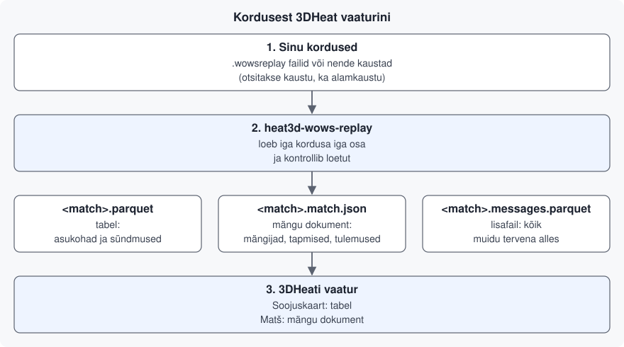

# 3DHeat World of Warshipsi kordused {#dheat-world-of-warships-replays}

**Mis see on?** World of Warships võib salvestada iga mängitud lahingu kordusfailina. See tööriist muudab need
failid tabeliks ja mängu dokumendiks (lahingu kokkuvõte), mida
[3DHeat vaatur](https://holdi601.github.io/3DHeat/) näitab 3D-s: kuhu iga laev purjetas, tulistas ja kuhu tabati.

**Miks ma seda kasutaksin?** Lahingut uuesti vaatamiseks ülevalt, kõik laevad korraga; et näha soojuskaarte,
kuhu sina ja teised purjetate, võitlete ja uppute sadade lahingute jooksul; et näha, kuhu mürsud ja torpeedod
läksid; või et lugeda kordust oma skriptidega, sest väljund on tavaline Parquet ja JSON.

**Näide:** üks kordusfail sisse, tabel ja mängu dokument välja:



## Kiirstart {#quick-start}

Uus käsurea kasutamisel? Loe esmalt [Enne alustamist](before-you-start.md).

```bash
git clone https://github.com/Holdi601/3DHeat-Ext-WoWs.git
cd 3DHeat-Ext-WoWs
pip install -e .
heat3d-wows-replay "<World of Warships>/replays" -o out
```

Iga kordus kohta näed ühte rida, mis lõpeb failiga, kuhu see kirjutas:
`... -> out/<map>/<match>.parquet`. Ava see fail ja selle kõrval olev `<match>.match.json` 3DHeat vaaturis.

## See dokumentatsioon {#this-documentation}

| Leht | Mida see katab |
|---|---|
| [Enne alustamist](before-you-start.md) | Python, terminal ja mis on edu |
| [Paigaldamine](installing.md) | paigaldus, kontroll, uuendused |
| [Kordustete konverteerimine](converting.md) | samm-sammult, iga valik, teated, väljumisolek |
| [Tabel](table.md) | iga veerg ja sündmus failis `<match>.parquet` |
| [Mängu dokument](match-document.md) | iga võti failis `<match>.match.json` |
| [Kuidas tööriist kordust loeb](how-it-reads.md) | formaat ja kuidas lugemist kontrolliti |
| [Täielikkus](completeness.md) | lisafail ja enesekontroll |
| [Tingimused ja litsents](terms.md) | Wargamingi tingimused, litsents, allikad |
| [Käskude viide](../cli-reference.md), [Veergude loend](../columns.md) | koodist genereeritud |

## Osa 3DHeatist {#part-of-3dheat}

See konverter on üks [3DHeati](https://github.com/Holdi601/3DHeat) tööriistadest, reaalajalisest 3D-telemeetria ja
kordusvaaturist ([dokumentatsioon](https://holdi601.github.io/3DHeat/)). Vaatur avab tabeli oma vahekaardil
**Soojuskaart** ja mängu dokumendi vahekaardil **Matš**. Ta suudab lahingu failid pakkida ühte faili:
[Üks fail mängu kohta](https://holdi601.github.io/3DHeat/container.html). Mida iga konverter peab säilitama:
[Konverterid hoiavad kõike](https://holdi601.github.io/3DHeat/converters.html).

Konverter on 3DHeat Watcherist tahtlikult eraldi: kordused on šifreeritud ja Wargamingi tingimused on laiad
([Tingimused ja litsents](terms.md)). Kui ta peab kunagi kaduma, ei kao sellega koos midagi muud. Watcher käivitab
selle, kui see on paigaldatud, ja töötab ka ilma selleta.

| Tööriist | Mida see teeb | Lähtekood | Dokumentatsioon |
|---|---|---|---|
| 3DHeat vaatur | näitab andmeid 3D-s: soojuskaardid, kordused, sõiduanalüüs | [3DHeat](https://github.com/Holdi601/3DHeat) | [sait](https://holdi601.github.io/3DHeat/) |
| GameFiles | rajad ja tasemed mängude laevaga kaasasolevatest failidest | [3DHeat-GameFiles](https://github.com/Holdi601/3DHeat-GameFiles) | [sait](https://holdi601.github.io/3DHeat-GameFiles/) |
| GameCapture | ringide telemeetria ja mängu videost taastatud tasemed | [3DHeat-GameCapture](https://github.com/Holdi601/3DHeat-GameCapture) | [sait](https://holdi601.github.io/3DHeat-GameCapture/) |
| Unreal Exporter | Unreal Editori plugin, mis eksportib taseme | [3DHeat-UnrealExporter](https://github.com/Holdi601/3DHeat-UnrealExporter) | [sait](https://holdi601.github.io/3DHeat-UnrealExporter/) |
| CS2 | Counter-Strike 2 demod ja kaardid | [3DHeat-CS2](https://github.com/Holdi601/3DHeat-CS2) | [sait](https://holdi601.github.io/3DHeat-CS2/) |
| Watcher | salvestab, mida mängud avaldavad, kui sa mängid | [3DHeat-Watcher](https://github.com/Holdi601/3DHeat-Watcher) | [sait](https://holdi601.github.io/3DHeat-Watcher/) |
| War Thunderi kordused | `.wrpl` kordused ja War Thunderi tasemed | [3DHeat-Ext-WarThunder](https://github.com/Holdi601/3DHeat-Ext-WarThunder) | [sait](https://holdi601.github.io/3DHeat-Ext-WarThunder/) |
| World of Tanksi kordused | `.wotreplay` kordused | [3DHeat-Ext-WoT](https://github.com/Holdi601/3DHeat-Ext-WoT) | [sait](https://holdi601.github.io/3DHeat-Ext-WoT/) |
| World of Warshipsi kordused | `.wowsreplay` kordused | [3DHeat-Ext-WoWs](https://github.com/Holdi601/3DHeat-Ext-WoWs) | [sait](https://holdi601.github.io/3DHeat-Ext-WoWs/) |
| Squadi demod | Squadi serveri demod | [3DHeat-Ext-Squad](https://github.com/Holdi601/3DHeat-Ext-Squad) | [sait](https://holdi601.github.io/3DHeat-Ext-Squad/) |
| DCS kaardid | DCS Worldi kaardid 3D-tasemetena | [3DHeat-Ext-DCS](https://github.com/Holdi601/3DHeat-Ext-DCS) | [sait](https://holdi601.github.io/3DHeat-Ext-DCS/) |
| IL-2 kaardid | IL-2 Great Battlesi kaardid 3D-tasemetena | [3DHeat-Ext-IL2](https://github.com/Holdi601/3DHeat-Ext-IL2) | [sait](https://holdi601.github.io/3DHeat-Ext-IL2/) |

---

Lähtekood: [3DHeat-Ext-WoWs](https://github.com/Holdi601/3DHeat-Ext-WoWs).
