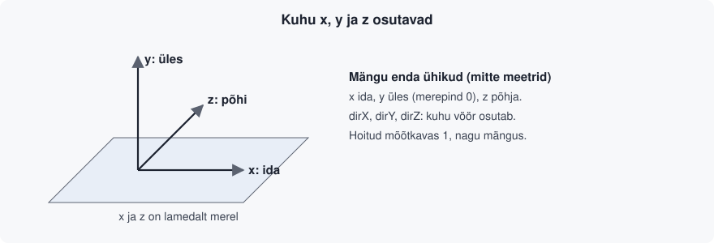

# Tabel {#the-table}

Üks rida iga näidise või sündmuse kohta failis `<match>.parquet`: 31 veergu ([Veergude loend](../columns.md), koodist genereeritud).

| Veerg | Mis see on |
|---|---|
| `match`, `map` | lahingu ID; kaart (`spaces/99_testmap` piltidel) |
| `time` | sekundid, mis on möödunud salvestuse algusest (loendus on selles sees) |
| `battleTime` | sekundid, mis on möödunud lahingu algusest; loenduse ajal negatiivne |
| `event` | mis rida on (allpool) |
| `player`, `team`, `own` | mängija nimi; `ally` või `enemy` salvestajamängija suhtes; `1` salvestajamängija ridadel |
| `vehicle`, `type` | salvestajamängija laev nime järgi (`PASB018-Iowa-1944`), teised mängu laevanumbri järgi (`4253956080`), kui `--ship-names` neid ei nimeta; `battleship`, `cruiser`, `destroyer`, `aircraft carrier`, `submarine`, kui nimi seda ütleb, muidu `ship` |
| `x`, `y`, `z` | mängu maailma ühikud: x ida, y üles (merepind 0), z põhja |
| `dirX`, `dirY`, `dirZ` | kuhu vöör osutab, ühikvektor samas raamistikus (`dirY` 0: ainult suund); mürsul või torpeedol, kuhu see läks |
| `other`, `reason` | sündmuse teine laev (tapja, ohver, ründaja); uppumise puhul mängu põhjuse number (nimetamata), tabamuse puhul tabamuse tüüp, vestluse puhul kanal |
| `value`, `health` | sündmuse number (kahju, mürsu või torpeedo kiirus maailma ühikutes sekundis); laeva tervis pärast tabamust |
| `text` | vestlusrida |
| `shot`, `params` | salve ID; mürsu või torpeedo tüüp, mängu parameetri numbrina |
| `entity` | laeva ID kordusel |
| `otherVehicle`, `otherType` | `impact` laeval: see laev ja tema klass |
| `hitLocalX`, `hitLocalY`, `hitLocalZ` | `impact` laeval: kus mürsk lõppes selle laeva enda raamistikus, meetrites (maailma ühikud korda 15): x ees, y üles merest, z paremale |
| `pitch`, `roll` | asukoha real laeva tõus ja rull (radiaanides), nii nagu mäng need saadab: laev kallub pöörates |

| `event` | Selle rea juures | Mis see on |
|---|---|---|
| `position` | iga laev | kui klient seda nägi |
| `death`, `kill` | ohver, tapja | iga uppumine kaks korda: kus laev vajus, ja kus oli tema tapja |
| `hurt`, `damage` | ohver, ründaja | tabamus: `value` kahju, `health` mis on järel |
| `shot` | laskja | üks rida iga mürsu kohta, relva juures, suunas, kuhu see lendas |
| `torpedo` | laskja | üks rida iga torpeedo kohta, kus see välja lasti, suunas, kuhu see sõitis |
| `impact` | laskja | kus mürsk lõppes (tabamus, möödalask vette, ...); `reason` tabamuse tüübi number; laeval (mis tahes tüüp peale 0 vesi, 8, 32, 64 maa, laevast 6 ühiku piires) `other`/`otherVehicle`/`otherType` laev ja `hitLocalX/Y/Z` punkt tema raamistikus (ülal) |
| `chat` | saatja | `text` rida, `reason` kanal (`battle_team`, `battle_common`) |

**Ühikud.** Maailma ühik ei ole meeter. Lahinglaev kiirusel läbib neid umbes 2,4 sekundis, ja kaart on umbes 1200
laia. Laevade korpuse geomeetria järgi on ühik 15 m; mängu enda ulatuse arvud teevad selleks 30 m
(landaire/wows-toolkit, `crates/wows-core/src/units.rs`, MIT, mis jätab need kaks lahendamata). Tabel hoiab maailma
ühikuid mõõtkavas 1, nagu iga 3DHeati lähtekoht hoiab oma mängu enda ühikuid, nii et samades ühikutes eksporditud
tase langeb kokku. Jaluse `heat3d` vihjed: y üles, z pööratud (nii et kaart ei peegeldu), laev 12 ühikut pikk,
`player` kui inimene, `team` kui grupp, `match` kui sessioon.

---

Osa [3DHeatist](https://github.com/Holdi601/3DHeat) ([dokumentatsioon](https://holdi601.github.io/3DHeat/)). Lähtekood: [3DHeat-Ext-WoWs](https://github.com/Holdi601/3DHeat-Ext-WoWs).
