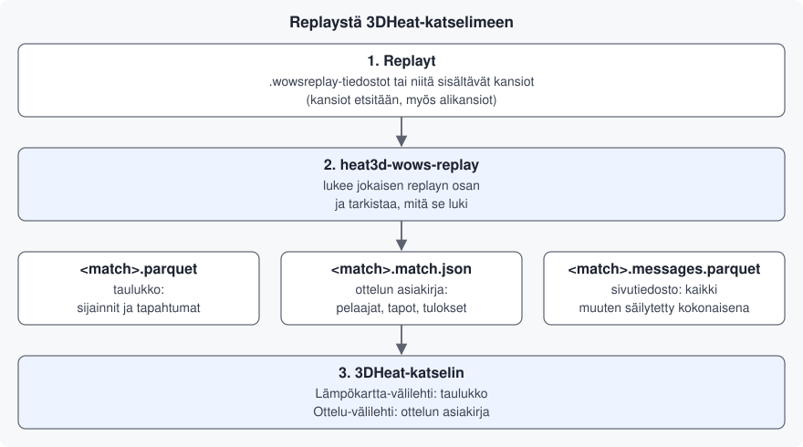

# 3DHeat World of Warships -replayt {#dheat-world-of-warships-replays}

**Mitä tämä on?** World of Warships voi tallentaa jokaisen pelaamasi taistelun replay-tiedostoksi.
Tämä työkalu muuttaa nämä tiedostot taulukoksi ja ottelun asiakirjaksi (taistelun yhteenvedoksi),
jonka [3DHeat-katselin](https://holdi601.github.io/3DHeat/) näyttää 3D:nä: minne jokainen alus purjehti,
ampui ja mihin se osui.

**Miksi käyttäisin sitä?** Katsoaksesi taistelun uudelleen ylhäältä, kaikki alukset kerralla; nähdäksesi
lämpökarttoja siitä, missä sinä ja muut purjehditte, taistelette ja upotte satojen taistelujen aikana;
nähdäksesi, minne kuoret ja torpedot menivät; tai lukeaksesi replayn omilla skripteillä, koska tulos on
tavallista Parquet- ja JSON-muotoa.

**Esimerkki:** yksi replay-tiedosto sisään, taulukko ja ottelun asiakirja ulos:



## Pikaohje {#quick-start}

Uusi komentoriviltä? Lue ensin [Ennen aloittamista](before-you-start.md).

```bash
git clone https://github.com/Holdi601/3DHeat-Ext-WoWs.git
cd 3DHeat-Ext-WoWs
pip install -e .
heat3d-wows-replay "<World of Warships>/replays" -o out
```

Näet yhden rivin replayta kohden, ja se päättyy tiedostoon, jonka se kirjoitti:
`... -> out/<map>/<match>.parquet`. Avaa tämä tiedosto ja sen vieressä oleva `<match>.match.json`
3DHeat-katselimessa.

## Tämä dokumentaatio {#this-documentation}

| Sivu | Mitä se kattaa |
|---|---|
| [Ennen aloittamista](before-you-start.md) | Python, pääte ja mitä onnistuminen tarkoittaa |
| [Asennus](installing.md) | asennus, tarkistus, päivitykset |
| [Replayjen muuntaminen](converting.md) | vaihe vaiheelta, kaikki valinnat, viestit, poistumiskoodi |
| [Taulukko](table.md) | jokainen sarake ja tapahtuma tiedostossa `<match>.parquet` |
| [Ottelun asiakirja](match-document.md) | jokainen avain tiedostossa `<match>.match.json` |
| [Miten replay luetaan](how-it-reads.md) | formaatti ja se, miten lukeminen tarkistettiin |
| [Täydellisyys](completeness.md) | sivutiedosto ja itsetarkistus |
| [Ehdot ja lisenssi](terms.md) | Wargamingin ehdot, lisenssi, lähteet |
| [Komentoviite](../cli-reference.md), [Sarakeluettelo](../columns.md) | luotu koodista |

## Osa 3DHeatiä {#part-of-3dheat}

Tämä muunnin on yksi [3DHeatin](https://github.com/Holdi601/3DHeat) työkaluista,
reaaliaikainen 3D-telemetria- ja replaykatselin ([dokumentaatio](https://holdi601.github.io/3DHeat/)).
Katselin avaa taulukon Lämpökartta-välilehdellään ja ottelun asiakirjan Ottelu-välilehdellään.
Se voi pakata ottelun tiedostot yhteen tiedostoon:
[Yksi tiedosto ottelua kohden](https://holdi601.github.io/3DHeat/container.html). Mitä jokaisen muuntimen
on säilytettävä: [Muuntimet säilyttävät kaiken](https://holdi601.github.io/3DHeat/converters.html).

Muunnin on pidetty erillään 3DHeat Watcherista tarkoituksella: replayt ovat salattuja, ja Wargamingin
ehdot ovat laajat ([Ehdot ja lisenssi](terms.md)). Jos se joskus poistetaan, mikään muu ei lähde sen mukana.
Watcher ajaa sitä, kun se on asennettu, ja toimii ilman sitä.

| Työkalu | Mitä se tekee | Lähde | Dokumentaatio |
|---|---|---|---|
| 3DHeat-katselin | näyttää datan 3D:nä: lämpökartat, replayt, kilpa-analyysi | [3DHeat](https://github.com/Holdi601/3DHeat) | [sivusto](https://holdi601.github.io/3DHeat/) |
| GameFiles | radat ja kentät pelien mukana tulevista tiedostoista | [3DHeat-GameFiles](https://github.com/Holdi601/3DHeat-GameFiles) | [sivusto](https://holdi601.github.io/3DHeat-GameFiles/) |
| GameCapture | kierrosten telemetria ja kentät pelivideosta rakennettuina | [3DHeat-GameCapture](https://github.com/Holdi601/3DHeat-GameCapture) | [sivusto](https://holdi601.github.io/3DHeat-GameCapture/) |
| Unreal Exporter | Unreal Editor -lisäosa, joka vie kentän | [3DHeat-UnrealExporter](https://github.com/Holdi601/3DHeat-UnrealExporter) | [sivusto](https://holdi601.github.io/3DHeat-UnrealExporter/) |
| CS2 | Counter-Strike 2 -demot ja kartat | [3DHeat-CS2](https://github.com/Holdi601/3DHeat-CS2) | [sivusto](https://holdi601.github.io/3DHeat-CS2/) |
| Watcher | tallentaa sen, mitä pelit julkaisevat pelatessasi | [3DHeat-Watcher](https://github.com/Holdi601/3DHeat-Watcher) | [sivusto](https://holdi601.github.io/3DHeat-Watcher/) |
| War Thunder -replayt | `.wrpl`-replayt ja War Thunderin kentät | [3DHeat-Ext-WarThunder](https://github.com/Holdi601/3DHeat-Ext-WarThunder) | [sivusto](https://holdi601.github.io/3DHeat-Ext-WarThunder/) |
| World of Tanks -replayt | `.wotreplay`-replayt | [3DHeat-Ext-WoT](https://github.com/Holdi601/3DHeat-Ext-WoT) | [sivusto](https://holdi601.github.io/3DHeat-Ext-WoT/) |
| World of Warships -replayt | `.wowsreplay`-replayt | [3DHeat-Ext-WoWs](https://github.com/Holdi601/3DHeat-Ext-WoWs) | [sivusto](https://holdi601.github.io/3DHeat-Ext-WoWs/) |
| Squad-demot | Squad-palvelimen demot | [3DHeat-Ext-Squad](https://github.com/Holdi601/3DHeat-Ext-Squad) | [sivusto](https://holdi601.github.io/3DHeat-Ext-Squad/) |
| DCS-kartat | DCS Worldin kartat 3D-kentinä | [3DHeat-Ext-DCS](https://github.com/Holdi601/3DHeat-Ext-DCS) | [sivusto](https://holdi601.github.io/3DHeat-Ext-DCS/) |
| IL-2-kartat | IL-2 Great Battles -kartat 3D-kentinä | [3DHeat-Ext-IL2](https://github.com/Holdi601/3DHeat-Ext-IL2) | [sivusto](https://holdi601.github.io/3DHeat-Ext-IL2/) |

---

Lähde: [3DHeat-Ext-WoWs](https://github.com/Holdi601/3DHeat-Ext-WoWs).
