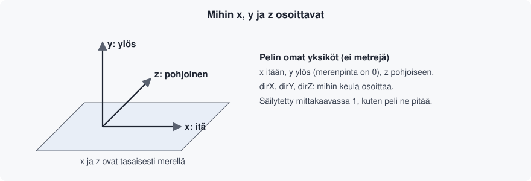

# Taulukko {#the-table}

Yksi rivi näytettä tai tapahtumaa kohden tiedostossa `<match>.parquet`: 31 saraketta
([Sarakeluettelo](../columns.md), luotu koodista).

| Sarake | Mitä se on |
|---|---|
| `match`, `map` | taistelun tunnus; kartta (`spaces/99_testmap` kuvissa) |
| `time` | sekunteja tallennuksen alusta (laskuri on mukana) |
| `battleTime` | sekunteja taistelun alusta; negatiivinen laskurin aikana |
| `event` | mikä rivi on (alla) |
| `player`, `team`, `own` | pelaajan nimi; `ally` tai `enemy` tallentavaan pelaajaan nähden; `1` tallentavan pelaajan riveillä |
| `vehicle`, `type` | tallentavan pelaajan alus nimeltä (`PASB018-Iowa-1944`), muut pelin aluksen numeron mukaan (`4253956080`), ellei `--ship-names` nimeä niitä; `battleship`, `cruiser`, `destroyer`, `aircraft carrier`, `submarine`, kun nimi sen kertoo, muuten `ship` |
| `x`, `y`, `z` | pelin maailman yksiköt: x itään, y ylös (merenpinta 0), z pohjoiseen |
| `dirX`, `dirY`, `dirZ` | mihin keula osoittaa, yksikkövektori samassa koordinaatistossa (`dirY` 0: vain suunta); kuorella tai torpedolla, mihin suuntaan se meni |
| `other`, `reason` | tapahtuman toinen alus (tappaja, uhri, hyökkääjä); upotuksella pelin syynumero (ei nimetty), iskulla osumatyyppi, chatilla kanava |
| `value`, `health` | tapahtuman numero (vahinko, kuoren tai torpedon nopeus maailman yksiköinä sekunnissa); aluksen terveys osuman jälkeen |
| `text` | chat-rivi |
| `shot`, `params` | salvon tunnus; kuoren tai torpedon tyyppi pelin parametrinumerona |
| `entity` | aluksen tunnus replayssa |
| `otherVehicle`, `otherType` | `impact`-rivillä aluksen kohdalla: kyseinen alus ja sen luokka |
| `hitLocalX`, `hitLocalY`, `hitLocalZ` | `impact`-rivillä aluksen kohdalla: missä kuori päättyi kyseisen aluksen omassa koordinaatistossa, metreinä (maailman yksiköt kertaa 15): x eteen, y ylös merenpinnasta, z oikealle |
| `pitch`, `roll` | sijainnissa aluksen kallistus ja roll (radiaaneina), sellaisina kuin peli ne lähettää: alus kallistuu käännöksessä |

| `event` | Millä rivillä | Mitä |
|---|---|---|
| `position` | jokainen alus | kun asiakas näki sen |
| `death`, `kill` | uhri, tappaja | jokainen upotus kahdesti: missä alus upposi ja missä sen tappaja oli |
| `hurt`, `damage` | uhri, hyökkääjä | osuma: `value` vahinko, `health` mitä on jäljellä |
| `shot` | ampuja | yksi rivi kuorta kohden, tykillä, siihen suuntaan, mihin se lensi |
| `torpedo` | ampuja | yksi rivi torpedoa kohden, siinä missä se laukaistiin, siihen suuntaan, mihin se kulki |
| `impact` | ampuja | missä kuori päättyi (osuma, ohi veteen, ...); `reason` osumatyypin numero; aluksella (mikä tahansa tyyppi paitsi 0 vesi, 8, 32, 64 maa; 6 yksikön säteellä aluksesta) `other`/`otherVehicle`/`otherType` alus ja `hitLocalX/Y/Z` piste sen koordinaatistossa (yllä) |
| `chat` | lähettäjä | `text` rivi, `reason` kanava (`battle_team`, `battle_common`) |

**Yksiköt.** Maailman yksikkö ei ole metri. Liikkuva taistelulaiva kulkee noin 2,4 yksikköä sekunnissa, ja kartta on noin
1 200 yksikköä poikki. Aluksen rungon geometriaa vasten yksikkö on 15 m; pelin omat kantamalukemat tekevät siitä 30 m
(landaire/wows-toolkit, `crates/wows-core/src/units.rs`, MIT, joka jättää nämä kaksi yhteensovittamatta). Taulukko säilyttää
maailman yksiköt mittakaavassa 1, kuten jokainen 3DHeat-lähde säilyttää oman pelinsä yksiköt, joten samoissa yksiköissä
viety kenttä osuu kohdalleen. Alatunnisteen `heat3d`-vihjeet: Y ylös, Z käännetty (jottei kartta peilaudu), alus
12 yksikköä pitkä, `player` henkilönä, `team` ryhmänä, `match` istuntona.

---

Osa [3DHeatiä](https://github.com/Holdi601/3DHeat) ([dokumentaatio](https://holdi601.github.io/3DHeat/)). Lähde: [3DHeat-Ext-WoWs](https://github.com/Holdi601/3DHeat-Ext-WoWs).
