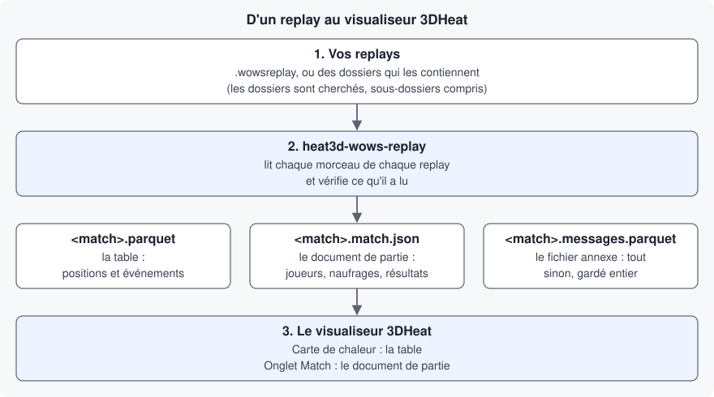

# Replays World of Warships pour 3DHeat {#dheat-world-of-warships-replays}

**Qu'est-ce que c'est ?** World of Warships peut sauvegarder chaque bataille à laquelle vous jouez sous
forme de fichier replay. Cet outil transforme ces fichiers en une table et un document de partie (le
résumé de la bataille) que le [visualiseur 3DHeat](https://holdi601.github.io/3DHeat/) montre en 3D :
où chaque navire a navigué, tiré et été touché.

**Pourquoi l'utiliser ?** Pour revoir une bataille d'en haut, tous les navires à la fois ; pour voir des
cartes de chaleur de l'endroit où vous et d'autres naviguez, combattez et coulez, sur des centaines de
batailles ; pour voir où sont allés les obus et les torpilles ; ou pour lire un replay avec vos propres
scripts, puisque le résultat est du Parquet et du JSON simples.

**Exemple :** un fichier replay en entrée, une table et un document de partie en sortie :



## Démarrage rapide {#quick-start}

Vous ne connaissez pas la ligne de commande ? Lisez d'abord [Avant de commencer](before-you-start.md).

```bash
git clone https://github.com/Holdi601/3DHeat-Ext-WoWs.git
cd 3DHeat-Ext-WoWs
pip install -e .
heat3d-wows-replay "<World of Warships>/replays" -o out
```

Vous devez voir une ligne par replay, qui se termine par le fichier écrit :
`... -> out/<map>/<match>.parquet`. Ouvrez ce fichier et le `<match>.match.json` à côté dans le
visualiseur 3DHeat.

## Cette documentation {#this-documentation}

| Page | Ce qu'elle couvre |
|---|---|
| [Avant de commencer](before-you-start.md) | Python, un terminal, et à quoi ressemble la réussite |
| [Installation](installing.md) | installation, vérification, mises à jour |
| [Convertir les replays](converting.md) | pas à pas, chaque option, messages, code de sortie |
| [La table](table.md) | chaque colonne et chaque événement de `<match>.parquet` |
| [Le document de partie](match-document.md) | chaque clé de `<match>.match.json` |
| [Comment le replay est lu](how-it-reads.md) | le format, et comment la lecture a été vérifiée |
| [Exhaustivité](completeness.md) | le fichier annexe et le contrôle interne |
| [Termes et licence](terms.md) | ce qu'il lit, la licence, les sources |
| [Référence des commandes](../cli-reference.md), [Liste des colonnes](../columns.md) | générées à partir du code |

## Une partie de 3DHeat {#part-of-3dheat}

Ce convertisseur est l'un des outils de [3DHeat](https://github.com/Holdi601/3DHeat),
un visualiseur 3D de télémétrie et de replays en temps réel ([documentation](https://holdi601.github.io/3DHeat/)).
Le visualiseur ouvre la table dans son onglet Carte de chaleur et le document de partie dans son onglet
Match. Il peut regrouper les fichiers d'un match en un seul :
[Un fichier par match](https://holdi601.github.io/3DHeat/container.html). Ce que chaque convertisseur doit
conserver : [Les convertisseurs gardent tout](https://holdi601.github.io/3DHeat/converters.html).

Chaque lecteur de jeu est un petit projet à part, avec son propre fichier de
licence, ses versions et son suivi des problèmes, de sorte qu'il peut être
installé, mis à jour, maintenu - ou retiré à la demande d'un titulaire de
droits - séparément, sans toucher à la visionneuse ni aux autres outils. Le
Watcher lance ce convertisseur quand il est installé et fonctionne sans lui.
Ce que lit le convertisseur : [Termes et licence](terms.md).

| Outil | Ce qu'il fait | Source | Documentation |
|---|---|---|---|
| Visualiseur 3DHeat | affiche les données en 3D : cartes de chaleur, replays, analyse de course | [3DHeat](https://github.com/Holdi601/3DHeat) | [site](https://holdi601.github.io/3DHeat/) |
| GameFiles | parcours et niveaux tirés des fichiers livrés avec les jeux | [3DHeat-GameFiles](https://github.com/Holdi601/3DHeat-GameFiles) | [site](https://holdi601.github.io/3DHeat-GameFiles/) |
| GameCapture | télémétrie de tour, et niveaux reconstruits à partir de vidéos de jeu | [3DHeat-GameCapture](https://github.com/Holdi601/3DHeat-GameCapture) | [site](https://holdi601.github.io/3DHeat-GameCapture/) |
| Unreal Exporter | un plugin de l'éditeur Unreal qui exporte un niveau | [3DHeat-UnrealExporter](https://github.com/Holdi601/3DHeat-UnrealExporter) | [site](https://holdi601.github.io/3DHeat-UnrealExporter/) |
| CS2 | démos et cartes de Counter-Strike 2 | [3DHeat-CS2](https://github.com/Holdi601/3DHeat-CS2) | [site](https://holdi601.github.io/3DHeat-CS2/) |
| Watcher | enregistre ce que les jeux publient pendant que vous jouez | [3DHeat-Watcher](https://github.com/Holdi601/3DHeat-Watcher) | [site](https://holdi601.github.io/3DHeat-Watcher/) |
| Replays War Thunder | replays `.wrpl` et niveaux de War Thunder | [3DHeat-Ext-WarThunder](https://github.com/Holdi601/3DHeat-Ext-WarThunder) | [site](https://holdi601.github.io/3DHeat-Ext-WarThunder/) |
| Replays World of Tanks | replays `.wotreplay` | [3DHeat-Ext-WoT](https://github.com/Holdi601/3DHeat-Ext-WoT) | [site](https://holdi601.github.io/3DHeat-Ext-WoT/) |
| Replays World of Warships | replays `.wowsreplay` | [3DHeat-Ext-WoWs](https://github.com/Holdi601/3DHeat-Ext-WoWs) | [site](https://holdi601.github.io/3DHeat-Ext-WoWs/) |
| Démos Squad | démos de serveur Squad | [3DHeat-Ext-Squad](https://github.com/Holdi601/3DHeat-Ext-Squad) | [site](https://holdi601.github.io/3DHeat-Ext-Squad/) |
| Cartes DCS | cartes de DCS World en niveaux 3D | [3DHeat-Ext-DCS](https://github.com/Holdi601/3DHeat-Ext-DCS) | [site](https://holdi601.github.io/3DHeat-Ext-DCS/) |
| Cartes IL-2 | cartes d'IL-2 Great Battles en niveaux 3D | [3DHeat-Ext-IL2](https://github.com/Holdi601/3DHeat-Ext-IL2) | [site](https://holdi601.github.io/3DHeat-Ext-IL2/) |
| Carte Dota 2 | la carte de Dota 2 de votre propre installation, en niveau 3D | [3DHeat-Ext-Dota](https://github.com/Holdi601/3DHeat-Ext-Dota) | [site](https://holdi601.github.io/3DHeat-Ext-Dota/) |
| Replays Dota 2 | replays de Dota 2 | [3DHeat-Ext-DotaReplay](https://github.com/Holdi601/3DHeat-Ext-DotaReplay) | [site](https://holdi601.github.io/3DHeat-Ext-DotaReplay/) |
| Replays Riot | replays de League of Legends et VALORANT (ce qu'ils transportent en clair) | [3DHeat-Ext-Riot](https://github.com/Holdi601/3DHeat-Ext-Riot) | [site](https://holdi601.github.io/3DHeat-Ext-Riot/) |
| Cartes Forza | parcours, courses et voitures de Forza de votre propre installation | [3DHeat-Ext-Forza](https://github.com/Holdi601/3DHeat-Ext-Forza) | [site](https://holdi601.github.io/3DHeat-Ext-Forza/) |
| Cartes Battlefield | niveaux Battlefield (Frostbite) en niveaux 3D | [3DHeat-Ext-Battlefield](https://github.com/Holdi601/3DHeat-Ext-Battlefield) | [site](https://holdi601.github.io/3DHeat-Ext-Battlefield/) |
| Cartes BeamNG | parcours de BeamNG.drive | [3DHeat-Ext-BeamNG](https://github.com/Holdi601/3DHeat-Ext-BeamNG) | [site](https://holdi601.github.io/3DHeat-Ext-BeamNG/) |
| Cartes AC Rally | étapes d'Assetto Corsa Rally en parcours | [3DHeat-Ext-ACRally](https://github.com/Holdi601/3DHeat-Ext-ACRally) | [site](https://holdi601.github.io/3DHeat-Ext-ACRally/) |
| Cartes Reforger | mondes d'Arma Reforger (Enfusion) en niveaux 3D | [3DHeat-Ext-Reforger](https://github.com/Holdi601/3DHeat-Ext-Reforger) | [site](https://holdi601.github.io/3DHeat-Ext-Reforger/) |
| Replays R6 | replays de matchs Rainbow Six Siege | [3DHeat-Ext-R6](https://github.com/Holdi601/3DHeat-Ext-R6) | [site](https://holdi601.github.io/3DHeat-Ext-R6/) |

---

Source : [3DHeat-Ext-WoWs](https://github.com/Holdi601/3DHeat-Ext-WoWs).
