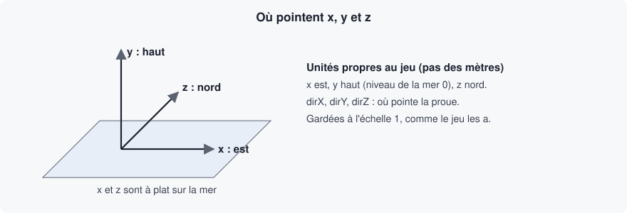

# La table {#the-table}

Une ligne par échantillon ou événement, dans `<match>.parquet` : 31 colonnes
([Liste des colonnes](../columns.md), générée à partir du code).

| Colonne | Contenu |
|---|---|
| `match`, `map` | l'identifiant de la bataille ; la carte (`spaces/99_testmap` sur les images) |
| `time` | secondes depuis le début de l'enregistrement (le compte à rebours y figure) |
| `battleTime` | secondes depuis le début de la bataille ; négatif pendant le compte à rebours |
| `event` | ce que représente la ligne (voir ci-dessous) |
| `player`, `team`, `own` | le nom du joueur ; `ally` ou `enemy` par rapport au joueur qui enregistre ; `1` sur les lignes du joueur qui enregistre |
| `vehicle`, `type` | le navire du joueur qui enregistre par son nom (`PASB018-Iowa-1944`), les autres par le numéro de navire du jeu (`4253956080`), sauf si `--ship-names` les nomme ; `battleship`, `cruiser`, `destroyer`, `aircraft carrier`, `submarine` lorsque le nom le dit, sinon `ship` |
| `x`, `y`, `z` | les unités du monde du jeu : x est, y haut (niveau de la mer 0), z nord |
| `dirX`, `dirY`, `dirZ` | vers où pointe la proue, un vecteur unitaire dans le même repère (`dirY` 0 : cap seulement) ; sur un obus ou une torpille, le sens de leur trajectoire |
| `other`, `reason` | l'autre navire d'un événement (tueur, victime, attaquant) ; le numéro de cause du jeu pour un naufrage (non nommé), le type d'impact pour un impact, le canal pour le chat |
| `value`, `health` | le nombre de l'événement (dégâts, vitesse d'un obus ou d'une torpille en unités du monde par seconde) ; les points de vie du navire après un impact |
| `text` | une ligne de chat |
| `shot`, `params` | l'identifiant d'une salve ; le type de l'obus ou de la torpille, sous forme du numéro de paramètre du jeu |
| `entity` | l'identifiant du navire dans le replay |
| `otherVehicle`, `otherType` | sur un `impact` sur un navire : ce navire et sa classe |
| `hitLocalX`, `hitLocalY`, `hitLocalZ` | sur un `impact` sur un navire : l'endroit où l'obus s'est arrêté dans le repère propre de ce navire, en mètres (unités du monde fois 15) : x avant, y haut depuis la mer, z droite |
| `pitch`, `roll` | sur une position, le tangage et le roulis du navire (radians) tels que le jeu les envoie : un navire gîte dans un virage |

| `event` | Sur la ligne de | Contenu |
|---|---|---|
| `position` | chaque navire | tant que le client le voyait |
| `death`, `kill` | la victime, le tueur | chaque naufrage deux fois : là où le navire a coulé, et là où se tenait son tueur |
| `hurt`, `damage` | la victime, l'attaquant | un impact : `value` les dégâts, `health` ce qui reste |
| `shot` | le tireur | une ligne par obus, au canon, dans la direction où il a volé |
| `torpedo` | le tireur | une ligne par torpille, là où elle a été lancée, dans la direction où elle a couru |
| `impact` | le tireur | l'endroit où un obus s'est arrêté (touché, tombé à l'eau, ...) ; `reason` le numéro de type d'impact ; sur un navire (tout type sauf 0 eau, 8, 32, 64 terre, à moins de 6 unités d'un navire) `other`/`otherVehicle`/`otherType` le navire et `hitLocalX/Y/Z` le point dans son repère |
| `chat` | l'expéditeur | `text` la ligne, `reason` le canal (`battle_team`, `battle_common`) |

**Unités.** Une unité du monde n'est pas un mètre. Un cuirassé à pleine vitesse parcourt environ 2,4 unités par
seconde, et une carte fait environ 1 200 unités de large. Rapportée à la géométrie des coques des navires, une
unité vaut 15 m ; les chiffres de portée du jeu la donnent à 30 m (landaire/wows-toolkit,
`crates/wows-core/src/units.rs`, MIT, qui ne concilie pas les deux). La table garde les unités du monde à
l'échelle 1, comme chaque source de 3DHeat garde les unités propres à son jeu, de sorte qu'un niveau exporté dans
les mêmes unités s'aligne. Les indications `heat3d` du pied : Y vers le haut, Z retourné (ainsi la carte n'est pas
en miroir), un navire long de 12 unités, `player` comme la personne, `team` comme le groupe, `match` comme la
session.

---

Une partie de [3DHeat](https://github.com/Holdi601/3DHeat) ([documentation](https://holdi601.github.io/3DHeat/)). Source : [3DHeat-Ext-WoWs](https://github.com/Holdi601/3DHeat-Ext-WoWs).
