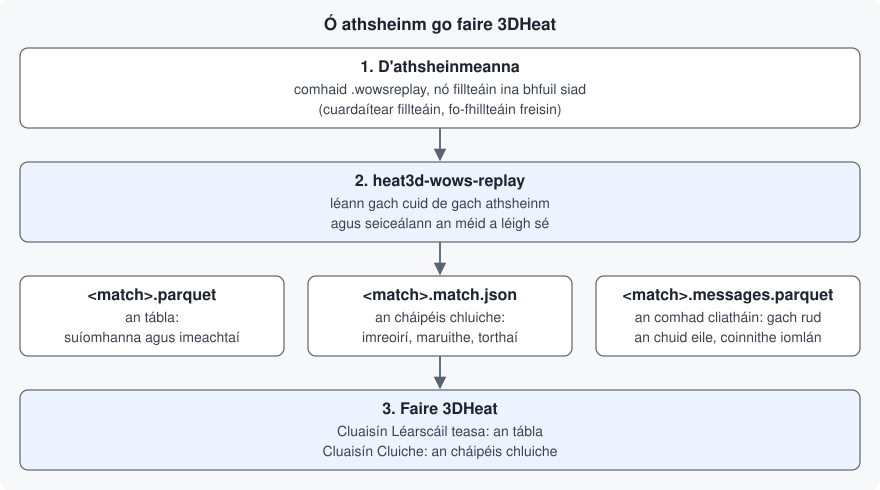

# Athsheinmeanna 3DHeat World of Warships {#dheat-world-of-warships-replays}

**Céard é?** Is féidir le World of Warships gach cath a imríonn tú a shábháil mar chomhad athsheinm. Tiontaíonn an uirlis seo na comhaid sin ina dtábla agus ina gcáipéis chluiche (achoimre an chatha) a thaispeánann [amharcán 3DHeat](https://holdi601.github.io/3DHeat/) i 3T: an áit ar sheol, ar lámhaigh agus ar bualadh gach long.

**Cén fáth a n-úsáidfinn é?** Chun cath a fheiceáil arís ó thuas, gach long ag an am céanna; chun léarscáileanna teasa a fheiceáil den áit a seolann, a gcathaíonn agus a mbáitear tú féin agus daoine eile thar na céadta cath; chun a fheiceáil cá ndeachaigh sliogáin agus torpéidí; nó chun athsheinm a léamh le do scripteanna féin, mar is Parquet agus JSON simplí an t-aschur.

**Sampla:** comhad athsheinm amháin isteach, tábla agus cáipéis chluiche amach:



## Tús tapa {#quick-start}

Nua leis an líne ordaithe? Léigh [Sula dtosaíonn tú](before-you-start.md) ar dtús.

```bash
git clone https://github.com/Holdi601/3DHeat-Ext-WoWs.git
cd 3DHeat-Ext-WoWs
pip install -e .
heat3d-wows-replay "<World of Warships>/replays" -o out
```

Ba cheart duit líne amháin a fheiceáil do gach athsheinm, ag críochnú leis an gcomhad a scríobh sé: `... -> out/<map>/<match>.parquet`. Oscail an comhad sin agus an `<match>.match.json` lena thaobh in amharcán 3DHeat.

## An doiciméadúchán seo {#this-documentation}

| Leathanach | Cad a chlúdaíonn sé |
|---|---|
| [Sula dtosaíonn tú](before-you-start.md) | Python, teirminéal, agus cén chuma atá ar rath |
| [Suiteáil](installing.md) | suiteáil, seiceáil, nuashonruithe |
| [Athsheinmeanna a thiontú](converting.md) | céim ar chéim, gach rogha, teachtaireachtaí, stádas scoir |
| [An tábla](table.md) | gach colún agus imeacht de `<match>.parquet` |
| [An cháipéis chluiche](match-document.md) | gach eochair de `<match>.match.json` |
| [Conas a léann sé athsheinm](how-it-reads.md) | an fhormáid, agus conas a seiceáladh an léamh |
| [Iomláine](completeness.md) | an comhad cliatháin agus an fhéinseiceáil |
| [Téarmaí agus ceadúnas](terms.md) | cad a léann sé, ceadúnas, foinsí |
| [Tagairt orduithe](../cli-reference.md), [Liosta colún](../columns.md) | ginte ón gcód |

## Cuid de 3DHeat {#part-of-3dheat}

Is ceann d'uirlisí [3DHeat](https://github.com/Holdi601/3DHeat) an tiontaire seo, amharcán teiliméadrachta agus athsheinm 3T fíor-ama ([doiciméadúchán](https://holdi601.github.io/3DHeat/)). Osclaíonn an t-amharcán an tábla ina cluaisín Léarscáil teasa agus an cháipéis chluiche ina cluaisín Cluiche. Is féidir léi comhaid cluiche a phacáil i gcomhad amháin: [Comhad amháin an cluiche](https://holdi601.github.io/3DHeat/container.html). An rud a chaithfidh gach tiontaire a choimeád: [Coimeádann tiontairí gach rud](https://holdi601.github.io/3DHeat/converters.html).

Is tionscadal beag dá chuid féin é gach léitheoir cluiche, lena chomhad
ceadúnais, a eisiúintí agus a rianaitheoir fadhbanna féin, ionas gur féidir é
a shuiteáil, a nuashonrú, a chothabháil - nó a tharraingt siar ar iarratas ó
shealbhóir cearta - ar leith, gan tionchar ar an amharcán ná ar na huirlisí
eile. Ritheann an Watcher an tiontaire seo nuair atá sé suiteáilte, agus
oibríonn sé gan é. Cad a léann an tiontaire: [Téarmaí agus
ceadúnas](terms.md).

| Uirlis | Cad a dhéanann sí | Foinse | Doiciméadúchán |
|---|---|---|---|
| Amharcán 3DHeat | taispeánann sí na sonraí i 3T: léarscáileanna teasa, athsheinmeanna, anailís rása | [3DHeat](https://github.com/Holdi601/3DHeat) | [suíomh](https://holdi601.github.io/3DHeat/) |
| GameFiles | cúrsaí agus leibhéil as comhaid a seoltar le cluichí | [3DHeat-GameFiles](https://github.com/Holdi601/3DHeat-GameFiles) | [suíomh](https://holdi601.github.io/3DHeat-GameFiles/) |
| GameCapture | telemetria lap, agus leibhéil atógtha ó fhístéip chluiche | [3DHeat-GameCapture](https://github.com/Holdi601/3DHeat-GameCapture) | [suíomh](https://holdi601.github.io/3DHeat-GameCapture/) |
| Unreal Exporter | breiseán d'Unreal Editor a onnmhairíonn leibhéal | [3DHeat-UnrealExporter](https://github.com/Holdi601/3DHeat-UnrealExporter) | [suíomh](https://holdi601.github.io/3DHeat-UnrealExporter/) |
| CS2 | taispeántais agus léarscáileanna Counter-Strike 2 | [3DHeat-CS2](https://github.com/Holdi601/3DHeat-CS2) | [suíomh](https://holdi601.github.io/3DHeat-CS2/) |
| Watcher | taifeadann sé an méid a fhoilsíonn cluichí agus tú ag imirt | [3DHeat-Watcher](https://github.com/Holdi601/3DHeat-Watcher) | [suíomh](https://holdi601.github.io/3DHeat-Watcher/) |
| Athsheinmeanna War Thunder | athsheinmeanna `.wrpl` agus leibhéil War Thunder | [3DHeat-Ext-WarThunder](https://github.com/Holdi601/3DHeat-Ext-WarThunder) | [suíomh](https://holdi601.github.io/3DHeat-Ext-WarThunder/) |
| Athsheinmeanna World of Tanks | athsheinmeanna `.wotreplay` | [3DHeat-Ext-WoT](https://github.com/Holdi601/3DHeat-Ext-WoT) | [suíomh](https://holdi601.github.io/3DHeat-Ext-WoT/) |
| Athsheinmeanna World of Warships | athsheinmeanna `.wowsreplay` | [3DHeat-Ext-WoWs](https://github.com/Holdi601/3DHeat-Ext-WoWs) | [suíomh](https://holdi601.github.io/3DHeat-Ext-WoWs/) |
| Taispeántais Squad | taispeántais freastalaí Squad | [3DHeat-Ext-Squad](https://github.com/Holdi601/3DHeat-Ext-Squad) | [suíomh](https://holdi601.github.io/3DHeat-Ext-Squad/) |
| Léarscáileanna DCS | léarscáileanna DCS World mar leibhéil 3T | [3DHeat-Ext-DCS](https://github.com/Holdi601/3DHeat-Ext-DCS) | [suíomh](https://holdi601.github.io/3DHeat-Ext-DCS/) |
| Léarscáileanna IL-2 | léarscáileanna IL-2 Great Battles mar leibhéil 3T | [3DHeat-Ext-IL2](https://github.com/Holdi601/3DHeat-Ext-IL2) | [suíomh](https://holdi601.github.io/3DHeat-Ext-IL2/) |

---

Foinse: [3DHeat-Ext-WoWs](https://github.com/Holdi601/3DHeat-Ext-WoWs).
