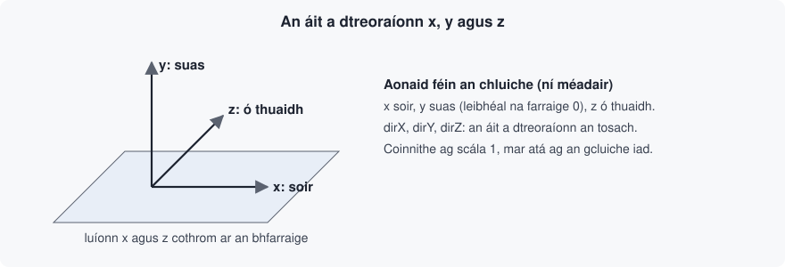

# An tábla {#the-table}

Sraith amháin do gach sampla nó imeacht, i `<match>.parquet`: 31 colún ([Liosta colún](../columns.md), ginte ón gcód).

| Colún | Cad é |
|---|---|
| `match`, `map` | id an chatha; an léarscáil (`spaces/99_testmap` sna pictiúir) |
| `time` | soicindí ó thosaigh an taifeadadh (tá an comhaireamh síos ann) |
| `battleTime` | soicindí ó thosaigh an cath; diúltach le linn an chomhairimh síos |
| `event` | cad é an tsraith (thíos) |
| `player`, `team`, `own` | ainm an imreora; `ally` nó `enemy` don imreoir taifeadta; `1` ar shraitheanna an imreora taifeadta |
| `vehicle`, `type` | long an imreora taifeadta de réir ainm (`PASB018-Iowa-1944`), na cinn eile de réir uimhir loinge an chluiche (`4253956080`) mura n-ainmníonn `--ship-names` iad; `battleship`, `cruiser`, `destroyer`, `aircraft carrier`, `submarine` nuair a deir an t-ainm, `ship` ar shlí eile |
| `x`, `y`, `z` | aonaid shaol an chluiche: x soir, y suas (leibhéal na farraige 0), z ó thuaidh |
| `dirX`, `dirY`, `dirZ` | an áit a dtreoraíonn an tosach, veicteoir aonaid sa fhráma céanna (`dirY` 0: treo cothrománach amháin); ar shliogán nó torpéido, an bealach ar imigh sé |
| `other`, `reason` | long eile imeachta (marfóir, íobartach, ionsaitheoir); uimhir chúise an chluiche do bháthadh (gan ainmniú), an cineál buille d'impact, an cainéal do chomhrá |
| `value`, `health` | uimhir an imeachta (damáiste, luas sligéin nó torpéido in aonaid shaoil sa soicind); sláinte na loinge tar éis buille |
| `text` | líne chomhrá |
| `shot`, `params` | id sailve; cineál an tsligéin nó an torpéido, mar uimhir pharaiméadair an chluiche |
| `entity` | id na loinge san athsheinm |
| `otherVehicle`, `otherType` | ar `impact` ar long: an long sin agus a haicme |
| `hitLocalX`, `hitLocalY`, `hitLocalZ` | ar `impact` ar long: an áit ar chríochnaigh an sliogán i bhfráma féin na loinge sin, i méadair (aonaid shaoil faoi 15): x ar aghaidh, y suas ón bhfarraige, z ar dheis |
| `pitch`, `roll` | ar shuíomh, pitch agus roll na loinge (raidian) mar a sheolann an cluiche iad: claonann long i gcasadh |

| `event` | Ar shraith de | Cad é |
|---|---|---|
| `position` | gach long | fad a chonaic an cliant í |
| `death`, `kill` | an t-íobartach, an marfóir | gach báthadh faoi dhó: an áit ar báthadh an long, agus an áit a raibh a marfóir |
| `hurt`, `damage` | an t-íobartach, an t-ionsaitheoir | buille: `value` an damáiste, `health` an méid atá fágtha |
| `shot` | an lámhachóir | sraith amháin do gach sliogán, ag an ngunna, sa treo ar eitil sé |
| `torpedo` | an lámhachóir | sraith amháin do gach torpéido, san áit ar lainseáladh é, sa treo ar rith sé |
| `impact` | an lámhachóir | an áit ar chríochnaigh sliogán (buille, caill isteach san uisce, ...); `reason` uimhir chineál an bhuille; ar long (aon chineál ach 0 uisce, 8, 32, 64 talamh, laistigh de 6 aonad de long) `other`/`otherVehicle`/`otherType` an long agus `hitLocalX/Y/Z` an pointe ina fráma (thuas) |
| `chat` | an seoltóir | `text` an líne, `reason` an cainéal (`battle_team`, `battle_common`) |

**Aonaid.** Ní méadar é aonad saoil. Clúdaíonn cathloinge ar luas thart ar 2.4 díobh sa soicind, agus tá léarscáil thart ar 1,200 trasna. Curtha i gcomparáid le geoiméadracht chorp na long, is 15 m é aonad; fágann figiúirí raoin an chluiche féin 30 m é (landaire/wows-toolkit, `crates/wows-core/src/units.rs`, MIT, a fhágann an dá cheann gan réiteach). Coinníonn an tábla aonaid shaoil ag scála 1, mar a choinníonn gach foinse 3DHeat aonaid féin a cluiche, mar sin luíonn leibhéal a onnmhairítear sna haonaid chéanna ar a chéile. Leideanna `heat3d` an bhuntáisc: Y suas, Z iompaithe (mar sin ní scáthánaítear an léarscáil), long 12 aonad ar fhad, `player` mar an duine, `team` mar an ghrúpa, `match` mar an seisiún.

---

Cuid de [3DHeat](https://github.com/Holdi601/3DHeat) ([doiciméadúchán](https://holdi601.github.io/3DHeat/)). Foinse: [3DHeat-Ext-WoWs](https://github.com/Holdi601/3DHeat-Ext-WoWs).
