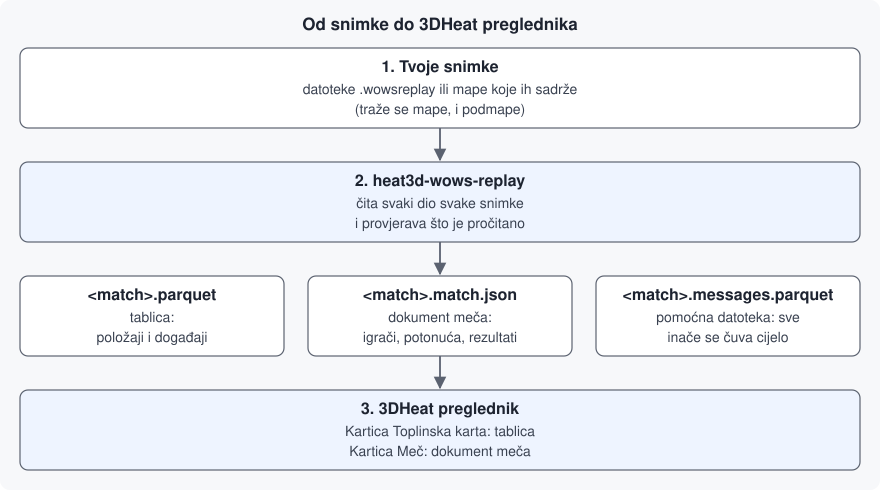

# 3DHeat snimke World of Warshipsa {#dheat-world-of-warships-replays}

**Što je to?** World of Warships može spremiti svaku bitku koju odigraš kao datoteku
snimke. Ovaj alat pretvara te datoteke u tablicu i dokument meča (sažetak bitke) koje
[3DHeat preglednik](https://holdi601.github.io/3DHeat/) prikazuje u 3D: gdje je svaki brod
plovio, pucao i bio pogođen.

**Zašto bih ga koristio?** Da bitku ponovno pogledaš odozgo, svaki brod odjednom; da vidiš
toplinske karte gdje ti i drugi plovite, borite se i tonete kroz stotine bitaka; da vidiš
gdje su granate i torpeda otišli; ili da čitaš snimku vlastitim skriptama, jer je rezultat
običan Parquet i JSON.

**Primjer:** jedna datoteka snimke na ulazu, tablica i dokument meča na izlazu:



## Brzi početak {#quick-start}

Nikad nisi koristio naredbeni redak? Prvo pročitaj [Prije početka](before-you-start.md).

```bash
git clone https://github.com/Holdi601/3DHeat-Ext-WoWs.git
cd 3DHeat-Ext-WoWs
pip install -e .
heat3d-wows-replay "<World of Warships>/replays" -o out
```

Trebao bi vidjeti jedan redak po snimci, koji završava datotekom koju je zapisao:
`... -> out/<map>/<match>.parquet`. Otvori tu datoteku i
`<match>.match.json` pored nje u 3DHeat pregledniku.

## Ova dokumentacija {#this-documentation}

| Stranica | Što obuhvaća |
|---|---|
| [Prije početka](before-you-start.md) | Python, terminal i kako izgleda uspjeh |
| [Instalacija](installing.md) | instalacija, provjera, ažuriranja |
| [Pretvaranje snimki](converting.md) | korak po korak, svaka opcija, poruke, status izlaza |
| [Tablica](table.md) | svaki stupac i događaj u `<match>.parquet` |
| [Dokument meča](match-document.md) | svaki ključ u `<match>.match.json` |
| [Kako se snimka čita](how-it-reads.md) | format i kako je čitanje provjereno |
| [Potpunost](completeness.md) | pomoćna datoteka i samoprovjera |
| [Pojmovi i licenca](terms.md) | Wargamingovi uvjeti, licenca, izvori |
| [Referenca naredbi](../cli-reference.md), [Popis stupaca](../columns.md) | generirano iz koda |

## Dio 3DHeata {#part-of-3dheat}

Ovaj pretvarač je jedan od alata [3DHeata](https://github.com/Holdi601/3DHeat),
aplikacije za 3D prikaz telemetrije i snimki u stvarnom vremenu ([dokumentacija](https://holdi601.github.io/3DHeat/)).
Preglednik tablicu prikazuje na kartici Toplinska karta, a dokument meča na kartici Meč.
Može spakirati datoteke jednog meča u jednu datoteku:
[Jedna datoteka za meč](https://holdi601.github.io/3DHeat/container.html). Što svaki pretvarač mora
zadržati: [Pretvarači zadržavaju sve](https://holdi601.github.io/3DHeat/converters.html).

Pretvarač je odvojen od 3DHeat Watchera namjerno: snimke su šifrirane, a Wargamingovi uvjeti su
široki ([Pojmovi i licenca](terms.md)). Ako ga ikad treba ukloniti, ništa drugo ne ide s njim.
Watcher ga pokreće kad je instaliran i radi bez njega.

| Alat | Što radi | Izvor | Dokumentacija |
|---|---|---|---|
| 3DHeat preglednik | prikazuje podatke u 3D: toplinske karte, snimke, analiza utrka | [3DHeat](https://github.com/Holdi601/3DHeat) | [web](https://holdi601.github.io/3DHeat/) |
| GameFiles | staze i razine iz datoteka koje igre isporučuju | [3DHeat-GameFiles](https://github.com/Holdi601/3DHeat-GameFiles) | [web](https://holdi601.github.io/3DHeat-GameFiles/) |
| GameCapture | telemetrija krugova i razine rekonstruirane iz videa igre | [3DHeat-GameCapture](https://github.com/Holdi601/3DHeat-GameCapture) | [web](https://holdi601.github.io/3DHeat-GameCapture/) |
| Unreal Exporter | dodatak za Unreal Editor koji izvozi razinu | [3DHeat-UnrealExporter](https://github.com/Holdi601/3DHeat-UnrealExporter) | [web](https://holdi601.github.io/3DHeat-UnrealExporter/) |
| CS2 | Counter-Strike 2 demo snimke i mape | [3DHeat-CS2](https://github.com/Holdi601/3DHeat-CS2) | [web](https://holdi601.github.io/3DHeat-CS2/) |
| Watcher | bilježi što igre objavljuju dok igraš | [3DHeat-Watcher](https://github.com/Holdi601/3DHeat-Watcher) | [web](https://holdi601.github.io/3DHeat-Watcher/) |
| Snimke War Thundera | `.wrpl` snimke i razine War Thundera | [3DHeat-Ext-WarThunder](https://github.com/Holdi601/3DHeat-Ext-WarThunder) | [web](https://holdi601.github.io/3DHeat-Ext-WarThunder/) |
| Snimke World of Tanks | `.wotreplay` snimke | [3DHeat-Ext-WoT](https://github.com/Holdi601/3DHeat-Ext-WoT) | [web](https://holdi601.github.io/3DHeat-Ext-WoT/) |
| Snimke World of Warships | `.wowsreplay` snimke | [3DHeat-Ext-WoWs](https://github.com/Holdi601/3DHeat-Ext-WoWs) | [web](https://holdi601.github.io/3DHeat-Ext-WoWs/) |
| Squad demo | demo snimke Squad poslužitelja | [3DHeat-Ext-Squad](https://github.com/Holdi601/3DHeat-Ext-Squad) | [web](https://holdi601.github.io/3DHeat-Ext-Squad/) |
| DCS mape | karte DCS Worlda kao 3D razine | [3DHeat-Ext-DCS](https://github.com/Holdi601/3DHeat-Ext-DCS) | [web](https://holdi601.github.io/3DHeat-Ext-DCS/) |
| IL-2 mape | karte IL-2 Great Battlesa kao 3D razine | [3DHeat-Ext-IL2](https://github.com/Holdi601/3DHeat-Ext-IL2) | [web](https://holdi601.github.io/3DHeat-Ext-IL2/) |

---

Izvor: [3DHeat-Ext-WoWs](https://github.com/Holdi601/3DHeat-Ext-WoWs).
