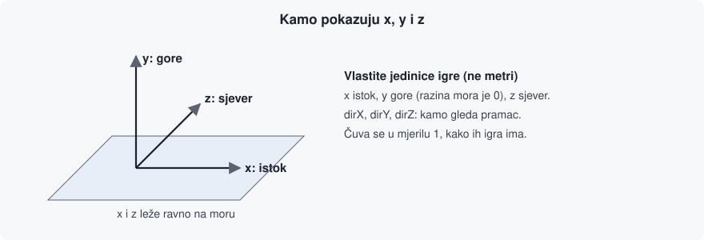

# Tablica {#the-table}

Jedan redak po uzorku ili događaju, u `<match>.parquet`: 31 stupac
([Popis stupaca](../columns.md), generiran iz koda).

| Stupac | Što |
|---|---|
| `match`, `map` | id bitke; karta (`spaces/99_testmap` na slikama) |
| `time` | sekunde od početka snimanja (u njemu je i odbrojavanje) |
| `battleTime` | sekunde od početka bitke; negativno tijekom odbrojavanja |
| `event` | što redak predstavlja (dolje) |
| `player`, `team`, `own` | ime igrača; `ally` ili `enemy` u odnosu na igrača koji snima; `1` na retcima igrača koji snima |
| `vehicle`, `type` | brod igrača koji snima po nazivu (`PASB018-Iowa-1944`), ostali po broju broda igre (`4253956080`), osim ako ih `--ship-names` ne imenuje; `battleship`, `cruiser`, `destroyer`, `aircraft carrier`, `submarine` gdje to kaže naziv, inače `ship` |
| `x`, `y`, `z` | jedinice svijeta igre: x istok, y gore (razina mora 0), z sjever |
| `dirX`, `dirY`, `dirZ` | kamo gleda pramac, jedinični vektor u istom okviru (`dirY` 0: samo smjer); na granati ili torpedu kojim su išli |
| `other`, `reason` | drugi brod događaja (ubojica, žrtva, napadač); broj uzroka igre za potonuće (nije imenovan), vrsta pogotka za udar, kanal za razgovor |
| `value`, `health` | broj događaja (šteta, brzina granate ili torpeda u jedinicama svijeta u sekundi); zdravlje broda nakon pogotka |
| `text` | red razgovora |
| `shot`, `params` | id salve; vrsta granate ili torpeda, kao broj parametra igre |
| `entity` | id broda u snimci |
| `otherVehicle`, `otherType` | na `impact`-u na brodu: taj brod i njegova klasa |
| `hitLocalX`, `hitLocalY`, `hitLocalZ` | na `impact`-u na brodu: gdje je granata završila u okviru tog broda, u metrima (jedinice svijeta puta 15): x naprijed, y gore od mora, z desno |
| `pitch`, `roll` | na položaju, nagib i valjanje broda (radijani) kako ih igra šalje: brod se nagiba u zaokretu |

| `event` | Na retku | Što |
|---|---|---|
| `position` | svakog broda | dok ga je klijent vidio |
| `death`, `kill` | žrtve, ubojice | svako potonuće dvaput: gdje je brod potonuo, i gdje je bio njegov ubojica |
| `hurt`, `damage` | žrtve, napadača | pogodak: `value` šteta, `health` što je ostalo |
| `shot` | strijelca | jedan redak po granati, na topu, u smjeru u kojem je letjela |
| `torpedo` | strijelca | jedan redak po torpedu, gdje je ispaljen, u smjeru u kojem je plovio |
| `impact` | strijelca | gdje je granata završila (pogodak, promašaj u vodu, ...); `reason` broj vrste pogotka; na brodu (bilo koje vrste osim 0 voda, 8, 32, 64 kopno, unutar 6 jedinica od broda) `other`/`otherVehicle`/`otherType` brod, i `hitLocalX/Y/Z` točka u njegovom okviru (gore) |
| `chat` | pošiljatelja | `text` red, `reason` kanal (`battle_team`, `battle_common`) |

**Jedinice.** Jedinica svijeta nije metar. Brod u plovidbi pređe oko 2,4 od njih u sekundi, a karta je
široka oko 1.200. Prema geometriji trupova brodova, jedinica je 15 m; igrini vlastiti dometi daju 30 m
(landaire/wows-toolkit, `crates/wows-core/src/units.rs`, MIT, koji ta dva ne usklađuje). Tablica čuva
jedinice svijeta u mjerilu 1, kao što svaki izvor 3DHeata čuva vlastite jedinice igre, pa se razina izvezena
u istim jedinicama poklapa. Upute u podnožju `heat3d`: Y gore, Z okrenut (da karta nije zrcaljena), brod
dug 12 jedinica, `player` kao osoba, `team` kao grupa, `match` kao sesija.

---

Dio [3DHeata](https://github.com/Holdi601/3DHeat) ([dokumentacija](https://holdi601.github.io/3DHeat/)). Izvor: [3DHeat-Ext-WoWs](https://github.com/Holdi601/3DHeat-Ext-WoWs).
