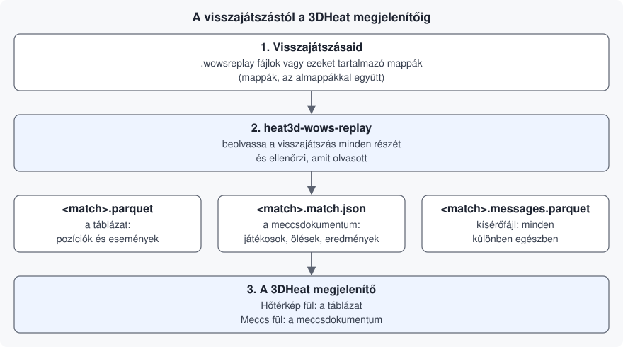

# 3DHeat World of Warships visszajátszások {#dheat-world-of-warships-replays}

**Mi ez?** A World of Warships minden csatát el tud menteni visszajátszás-fájlként. Ez az eszköz
ezeket a fájlokat táblázattá és meccsdokumentummá (a csata összefoglalójává) alakítja, amelyet a
[3DHeat nézegető](https://holdi601.github.io/3DHeat/) 3D-ben mutat meg: hol hajózott, lőtt és
találtak el minden hajót.

**Mire jó?** Hogy egy csatát újra megnézz felülről, minden hajót egyszerre; hőtérképekhez, hogy lásd,
hol hajózol, harcolsz és süllyedsz te és mások több száz csatában; hogy lásd, hová értek a lövedékek
és a torpedók; vagy hogy a visszajátszást a saját szkriptjeiddel olvasd, mert a kimenet sima Parquet és JSON.

**Példa:** egy visszajátszás-fájl be, egy táblázat és egy meccsdokumentum ki:



## Gyors kezdés {#quick-start}

Új vagy a parancssorban? Olvasd el előbb a [Mielőtt elkezded](before-you-start.md) oldalt.

```bash
git clone https://github.com/Holdi601/3DHeat-Ext-WoWs.git
cd 3DHeat-Ext-WoWs
pip install -e .
heat3d-wows-replay "<World of Warships>/replays" -o out
```

Visszajátszásonként egy sort kell látnod, a végén a fájllal, amelyet írt:
`... -> out/<map>/<match>.parquet`. Nyisd meg ezt a fájlt, és mellette a
`<match>.match.json`-t a 3DHeat nézegetőben.

## Ez a dokumentáció {#this-documentation}

| Oldal | Mit fed le |
|---|---|
| [Mielőtt elkezded](before-you-start.md) | Python, terminál, és mi jelzi a sikert |
| [Telepítés](installing.md) | telepítés, ellenőrzés, frissítések |
| [Visszajátszások konvertálása](converting.md) | lépésről lépésre, minden kapcsoló, üzenetek, kilépési állapot |
| [A táblázat](table.md) | a `<match>.parquet` minden oszlopa és eseménye |
| [A meccsdokumentum](match-document.md) | a `<match>.match.json` minden kulcsa |
| [Hogyan olvassa a visszajátszást](how-it-reads.md) | a formátum, és hogyan ellenőriztük az olvasást |
| [Teljesség](completeness.md) | a kísérőfájl és az önellenőrzés |
| [Feltételek és licenc](terms.md) | a Wargaming feltételei, licenc, források |
| [Parancsreferencia](../cli-reference.md), [Oszloplista](../columns.md) | a kódból generálva |

## A 3DHeat része {#part-of-3dheat}

Ez a konverter a [3DHeat](https://github.com/Holdi601/3DHeat) eszközeinek egyike, egy valós
idejű 3D telemetria- és visszajátszás-nézegető ([dokumentáció](https://holdi601.github.io/3DHeat/)).
A nézegető a táblázatot a Hőtérkép fülön, a meccsdokumentumot a Meccs fülön nyitja meg. Egy meccs
fájljait egybe is csomagolhatja: [Egy fájl egy meccshez](https://holdi601.github.io/3DHeat/container.html).
Amit minden konverternek meg kell őriznie: [A konverterek mindent megtartanak](https://holdi601.github.io/3DHeat/converters.html).

A konvertert szándékosan tartjuk külön a 3DHeat Watchertől: a visszajátszások titkosítottak, a
Wargaming feltételei pedig szélesek ([Feltételek és licenc](terms.md)). Ha valaha el kell
távolítani, semmi más nem megy vele együtt. A Watcher telepítve futtatja, és enélkül is működik.

| Eszköz | Mit csinál | Forrás | Dokumentáció |
|---|---|---|---|
| 3DHeat nézegető | 3D-ben mutatja az adatokat: hőtérképek, visszajátszások, versenyelemzés | [3DHeat](https://github.com/Holdi601/3DHeat) | [oldal](https://holdi601.github.io/3DHeat/) |
| GameFiles | pályák és versenypályák a játékok fájljaiból | [3DHeat-GameFiles](https://github.com/Holdi601/3DHeat-GameFiles) | [oldal](https://holdi601.github.io/3DHeat-GameFiles/) |
| GameCapture | körtelemetria, és játékvideóból újjáépített pályák | [3DHeat-GameCapture](https://github.com/Holdi601/3DHeat-GameCapture) | [oldal](https://holdi601.github.io/3DHeat-GameCapture/) |
| Unreal Exporter | egy Unreal Editor-bővítmény, amely egy pályát exportál | [3DHeat-UnrealExporter](https://github.com/Holdi601/3DHeat-UnrealExporter) | [oldal](https://holdi601.github.io/3DHeat-UnrealExporter/) |
| CS2 | Counter-Strike 2 demók és pályák | [3DHeat-CS2](https://github.com/Holdi601/3DHeat-CS2) | [oldal](https://holdi601.github.io/3DHeat-CS2/) |
| Watcher | rögzíti, amit a játékok közzétesznek, amíg játszol | [3DHeat-Watcher](https://github.com/Holdi601/3DHeat-Watcher) | [oldal](https://holdi601.github.io/3DHeat-Watcher/) |
| War Thunder visszajátszások | `.wrpl` visszajátszások és War Thunder pályák | [3DHeat-Ext-WarThunder](https://github.com/Holdi601/3DHeat-Ext-WarThunder) | [oldal](https://holdi601.github.io/3DHeat-Ext-WarThunder/) |
| World of Tanks visszajátszások | `.wotreplay` visszajátszások | [3DHeat-Ext-WoT](https://github.com/Holdi601/3DHeat-Ext-WoT) | [oldal](https://holdi601.github.io/3DHeat-Ext-WoT/) |
| World of Warships visszajátszások | `.wowsreplay` visszajátszások | [3DHeat-Ext-WoWs](https://github.com/Holdi601/3DHeat-Ext-WoWs) | [oldal](https://holdi601.github.io/3DHeat-Ext-WoWs/) |
| Squad demók | Squad szerver-demók | [3DHeat-Ext-Squad](https://github.com/Holdi601/3DHeat-Ext-Squad) | [oldal](https://holdi601.github.io/3DHeat-Ext-Squad/) |
| DCS térképek | DCS World térképek 3D-s pályaként | [3DHeat-Ext-DCS](https://github.com/Holdi601/3DHeat-Ext-DCS) | [oldal](https://holdi601.github.io/3DHeat-Ext-DCS/) |
| IL-2 térképek | IL-2 Great Battles térképek 3D-s pályaként | [3DHeat-Ext-IL2](https://github.com/Holdi601/3DHeat-Ext-IL2) | [oldal](https://holdi601.github.io/3DHeat-Ext-IL2/) |

---

Forrás: [3DHeat-Ext-WoWs](https://github.com/Holdi601/3DHeat-Ext-WoWs).
