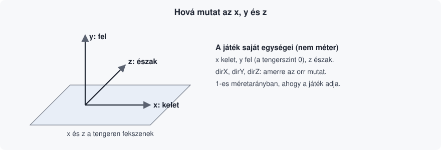

# A táblázat {#the-table}

Mintánként vagy eseményenként egy sor, a `<match>.parquet` fájlban: 31 oszlop
([Oszloplista](../columns.md), a kódból generálva).

| Oszlop | Mi |
|---|---|
| `match`, `map` | a csata azonosítója; a térkép (a képeken `spaces/99_testmap`) |
| `time` | másodpercek a felvétel kezdete óta (a visszaszámlálás is benne van) |
| `battleTime` | másodpercek a csata kezdete óta; negatív a visszaszámlálás alatt |
| `event` | mi a sor (lent) |
| `player`, `team`, `own` | a játékos neve; a felvevő játékos `ally` (szövetséges) vagy `enemy` (ellenség) csapata; `1` a felvevő játékos sorain |
| `vehicle`, `type` | a felvevő játékos hajója a nevével (`PASB018-Iowa-1944`), a többiek a játék hajószámával (`4253956080`), kivéve ha a `--ship-names` megnevezi őket; `battleship`, `cruiser`, `destroyer`, `aircraft carrier`, `submarine`, ahol a név elárulja, különben `ship` |
| `x`, `y`, `z` | a játék világegységei: x kelet, y fel (a tengerszint 0), z észak |
| `dirX`, `dirY`, `dirZ` | amerre az orr mutat, egységvektor ugyanabban a koordinátarendszerben (`dirY` 0: csak az irány); lövedéknél vagy torpedónál az útjuk iránya |
| `other`, `reason` | egy esemény másik hajója (gyilkos, áldozat, támadó); elsüllyedésnél a játék okának száma (nincs megnevezve), becsapódásnál a találattípus, chatnél a csatorna |
| `value`, `health` | az esemény száma (sebzés, lövedék vagy torpedó sebessége világegység/másodpercben); a hajó életereje egy találat után |
| `text` | egy chat-sor |
| `shot`, `params` | egy salvó azonosítója; a lövedék vagy torpedó típusa, a játék paraméterszámaként |
| `entity` | a hajó azonosítója a visszajátszásban |
| `otherVehicle`, `otherType` | hajón történő `impact`-nél: az a hajó és az osztálya |
| `hitLocalX`, `hitLocalY`, `hitLocalZ` | hajón történő `impact`-nél: hol ért véget a lövedék az adott hajó saját koordinátarendszerében, méterben (világegység szorozva 15-tel): x előre, y fel a tengerről, z jobbra |
| `pitch`, `roll` | egy pozíción a hajó dőlése és billenése (radián), ahogy a játék küldi: a hajó fordulóban dől |

| `event` | Melyik sor | Mi |
|---|---|---|
| `position` | minden hajó | amíg a kliens látta |
| `death`, `kill` | az áldozat, a gyilkos | minden elsüllyedés kétszer: ahol a hajó elsüllyedt, és ahol a gyilkosa volt |
| `hurt`, `damage` | az áldozat, a támadó | egy találat: `value` a sebzés, `health` ami maradt |
| `shot` | a lövő | soronként egy lövedék, az ágyúnál, abban az irányban, amerre repült |
| `torpedo` | a lövő | soronként egy torpedó, ahol kilőtték, abban az irányban, amerre futott |
| `impact` | a lövő | hol ért véget egy lövedék (találat, tévesztés a vízbe, ...); `reason` a találattípus száma; hajón (bármely típus, kivéve 0 víz, 8, 32, 64 szárazföld, egy hajó 6 egységén belül) `other`/`otherVehicle`/`otherType` a hajó, és `hitLocalX/Y/Z` a pont annak saját koordinátarendszerében (fent) |
| `chat` | a küldő | `text` a sor, `reason` a csatorna (`battle_team`, `battle_common`) |

**Egységek.** A világegység nem méter. Egy csatahajó nagy sebességgel másodpercenként körülbelül 2,4
egységet tesz meg, a térkép pedig körülbelül 1200 egység széles. A hajók hajótest-geometriájához mérve
egy egység 15 m; a játék saját hatótávolság-adatai szerint 30 m (landaire/wows-toolkit,
`crates/wows-core/src/units.rs`, MIT, amely a kettőt nem egyezteti). A táblázat a világegységeket
1-es méretaránnyal tartja meg, ahogy minden 3DHeat-forrás megtartja a játék saját egységeit, így az
ugyanabban az egységben exportált pálya egybeesik. A lábléc `heat3d` súgói: Y felfelé, Z megfordítva
(így a térkép nem tükröződik), egy hajó 12 egység hosszú, a `player` a személy, a `team` a csoport,
a `match` a munkamenet.

---

A [3DHeat](https://github.com/Holdi601/3DHeat) ([dokumentáció](https://holdi601.github.io/3DHeat/)) része. Forrás: [3DHeat-Ext-WoWs](https://github.com/Holdi601/3DHeat-Ext-WoWs).
