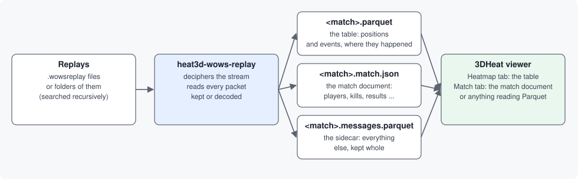

# 3DHeat World of Warships replays

World of Warships replays (`.wowsreplay`) into heatmap tables and match
summaries for the 3DHeat viewer - or anything that reads Parquet and JSON.
Every ship's position over time; every ship sunk, every hit and its damage,
every shell and torpedo fired and where shells ended, where it happened; ship
health, chat, and the recording player's own damage statistics.

This converter is kept outside the 3DHeat Watcher on purpose: the replays are
enciphered, and Wargaming's terms (below) are broad. If the converter ever has
to go, nothing else goes with it. The Watcher runs it as a command when it is
installed, and works without it.

**What it is useful for:** seeing a battle again from above, every
ship at once; heatmaps of where you and others drive, fight and die over
hundreds of battles; where shells and torpedoes came from and where they
ended; checking what a replay really holds, item by item. The output is plain
Parquet and JSON, so pandas, DuckDB or your own scripts read it as well as the
viewer does.



## Quick start

```bash
git clone https://github.com/Holdi601/3DHeat-Ext-WoWs.git
cd 3DHeat-Ext-WoWs
pip install -e .                              # installs the heat3d-wows-replay command
heat3d-wows-replay <replays or folders> -o out
```

Then open `out/<map>/<match>.parquet` and `<match>.match.json` in the
[3DHeat viewer](https://holdi601.github.io/3DHeat/).

## Part of 3DHeat

This converter is one of the tools of [3DHeat](https://github.com/Holdi601/3DHeat), a realtime 3D
telemetry and replay viewer for very large positional datasets
([documentation](https://holdi601.github.io/3DHeat/)). Its output opens in the viewer as it is: the table
in the Heatmap tab, the match document in the Match tab. How the viewer packs
a match's files into one `.3dheat` file is described in
[One file a match](https://holdi601.github.io/3DHeat/container.html); what every converter must keep in
[Converters keep everything](https://holdi601.github.io/3DHeat/converters.html).

- Source and issues: [3DHeat-Ext-WoWs](https://github.com/Holdi601/3DHeat-Ext-WoWs)
- This site: [https://holdi601.github.io/3DHeat-Ext-WoWs/](https://holdi601.github.io/3DHeat-Ext-WoWs/)

## This documentation

| Page | What it covers |
|---|---|
| [Installing](installing.md) | requirements, install, updates |
| [Converting replays](converting.md) | step by step, every option, exit status |
| [The table](table.md) | every column and event of `<match>.parquet` |
| [The match document](match-document.md) | `<match>.match.json` |
| [How it reads a replay](how-it-reads.md) | the format, and what was checked on real replays |
| [Completeness](completeness.md) | the sidecar and the self-check |
| [Terms and licence](terms.md) | Wargaming's terms, licence, sources |

---

Part of [3DHeat](https://github.com/Holdi601/3DHeat) ([documentation](https://holdi601.github.io/3DHeat/)). Source: [3DHeat-Ext-WoWs](https://github.com/Holdi601/3DHeat-Ext-WoWs).
