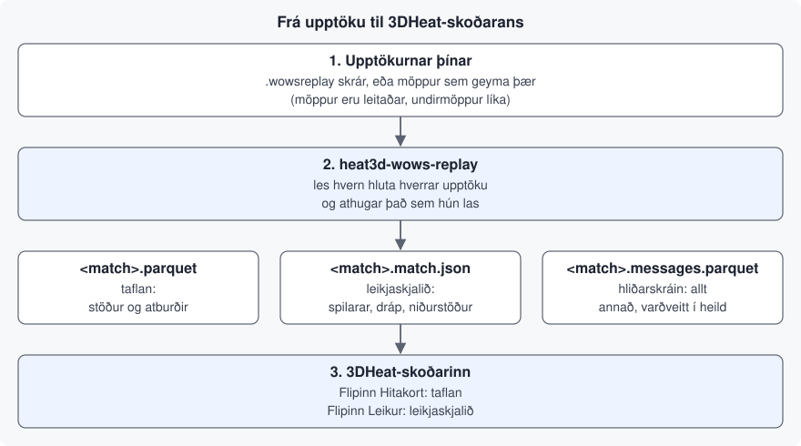

# 3DHeat World of Warships upptökur {#dheat-world-of-warships-replays}

**Hvað er þetta?** World of Warships getur vistað hvern bardaga sem þú spilar sem
upptökuskrá (replay). Þetta verkfæri breytir þessum skrám í töflu og leikjaskjal
(samantekt bardagans) sem
[3DHeat-skoðarinn](https://holdi601.github.io/3DHeat/) sýnir í 3D: hvert
skip sigldi, skaut og varð fyrir höggi.

**Hvers vegna ætti ég að nota það?** Til að horfa aftur á bardaga að ofan, öll
skip í einu; til að sjá hitakort af því hvar þú og aðrir siglið, berjist og
sökkvið í hundruðum bardaga; til að sjá hvert skeljar og tundurskeyti fóru; eða til að lesa upptöku með þínum eigin skriftum, þar
sem úttakið er venjulegt Parquet og JSON.

**Dæmi:** ein upptökuskrá inn, tafla og leikjaskjal út:



## Fljótleg byrjun {#quick-start}

Nýr í skipanalínunni? Lestu fyrst [Áður en þú byrjar](before-you-start.md).

```bash
git clone https://github.com/Holdi601/3DHeat-Ext-WoWs.git
cd 3DHeat-Ext-WoWs
pip install -e .
heat3d-wows-replay "<World of Warships>/replays" -o out
```

Þú ættir að sjá eina línu fyrir hverja upptöku, sem endar á skránni sem var skrifuð:
`... -> out/<map>/<match>.parquet`. Opnaðu þá skrá og
`<match>.match.json` við hlið hennar í 3DHeat-skoðaranum.

## Þessi skjölun {#this-documentation}

| Síða | Hvað hún fjallar um |
|---|---|
| [Áður en þú byrjar](before-you-start.md) | Python, skipanaglugga og hvernig árangur lítur út |
| [Uppsetning](installing.md) | uppsetning, athugun, uppfærslur |
| [Upptökum breytt](converting.md) | skref fyrir skref, allir valkostir, skilaboð, útgöngustaða |
| [Taflan](table.md) | hver dálkur og atburður í `<match>.parquet` |
| [Leikjaskjalið](match-document.md) | hver lykill í `<match>.match.json` |
| [Hvernig upptaka er lesin](how-it-reads.md) | sniðið, og hvernig lesturinn var athugaður |
| [Heilleiki](completeness.md) | hliðarskráin og sjálfsathugunin |
| [Skilmálar og leyfi](terms.md) | skilmálar Wargaming, leyfi, heimildir |
| [Skipanayfirlit](../cli-reference.md), [Dálkalisti](../columns.md) | búið til úr kóðanum |

## Hluti af 3DHeat {#part-of-3dheat}

Þessi breytir er eitt af verkfærum [3DHeat](https://github.com/Holdi601/3DHeat),
rauntíma 3D-skoðara fyrir mælingar og upptökur ([skjölun](https://holdi601.github.io/3DHeat/)).
Skoðarinn opnar töfluna í flipanum Hitakort og leikjaskjalið í flipanum
Leikur. Hann getur pakkað skrám leiks í eina skrá:
[Ein skrá á leik](https://holdi601.github.io/3DHeat/container.html). Það sem hver
breytir verður að varðveita: [Breytar varðveita allt](https://holdi601.github.io/3DHeat/converters.html).

Breytirinn er viljandi hafður aðskilinn frá 3DHeat Watcher: upptökurnar
eru dulkóðaðar og skilmálar Wargaming eru víðtækir ([Skilmálar og leyfi](terms.md)).
Ef hann þarf einhvern tíma að fara, fer ekkert annað með honum. Watcher keyrir hann þegar
hann er uppsettur og virkar án hans.

| Verkfæri | Hvað það gerir | Frumkóði | Skjölun |
|---|---|---|---|
| 3DHeat-skoðari | sýnir gögnin í 3D: hitakort, upptökur, kappakstursgreiningu | [3DHeat](https://github.com/Holdi601/3DHeat) | [vefur](https://holdi601.github.io/3DHeat/) |
| GameFiles | brautir og borð úr skrám sem leikir fylgja með | [3DHeat-GameFiles](https://github.com/Holdi601/3DHeat-GameFiles) | [vefur](https://holdi601.github.io/3DHeat-GameFiles/) |
| GameCapture | hringmælingar og borð endurbyggð úr leikmyndbandi | [3DHeat-GameCapture](https://github.com/Holdi601/3DHeat-GameCapture) | [vefur](https://holdi601.github.io/3DHeat-GameCapture/) |
| Unreal Exporter | Unreal Editor viðbót sem flytur út borð | [3DHeat-UnrealExporter](https://github.com/Holdi601/3DHeat-UnrealExporter) | [vefur](https://holdi601.github.io/3DHeat-UnrealExporter/) |
| CS2 | Counter-Strike 2 upptökur og kort | [3DHeat-CS2](https://github.com/Holdi601/3DHeat-CS2) | [vefur](https://holdi601.github.io/3DHeat-CS2/) |
| Watcher | skráir það sem leikir birta meðan þú spilar | [3DHeat-Watcher](https://github.com/Holdi601/3DHeat-Watcher) | [vefur](https://holdi601.github.io/3DHeat-Watcher/) |
| War Thunder upptökur | `.wrpl` upptökur og War Thunder borð | [3DHeat-Ext-WarThunder](https://github.com/Holdi601/3DHeat-Ext-WarThunder) | [vefur](https://holdi601.github.io/3DHeat-Ext-WarThunder/) |
| World of Tanks upptökur | `.wotreplay` upptökur | [3DHeat-Ext-WoT](https://github.com/Holdi601/3DHeat-Ext-WoT) | [vefur](https://holdi601.github.io/3DHeat-Ext-WoT/) |
| World of Warships upptökur | `.wowsreplay` upptökur | [3DHeat-Ext-WoWs](https://github.com/Holdi601/3DHeat-Ext-WoWs) | [vefur](https://holdi601.github.io/3DHeat-Ext-WoWs/) |
| Squad upptökur | Squad þjónustuupptökur | [3DHeat-Ext-Squad](https://github.com/Holdi601/3DHeat-Ext-Squad) | [vefur](https://holdi601.github.io/3DHeat-Ext-Squad/) |
| DCS kort | DCS World kort sem 3D-borð | [3DHeat-Ext-DCS](https://github.com/Holdi601/3DHeat-Ext-DCS) | [vefur](https://holdi601.github.io/3DHeat-Ext-DCS/) |
| IL-2 kort | IL-2 Great Battles kort sem 3D-borð | [3DHeat-Ext-IL2](https://github.com/Holdi601/3DHeat-Ext-IL2) | [vefur](https://holdi601.github.io/3DHeat-Ext-IL2/) |

---

Frumkóði: [3DHeat-Ext-WoWs](https://github.com/Holdi601/3DHeat-Ext-WoWs).
