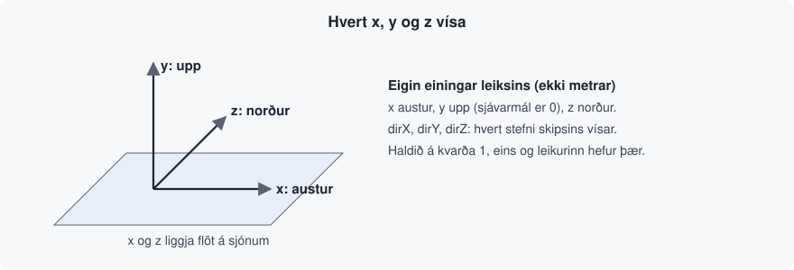

# Taflan {#the-table}

Ein röð fyrir hvert sýni eða atburð, í `<match>.parquet`: 31 dálkur
([Dálkalisti](../columns.md), búinn til úr kóðanum).

| Dálkur | Hvað |
|---|---|
| `match`, `map` | auðkenni bardagans; kortið (`spaces/99_testmap` á myndunum) |
| `time` | sekúndur frá því upptakan hófst (niðurtalningin er með) |
| `battleTime` | sekúndur frá því bardaginn hófst; neikvætt meðan á niðurtalningu stendur |
| `event` | hvað röðin er (að neðan) |
| `player`, `team`, `own` | nafn spilarans; `ally` eða `enemy` miðað við upptökumanninn; `1` á röðum upptökumannsins |
| `vehicle`, `type` | skip upptökumannsins með nafni (`PASB018-Iowa-1944`), hin með skipanúmeri leiksins (`4253956080`) nema `--ship-names` nefni þau; `battleship`, `cruiser`, `destroyer`, `aircraft carrier`, `submarine` þar sem nafnið segir til um, annars `ship` |
| `x`, `y`, `z` | heimseiningar leiksins: x austur, y upp (sjávarmál 0), z norður |
| `dirX`, `dirY`, `dirZ` | hvert stefni skipsins vísar, einingarvigur í sama ramma (`dirY` 0: aðeins stefna); á skel eða tundurskeyti leiðin sem það fór |
| `other`, `reason` | hitt skipið í atburði (drápsmaður, fórnarlamb, árásarmaður); orsakanúmer leiksins fyrir sökkvun (ekki nefnt), högggerðin fyrir högg, rásin fyrir spjall |
| `value`, `health` | tala atburðarins (skaði, hraði skeljar eða tundurskeytis í heimseiningum á sekúndu); heilsa skipsins eftir högg |
| `text` | spjalllína |
| `shot`, `params` | auðkenni skothríðar (salvo); gerð skeljarinnar eða tundurskeytisins, sem breytunúmer leiksins |
| `entity` | auðkenni skipsins í upptökunni |
| `otherVehicle`, `otherType` | á `impact` á skip: það skip og flokkur þess |
| `hitLocalX`, `hitLocalY`, `hitLocalZ` | á `impact` á skip: hvar skelin endaði í eigin ramma þess skips, í metrum (heimseiningar sinnum 15): x fram, y upp frá sjó, z hægri |
| `pitch`, `roll` | á stöðu, pitch og roll skipsins (radíanar) eins og leikurinn sendir þau: skip hallast í beygju |

| `event` | Á röð hjá | Hvað |
|---|---|---|
| `position` | hverju skipi | meðan biðlarinn sá það |
| `death`, `kill` | fórnarlambinu, drápsmanninum | hver sökkvun tvisvar: þar sem skipið sökk, og þar sem drápsmaður þess var |
| `hurt`, `damage` | fórnarlambinu, árásarmanninum | högg: `value` skaðinn, `health` það sem er eftir |
| `shot` | skyttunni | ein röð fyrir hverja skel, við byssuna, í þá átt sem hún flaug |
| `torpedo` | skyttunni | ein röð fyrir hvert tundurskeyti, þar sem því var skotið, í þá átt sem það fór |
| `impact` | skyttunni | hvar skel endaði (hitti, geigaði í vatnið, ...); `reason` númer högggerðar; á skip (hvaða gerð sem er nema 0 vatn, 8, 32, 64 land, innan 6 eininga frá skipi) `other`/`otherVehicle`/`otherType` skipið og `hitLocalX/Y/Z` punkturinn í ramma þess (að ofan) |
| `chat` | sendandanum | `text` línan, `reason` rásin (`battle_team`, `battle_common`) |

**Einingar.** Heimseining er ekki metri. Orrustuskip á hraða fer um 2,4
þeirra á sekúndu, og kort er um 1.200 á breidd. Borið saman við
skrokkgeómetríu skipanna er eining 15 m; eigin drægitölur leiksins gera hana 30 m
(landaire/wows-toolkit, `crates/wows-core/src/units.rs`, MIT, sem skilur þetta
tvennt eftir ósamræmt). Taflan heldur heimseiningum á kvarða 1, eins og hver 3DHeat
uppspretta heldur eigin einingum leiks síns, svo borð sem er flutt út í sömu einingum
passar. `heat3d` ábendingar fótarins: Y upp, Z snúið við (svo kortið er ekki
spegilmynd), skip 12 einingar á lengd, `player` sem manneskjan, `team` sem hópurinn,
`match` sem lotan (session).

---

Hluti af [3DHeat](https://github.com/Holdi601/3DHeat) ([skjölun](https://holdi601.github.io/3DHeat/)). Frumkóði: [3DHeat-Ext-WoWs](https://github.com/Holdi601/3DHeat-Ext-WoWs).
