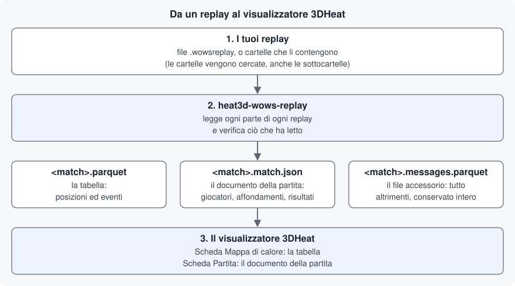

# Replay di World of Warships per 3DHeat {#dheat-world-of-warships-replays}

**Cos'è?** World of Warships può salvare ogni battaglia che giochi come file di replay. Questo strumento
trasforma quei file in una tabella e in un documento della partita (il riepilogo della battaglia) che il
[visualizzatore 3DHeat](https://holdi601.github.io/3DHeat/) mostra in 3D: dove ogni nave
ha navigato, ha sparato e ha subito colpi.

**Perché usarlo?** Per rivedere una battaglia dall'alto, tutte le navi insieme; per vedere le mappe di calore di dove tu navighi, combatti e affondi in
centinaia di battaglie; per vedere dove sono finiti proiettili e siluri; oppure per leggere un replay con i tuoi script, dato che il risultato è Parquet e JSON semplici.

**Esempio:** un file di replay in entrata, una tabella e un documento della partita in uscita:



## Avvio rapido {#quick-start}

Non hai mai usato la riga di comando? Leggi prima [Prima di iniziare](before-you-start.md).

```bash
git clone https://github.com/Holdi601/3DHeat-Ext-WoWs.git
cd 3DHeat-Ext-WoWs
pip install -e .
heat3d-wows-replay "<World of Warships>/replays" -o out
```

Dovresti vedere una riga per replay, che finisce con il file scritto:
`... -> out/<map>/<match>.parquet`. Apri quel file e il
`<match>.match.json` accanto ad esso nel visualizzatore 3DHeat.

## Questa documentazione {#this-documentation}

| Pagina | Cosa contiene |
|---|---|
| [Prima di iniziare](before-you-start.md) | Python, un terminale, e come si presenta il successo |
| [Installazione](installing.md) | installazione, verifica, aggiornamenti |
| [Conversione dei replay](converting.md) | passo dopo passo, ogni opzione, messaggi, stato di uscita |
| [La tabella](table.md) | ogni colonna ed evento di `<match>.parquet` |
| [Il documento della partita](match-document.md) | ogni chiave di `<match>.match.json` |
| [Come legge un replay](how-it-reads.md) | il formato, e come è stata verificata la lettura |
| [Completezza](completeness.md) | il file accessorio e l'autocontrollo |
| [Condizioni e licenza](terms.md) | condizioni, licenza e fonti di Wargaming |
| [Riferimento dei comandi](../cli-reference.md), [Elenco delle colonne](../columns.md) | generati dal codice |

## Parte di 3DHeat {#part-of-3dheat}

Questo convertitore è uno degli strumenti di [3DHeat](https://github.com/Holdi601/3DHeat),
un visualizzatore 3D in tempo reale di telemetria e replay ([documentazione](https://holdi601.github.io/3DHeat/)).
Il visualizzatore apre la tabella nella sua scheda Mappa di calore e il documento della partita nella
sua scheda Partita. Può raccogliere i file di una partita in un unico file:
[Un file per partita](https://holdi601.github.io/3DHeat/container.html). Ciò che ogni
convertitore deve conservare: [I convertitori conservano tutto](https://holdi601.github.io/3DHeat/converters.html).

Il convertitore è tenuto separato dal Watcher di 3DHeat di proposito: i replay
sono cifrati, e le condizioni di Wargaming sono ampie ([Condizioni e licenza](terms.md)).
Se dovesse essere tolto, non se ne va nient'altro con lui. Il Watcher lo esegue quando
è installato e funziona senza di esso.

| Strumento | Cosa fa | Sorgente | Documentazione |
|---|---|---|---|
| Visualizzatore 3DHeat | mostra i dati in 3D: mappe di calore, replay, analisi di gara | [3DHeat](https://github.com/Holdi601/3DHeat) | [sito](https://holdi601.github.io/3DHeat/) |
| GameFiles | percorsi e livelli dai file che i giochi distribuiscono | [3DHeat-GameFiles](https://github.com/Holdi601/3DHeat-GameFiles) | [sito](https://holdi601.github.io/3DHeat-GameFiles/) |
| GameCapture | telemetria dei giri, e livelli ricostruiti dal video di gioco | [3DHeat-GameCapture](https://github.com/Holdi601/3DHeat-GameCapture) | [sito](https://holdi601.github.io/3DHeat-GameCapture/) |
| Unreal Exporter | un plugin per l'Unreal Editor che esporta un livello | [3DHeat-UnrealExporter](https://github.com/Holdi601/3DHeat-UnrealExporter) | [sito](https://holdi601.github.io/3DHeat-UnrealExporter/) |
| CS2 | demo e mappe di Counter-Strike 2 | [3DHeat-CS2](https://github.com/Holdi601/3DHeat-CS2) | [sito](https://holdi601.github.io/3DHeat-CS2/) |
| Watcher | registra ciò che i giochi pubblicano mentre giochi | [3DHeat-Watcher](https://github.com/Holdi601/3DHeat-Watcher) | [sito](https://holdi601.github.io/3DHeat-Watcher/) |
| Replay di War Thunder | replay `.wrpl` e livelli di War Thunder | [3DHeat-Ext-WarThunder](https://github.com/Holdi601/3DHeat-Ext-WarThunder) | [sito](https://holdi601.github.io/3DHeat-Ext-WarThunder/) |
| Replay di World of Tanks | replay `.wotreplay` | [3DHeat-Ext-WoT](https://github.com/Holdi601/3DHeat-Ext-WoT) | [sito](https://holdi601.github.io/3DHeat-Ext-WoT/) |
| Replay di World of Warships | replay `.wowsreplay` | [3DHeat-Ext-WoWs](https://github.com/Holdi601/3DHeat-Ext-WoWs) | [sito](https://holdi601.github.io/3DHeat-Ext-WoWs/) |
| Demo di Squad | demo dei server di Squad | [3DHeat-Ext-Squad](https://github.com/Holdi601/3DHeat-Ext-Squad) | [sito](https://holdi601.github.io/3DHeat-Ext-Squad/) |
| Mappe DCS | mappe di DCS World come livelli 3D | [3DHeat-Ext-DCS](https://github.com/Holdi601/3DHeat-Ext-DCS) | [sito](https://holdi601.github.io/3DHeat-Ext-DCS/) |
| Mappe IL-2 | mappe di IL-2 Great Battles come livelli 3D | [3DHeat-Ext-IL2](https://github.com/Holdi601/3DHeat-Ext-IL2) | [sito](https://holdi601.github.io/3DHeat-Ext-IL2/) |
| Mappa di Dota 2 | la mappa di Dota 2 dalla tua installazione come livello 3D | [3DHeat-Ext-Dota](https://github.com/Holdi601/3DHeat-Ext-Dota) | [sito](https://holdi601.github.io/3DHeat-Ext-Dota/) |
| Replay di Dota 2 | replay di Dota 2 | [3DHeat-Ext-DotaReplay](https://github.com/Holdi601/3DHeat-Ext-DotaReplay) | [sito](https://holdi601.github.io/3DHeat-Ext-DotaReplay/) |
| Replay di Riot | replay di League of Legends e VALORANT (ciò che contengono senza cifratura) | [3DHeat-Ext-Riot](https://github.com/Holdi601/3DHeat-Ext-Riot) | [sito](https://holdi601.github.io/3DHeat-Ext-Riot/) |
| Mappe di Forza | percorsi, gare e auto di Forza dalla tua installazione | [3DHeat-Ext-Forza](https://github.com/Holdi601/3DHeat-Ext-Forza) | [sito](https://holdi601.github.io/3DHeat-Ext-Forza/) |
| Mappe di Battlefield | livelli di Battlefield (Frostbite) come livelli 3D | [3DHeat-Ext-Battlefield](https://github.com/Holdi601/3DHeat-Ext-Battlefield) | [sito](https://holdi601.github.io/3DHeat-Ext-Battlefield/) |
| Mappe di BeamNG | percorsi di BeamNG.drive | [3DHeat-Ext-BeamNG](https://github.com/Holdi601/3DHeat-Ext-BeamNG) | [sito](https://holdi601.github.io/3DHeat-Ext-BeamNG/) |
| Mappe di AC Rally | tappe di Assetto Corsa Rally come percorsi | [3DHeat-Ext-ACRally](https://github.com/Holdi601/3DHeat-Ext-ACRally) | [sito](https://holdi601.github.io/3DHeat-Ext-ACRally/) |
| Mappe di Reforger | mondi di Arma Reforger (Enfusion) come livelli 3D | [3DHeat-Ext-Reforger](https://github.com/Holdi601/3DHeat-Ext-Reforger) | [sito](https://holdi601.github.io/3DHeat-Ext-Reforger/) |
| Replay di R6 | replay di partite di Rainbow Six Siege | [3DHeat-Ext-R6](https://github.com/Holdi601/3DHeat-Ext-R6) | [sito](https://holdi601.github.io/3DHeat-Ext-R6/) |

---

Fonte: [3DHeat-Ext-WoWs](https://github.com/Holdi601/3DHeat-Ext-WoWs).
