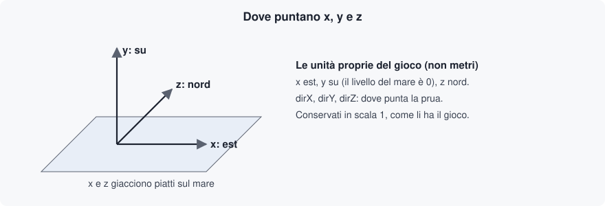

# La tabella {#the-table}

Una riga per campione o evento, in `<match>.parquet`: 31 colonne
([Elenco delle colonne](../columns.md), generato dal codice).

| Colonna | Cosa |
|---|---|
| `match`, `map` | l'id della battaglia; la mappa (`spaces/99_testmap` nelle immagini) |
| `time` | secondi da quando è iniziata la registrazione (il conto alla rovescia è incluso) |
| `battleTime` | secondi da quando è iniziata la battaglia; negativi durante il conto alla rovescia |
| `event` | che cosa è la riga (sotto) |
| `player`, `team`, `own` | il nome del giocatore; `ally` o `enemy` rispetto al giocatore che registra; `1` sulle righe del giocatore che registra |
| `vehicle`, `type` | la nave del giocatore che registra per nome (`PASB018-Iowa-1944`), le altre per numero di nave del gioco (`4253956080`) a meno che `--ship-names` non le nomini; `battleship`, `cruiser`, `destroyer`, `aircraft carrier`, `submarine` dove il nome lo dice, altrimenti `ship` |
| `x`, `y`, `z` | le unità del mondo del gioco: x est, y su (livello del mare 0), z nord |
| `dirX`, `dirY`, `dirZ` | dove punta la prua, un vettore unitario nello stesso sistema (`dirY` 0: solo rilevamento); su un proiettile o un siluro, la direzione in cui sono andati |
| `other`, `reason` | l'altra nave di un evento (assassino, vittima, attaccante); il numero di causa del gioco per un affondamento (non nominato), il tipo di colpo per un impatto, il canale per la chat |
| `value`, `health` | il numero dell'evento (danno, velocità di un proiettile o siluro in unità del mondo al secondo); la salute della nave dopo un colpo |
| `text` | una riga di chat |
| `shot`, `params` | l'id di una salva; il tipo del proiettile o del siluro, come numero di parametro del gioco |
| `entity` | l'id della nave nel replay |
| `otherVehicle`, `otherType` | su un `impact` su una nave: quella nave e la sua classe |
| `hitLocalX`, `hitLocalY`, `hitLocalZ` | su un `impact` su una nave: dove il proiettile è finito nel sistema di quella nave, in metri (unità del mondo per 15): x avanti, y su dal mare, z destra |
| `pitch`, `roll` | su una posizione, il beccheggio e il rollio della nave (radianti) come li invia il gioco: una nave si inclina in virata |

| Evento | Sulla riga di | Cosa |
|---|---|---|
| `position` | ogni nave | mentre il client la vedeva |
| `death`, `kill` | la vittima, l'assassino | ogni affondamento due volte: dove la nave è affondata, e dove si trovava il suo assassino |
| `hurt`, `damage` | la vittima, l'attaccante | un colpo: `value` il danno, `health` ciò che resta |
| `shot` | il tiratore | una riga per proiettile, al cannone, nella direzione in cui è volato |
| `torpedo` | il tiratore | una riga per siluro, dove è stato lanciato, nella direzione in cui ha corso |
| `impact` | il tiratore | dove è finito un proiettile (colpo, caduta in acqua, ...); `reason` il numero del tipo di colpo; su una nave (qualsiasi tipo tranne 0 acqua, 8, 32, 64 terra, entro 6 unità da una nave) `other`/`otherVehicle`/`otherType` la nave e `hitLocalX/Y/Z` il punto nel suo sistema (sopra) |
| `chat` | il mittente | `text` la riga, `reason` il canale (`battle_team`, `battle_common`) |

**Unità.** Un'unità del mondo non è un metro. Una corazzata a velocità percorre circa 2,4
di esse al secondo, e una mappa è larga circa 1.200. Confrontata con la geometria degli scafi delle navi, un'unità vale 15 m; le cifre di gittata proprie del gioco la fanno valere 30 m
(landaire/wows-toolkit, `crates/wows-core/src/units.rs`, MIT, che lascia le
due non conciliate). La tabella conserva le unità del mondo in scala 1, come ogni fonte 3DHeat
conserva le unità proprie del suo gioco, così un livello esportato nelle stesse unità
combacia. I suggerimenti del piè di pagina `heat3d`: Y in alto, Z capovolta (così la mappa non è
specchiata), una nave lunga 12 unità, `player` come persona, `team` come gruppo,
`match` come sessione.

---

Parte di [3DHeat](https://github.com/Holdi601/3DHeat) ([documentazione](https://holdi601.github.io/3DHeat/)). Fonte: [3DHeat-Ext-WoWs](https://github.com/Holdi601/3DHeat-Ext-WoWs).
