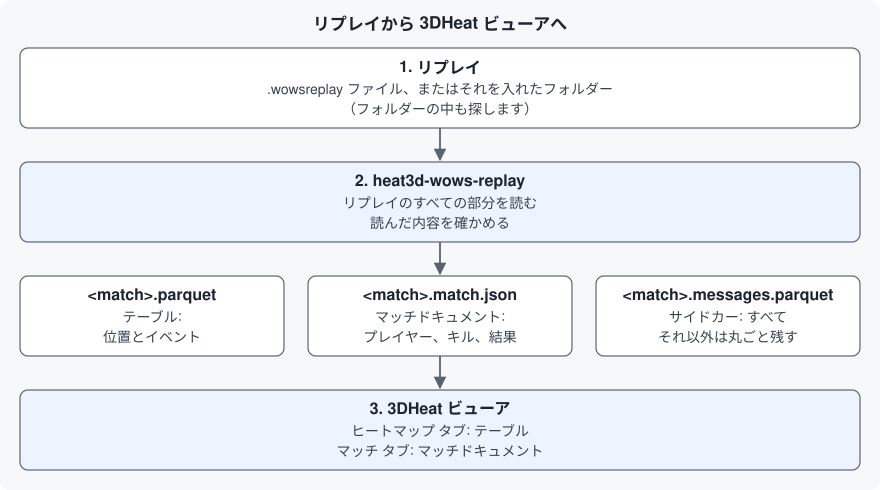

# 3DHeat World of Warships リプレイ {#dheat-world-of-warships-replays}

**これは何？** World of Warships は、プレイしたすべての戦闘をリプレイファイルとして保存できます。このツールは
そのファイルを、テーブルとマッチドキュメント（戦闘の要約）に変えます。これを
[3DHeat ビューア](https://holdi601.github.io/3DHeat/) で 3D に表示すると、すべての艦船がどこを航行し、
どこで撃ち、どこで撃たれたかがわかります。

**なぜ使うの？** 戦闘を上からもう一度見るため。すべての艦船を同時に見るため。何百もの戦闘で、
あなたや他の人が航行し、戦い、沈んだ場所のヒートマップを見るため。砲弾と魚雷がどこへ行ったかを見るため。
出力は普通の Parquet と JSON なので、自分のスクリプトでリプレイを読むこともできます。

**例:** リプレイのファイルを 1 つ入れると、テーブルとマッチドキュメントが出てきます:



## かんたんな始め方 {#quick-start}

コマンドラインは初めてですか？ まず [始める前に](before-you-start.md) を読んでください。

```bash
git clone https://github.com/Holdi601/3DHeat-Ext-WoWs.git
cd 3DHeat-Ext-WoWs
pip install -e .
heat3d-wows-replay "<World of Warships>/replays" -o out
```

リプレイ 1 つにつき 1 行が表示され、書き込んだファイルで終わります:
`... -> out/<map>/<match>.parquet`。そのファイルと、その隣の `<match>.match.json` を 3DHeat ビューアで開いてください。

## このドキュメントの内容 {#this-documentation}

| ページ | 内容 |
|---|---|
| [始める前に](before-you-start.md) | Python、ターミナル、成功したときの見え方 |
| [インストール](installing.md) | インストール、確認、更新 |
| [リプレイの変換](converting.md) | 手順ごとに、すべてのオプション、メッセージ、終了ステータス |
| [テーブル](table.md) | `<match>.parquet` のすべての列とイベント |
| [マッチドキュメント](match-document.md) | `<match>.match.json` のすべてのキー |
| [リプレイの読み取り方](how-it-reads.md) | フォーマットと、読み取りをどう確かめたか |
| [完全性](completeness.md) | サイドカーと自己チェック |
| [用語とライセンス](terms.md) | Wargaming の規約、ライセンス、出典 |
| [コマンドリファレンス](../cli-reference.md)、[列の一覧](../columns.md) | コードから生成 |

## 3DHeat の一部として {#part-of-3dheat}

この変換ツールは [3DHeat](https://github.com/Holdi601/3DHeat) の道具の 1 つです。3DHeat は、リアルタイムの 3D テレメトリとリプレイのビューアです（[ドキュメント](https://holdi601.github.io/3DHeat/)）。ビューアは、テーブルを ヒートマップ タブで、マッチドキュメントを マッチ タブで開きます。1 つの戦闘のファイルを 1 つにまとめることもできます: [1 マッチを 1 ファイルに](https://holdi601.github.io/3DHeat/container.html)。どの変換ツールも残さなければならないもの: [変換ツールはすべてを残す](https://holdi601.github.io/3DHeat/converters.html)。

この変換ツールは、3DHeat Watcher とは意図的に分けてあります。リプレイは暗号化されており、Wargaming の規約は広い範囲に及ぶからです（[用語とライセンス](terms.md)）。もし取り除く必要が出ても、ほかに何も一緒に取り除く必要はありません。Watcher は、インストールされていればこれを実行し、なくても動きます。

| ツール | 内容 | ソース | ドキュメント |
|---|---|---|---|
| 3DHeat ビューア | データを 3D で表示: ヒートマップ、リプレイ、レース分析 | [3DHeat](https://github.com/Holdi601/3DHeat) | [サイト](https://holdi601.github.io/3DHeat/) |
| GameFiles | ゲーム自身のファイルからのレベルとコース | [3DHeat-GameFiles](https://github.com/Holdi601/3DHeat-GameFiles) | [サイト](https://holdi601.github.io/3DHeat-GameFiles/) |
| GameCapture | ラップのテレメトリ、ゲームプレイ動画から組み直したレベル | [3DHeat-GameCapture](https://github.com/Holdi601/3DHeat-GameCapture) | [サイト](https://holdi601.github.io/3DHeat-GameCapture/) |
| Unreal Exporter | レベルを書き出す Unreal Editor プラグイン | [3DHeat-UnrealExporter](https://github.com/Holdi601/3DHeat-UnrealExporter) | [サイト](https://holdi601.github.io/3DHeat-UnrealExporter/) |
| CS2 | Counter-Strike 2 のデモとマップ | [3DHeat-CS2](https://github.com/Holdi601/3DHeat-CS2) | [サイト](https://holdi601.github.io/3DHeat-CS2/) |
| Watcher | プレイ中にゲームが公開する情報を記録 | [3DHeat-Watcher](https://github.com/Holdi601/3DHeat-Watcher) | [サイト](https://holdi601.github.io/3DHeat-Watcher/) |
| War Thunder リプレイ | `.wrpl` リプレイと War Thunder のレベル | [3DHeat-Ext-WarThunder](https://github.com/Holdi601/3DHeat-Ext-WarThunder) | [サイト](https://holdi601.github.io/3DHeat-Ext-WarThunder/) |
| World of Tanks リプレイ | `.wotreplay` リプレイ | [3DHeat-Ext-WoT](https://github.com/Holdi601/3DHeat-Ext-WoT) | [サイト](https://holdi601.github.io/3DHeat-Ext-WoT/) |
| World of Warships リプレイ | `.wowsreplay` リプレイ | [3DHeat-Ext-WoWs](https://github.com/Holdi601/3DHeat-Ext-WoWs) | [サイト](https://holdi601.github.io/3DHeat-Ext-WoWs/) |
| Squad デモ | Squad のサーバーデモ | [3DHeat-Ext-Squad](https://github.com/Holdi601/3DHeat-Ext-Squad) | [サイト](https://holdi601.github.io/3DHeat-Ext-Squad/) |
| DCS マップ | DCS World のマップを 3D レベルに | [3DHeat-Ext-DCS](https://github.com/Holdi601/3DHeat-Ext-DCS) | [サイト](https://holdi601.github.io/3DHeat-Ext-DCS/) |
| IL-2 マップ | IL-2 Great Battles のマップを 3D レベルに | [3DHeat-Ext-IL2](https://github.com/Holdi601/3DHeat-Ext-IL2) | [サイト](https://holdi601.github.io/3DHeat-Ext-IL2/) |

---

ソース: [3DHeat-Ext-WoWs](https://github.com/Holdi601/3DHeat-Ext-WoWs)。
