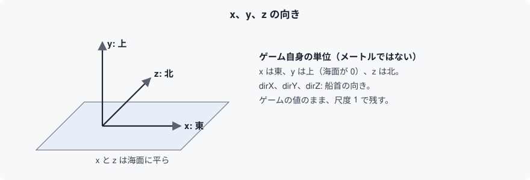

# テーブル {#the-table}

`<match>.parquet` には、サンプルまたはイベント 1 行につき 1 行が入ります: 31 列（[列の一覧](../columns.md)、コードから生成）。

| 列 | 内容 |
|---|---|
| `match`、`map` | 戦闘の ID。マップ（図では `spaces/99_testmap`） |
| `time` | 録画の開始からの秒数（カウントダウンも含む） |
| `battleTime` | 戦闘の開始からの秒数。カウントダウンの間は負の値 |
| `event` | その行が何か（下を参照） |
| `player`、`team`、`own` | プレイヤーの名前。録画しているプレイヤーから見て `ally`（味方）か `enemy`（敵）。録画しているプレイヤーの行では `1` |
| `vehicle`、`type` | 録画しているプレイヤーの艦船は名前（`PASB018-Iowa-1944`）。ほかは、`--ship-names` が名前を付けない限り、ゲームの艦船の番号（`4253956080`）。名前がそれを示す場合は `battleship`、`cruiser`、`destroyer`、`aircraft carrier`、`submarine`、それ以外は `ship` |
| `x`、`y`、`z` | ゲームのワールド単位: x は東、y は上（海面が 0）、z は北 |
| `dirX`、`dirY`、`dirZ` | 船首が向いている方向。同じ座標系の単位ベクトル（`dirY` が 0 の場合は方位だけ）。砲弾または魚雷では、それが進んだ方向 |
| `other`、`reason` | イベントのもう一方の艦船（キラー、犠牲者、攻撃者）。撃沈の場合はゲームの原因の番号（名前は付けない）、着弾の場合は命中の種類、チャットの場合はチャンネル |
| `value`、`health` | イベントの数（ダメージ、砲弾または魚雷の速さ。ワールド単位の毎秒）。命中の後の、その艦船の体力 |
| `text` | チャットの行 |
| `shot`、`params` | 一斉射撃の ID。砲弾または魚雷の種類。ゲームのパラメーターの番号 |
| `entity` | リプレイ内の艦船の ID |
| `otherVehicle`、`otherType` | 艦船への `impact` の場合: その艦船とその種別 |
| `hitLocalX`、`hitLocalY`、`hitLocalZ` | 艦船への `impact` の場合: その艦船自身の座標系での、砲弾の終点（メートル。ワールド単位に 15 を掛けたもの）。x は前、y は海面から上、z は右 |
| `pitch`、`roll` | 位置の行では、ゲームが送るとおりの艦船のピッチとロール（ラジアン）。艦船は旋回で傾きます |

| `event` | その行の対象 | 内容 |
|---|---|---|
| `position` | すべての艦船 | クライアントがそれを見ている間 |
| `death`、`kill` | 犠牲者、キラー | 撃沈ごとに 2 回: その艦船が沈んだ場所と、そのキラーがいた場所 |
| `hurt`、`damage` | 犠牲者、攻撃者 | 命中: `value` はダメージ、`health` は残り |
| `shot` | 射手 | 砲弾 1 発につき 1 行。砲で、それが飛んだ方向に |
| `torpedo` | 射手 | 魚雷 1 本につき 1 行。発射された場所で、それが走った方向に |
| `impact` | 射手 | 砲弾の終点（命中、水への外れ、...）。`reason` は命中の種類の番号。艦船の上（種類が 0 の水、8、32、64 の陸地以外で、艦船から 6 単位以内）の場合は、`other`/`otherVehicle`/`otherType` がその艦船、`hitLocalX/Y/Z` がその座標系での点（上を参照） |
| `chat` | 送信者 | `text` はその行、`reason` はチャンネル（`battle_team`、`battle_common`） |

**単位。** ワールド単位はメートルではありません。速度を出した戦艦は 1 秒に約 2.4 単位進み、マップは端から端まで約 1,200 あります。艦船の船体の形状と照らし合わせると、1 単位は 15 m です。ゲーム自身の射程の数値では 30 m になります（landaire/wows-toolkit、`crates/wows-core/src/units.rs`、MIT。この 2 つは一致させていません）。テーブルは、すべての 3DHeat のソースがゲーム自身の単位を保つのと同じく、ワールド単位を尺度 1 のまま保ちます。そのため、同じ単位で書き出されたレベルは、ぴったり合います。フッターの `heat3d` のヒント: y が上、z は反転（マップが鏡像にならないように）、長さ 12 単位の艦船、`player` は人、`team` はグループ、`match` はセッション。

---

[3DHeat](https://github.com/Holdi601/3DHeat)（[ドキュメント](https://holdi601.github.io/3DHeat/)）の一部です。ソース: [3DHeat-Ext-WoWs](https://github.com/Holdi601/3DHeat-Ext-WoWs)。
