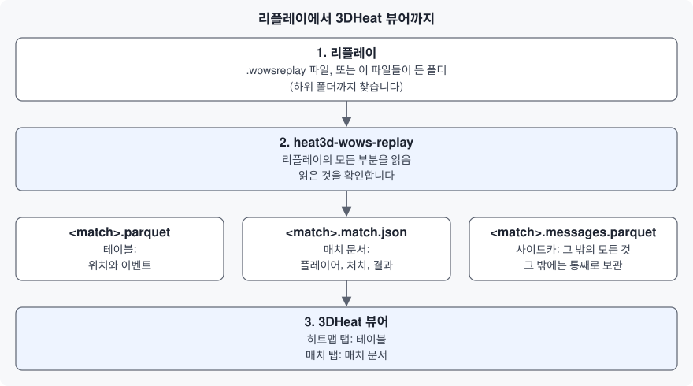

# 3DHeat 월드 오브 워십 리플레이 {#dheat-world-of-warships-replays}

**무엇입니까?** 월드 오브 워십은 여러분이 하는 전투를 모두 리플레이 파일로 저장할 수 있습니다. 이 도구는 그 파일을 표(테이블)와 매치 문서(전투 요약)로 바꿉니다. [3DHeat 뷰어](https://holdi601.github.io/3DHeat/)가 이것을 3D로 보여 줍니다. 모든 함선이 어디로 항해하고, 쏘고, 맞았는지를 보여 줍니다.

**왜 씁니까?** 전투를 위에서 다시 보기 위해서입니다. 모든 함선을 한꺼번에 볼 수 있습니다. 여러분과 다른 사람들이 수백 번의 전투에서 어디로 항해하고, 싸우고, 침몰했는지 히트맵으로 보기 위해서입니다. 포탄과 어뢰가 어디로 갔는지 보기 위해서입니다. 또는 여러분의 스크립트로 리플레이를 읽기 위해서입니다. 결과물은 평범한 Parquet과 JSON이라서 그렇습니다.

**예시:** 리플레이 파일 하나를 넣으면 표와 매치 문서가 나옵니다:



## 빠른 시작 {#quick-start}

명령줄이 처음이라면 먼저 [시작하기 전에](before-you-start.md)를 읽어 주세요.

```bash
git clone https://github.com/Holdi601/3DHeat-Ext-WoWs.git
cd 3DHeat-Ext-WoWs
pip install -e .
heat3d-wows-replay "<World of Warships>/replays" -o out
```

리플레이마다 한 줄씩 보이고, 쓴 파일로 끝납니다: `... -> out/<map>/<match>.parquet`. 그 파일과 옆에 있는 `<match>.match.json`을 3DHeat 뷰어에서 여세요.

## 이 문서 {#this-documentation}

| 페이지 | 내용 |
|---|---|
| [시작하기 전에](before-you-start.md) | Python, 터미널, 제대로 되었는지 확인하는 법 |
| [설치](installing.md) | 설치, 확인, 업데이트 |
| [리플레이 변환하기](converting.md) | 단계별 안내, 모든 옵션, 메시지, 종료 상태 |
| [테이블](table.md) | `<match>.parquet`의 모든 열과 이벤트 |
| [매치 문서](match-document.md) | `<match>.match.json`의 모든 키 |
| [리플레이를 읽는 법](how-it-reads.md) | 형식, 그리고 읽기를 어떻게 확인했는지 |
| [완전성](completeness.md) | 사이드카와 자기 점검 |
| [약관과 라이선스](terms.md) | Wargaming의 약관, 라이선스, 출처 |
| [명령 참조](../cli-reference.md), [열 목록](../columns.md) | 코드에서 생성됨 |

## 3DHeat의 일부 {#part-of-3dheat}

이 변환기는 [3DHeat](https://github.com/Holdi601/3DHeat)의 도구 중 하나입니다. 3DHeat는 실시간 3D 텔레메트리와 리플레이 뷰어입니다([문서](https://holdi601.github.io/3DHeat/)). 뷰어는 테이블을 히트맵 탭에, 매치 문서를 매치 탭에 엽니다. 한 매치의 파일들을 하나로 묶을 수도 있습니다: [매치 하나를 담은 파일](https://holdi601.github.io/3DHeat/container.html). 모든 변환기가 지켜야 할 것: [변환기는 모든 것을 보관합니다](https://holdi601.github.io/3DHeat/converters.html).

이 변환기는 일부러 3DHeat Watcher와 분리되어 있습니다. 리플레이는 암호화되어 있고, Wargaming의 약관은 넓기 때문입니다([약관과 라이선스](terms.md)). 나중에 이것을 빼야 한다고 해도 다른 것은 함께 빠지지 않습니다. Watcher는 이것이 설치되어 있으면 실행하고, 없어도 작동합니다.

| 도구 | 하는 일 | 소스 | 문서 |
|---|---|---|---|
| 3DHeat 뷰어 | 데이터를 3D로 보여 줍니다: 히트맵, 리플레이, 레이스 분석 | [3DHeat](https://github.com/Holdi601/3DHeat) | [사이트](https://holdi601.github.io/3DHeat/) |
| GameFiles | 게임이 함께 배포하는 파일에서 꺼낸 코스와 레벨 | [3DHeat-GameFiles](https://github.com/Holdi601/3DHeat-GameFiles) | [사이트](https://holdi601.github.io/3DHeat-GameFiles/) |
| GameCapture | 랩 텔레메트리, 그리고 게임 영상으로 다시 만든 레벨 | [3DHeat-GameCapture](https://github.com/Holdi601/3DHeat-GameCapture) | [사이트](https://holdi601.github.io/3DHeat-GameCapture/) |
| Unreal Exporter | 레벨을 내보내는 Unreal Editor 플러그인 | [3DHeat-UnrealExporter](https://github.com/Holdi601/3DHeat-UnrealExporter) | [사이트](https://holdi601.github.io/3DHeat-UnrealExporter/) |
| CS2 | Counter-Strike 2 데모와 맵 | [3DHeat-CS2](https://github.com/Holdi601/3DHeat-CS2) | [사이트](https://holdi601.github.io/3DHeat-CS2/) |
| Watcher | 여러분이 플레이하는 동안 게임이 공개하는 것을 기록 | [3DHeat-Watcher](https://github.com/Holdi601/3DHeat-Watcher) | [사이트](https://holdi601.github.io/3DHeat-Watcher/) |
| 워 썬더 리플레이 | `.wrpl` 리플레이와 워 썬더 레벨 | [3DHeat-Ext-WarThunder](https://github.com/Holdi601/3DHeat-Ext-WarThunder) | [사이트](https://holdi601.github.io/3DHeat-Ext-WarThunder/) |
| 월드 오브 탱크 리플레이 | `.wotreplay` 리플레이 | [3DHeat-Ext-WoT](https://github.com/Holdi601/3DHeat-Ext-WoT) | [사이트](https://holdi601.github.io/3DHeat-Ext-WoT/) |
| 월드 오브 워십 리플레이 | `.wowsreplay` 리플레이 | [3DHeat-Ext-WoWs](https://github.com/Holdi601/3DHeat-Ext-WoWs) | [사이트](https://holdi601.github.io/3DHeat-Ext-WoWs/) |
| Squad 데모 | Squad 서버 데모 | [3DHeat-Ext-Squad](https://github.com/Holdi601/3DHeat-Ext-Squad) | [사이트](https://holdi601.github.io/3DHeat-Ext-Squad/) |
| DCS 맵 | DCS World 맵을 3D 레벨로 | [3DHeat-Ext-DCS](https://github.com/Holdi601/3DHeat-Ext-DCS) | [사이트](https://holdi601.github.io/3DHeat-Ext-DCS/) |
| IL-2 맵 | IL-2 Great Battles 맵을 3D 레벨로 | [3DHeat-Ext-IL2](https://github.com/Holdi601/3DHeat-Ext-IL2) | [사이트](https://holdi601.github.io/3DHeat-Ext-IL2/) |

---

소스: [3DHeat-Ext-WoWs](https://github.com/Holdi601/3DHeat-Ext-WoWs).
