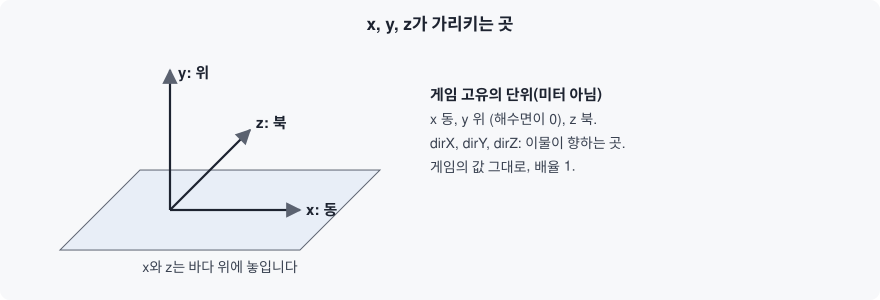

# 테이블 {#the-table}

`<match>.parquet`에는 샘플이나 이벤트마다 한 행이 있어요. 열은 31개예요([열 목록](../columns.md), 코드에서 생성됨).

| 열 | 내용 |
|---|---|
| `match`, `map` | 전투의 ID; 맵(그림에서는 `spaces/99_testmap`) |
| `time` | 녹화가 시작된 뒤의 초(카운트다운도 포함돼요) |
| `battleTime` | 전투가 시작된 뒤의 초; 카운트다운 중에는 음수 |
| `event` | 이 행이 무엇인지(아래 참고) |
| `player`, `team`, `own` | 플레이어의 이름; 녹화한 플레이어에 대한 `ally`(아군) 또는 `enemy`(적군); 녹화한 플레이어의 행에는 `1` |
| `vehicle`, `type` | 녹화한 플레이어의 함선은 이름으로(`PASB018-Iowa-1944`), 나머지는 `--ship-names`가 이름을 주지 않는 한 게임의 함선 번호로(`4253956080`). 이름이 말해 주면 `battleship`, `cruiser`, `destroyer`, `aircraft carrier`, `submarine`, 아니면 `ship` |
| `x`, `y`, `z` | 게임의 세계 단위: x 동, y 위(해수면은 0), z 북 |
| `dirX`, `dirY`, `dirZ` | 이물이 향하는 곳; 같은 좌표계의 단위 벡터(`dirY` 0: 방위만). 포탄이나 어뢰에서는 그것이 간 방향 |
| `other`, `reason` | 이벤트의 다른 함선(공격자, 피해자, 가해자); 침몰의 게임 원인 번호(이름 없음), 명중의 명중 종류, 채팅의 채널 |
| `value`, `health` | 이벤트의 수치(피해, 포탄이나 어뢰의 속도, 세계 단위 초당); 명중 뒤 함선의 체력 |
| `text` | 채팅 줄 |
| `shot`, `params` | 일제 사격의 ID; 포탄이나 어뢰의 종류, 게임 매개변수 번호로 |
| `entity` | 리플레이에서의 함선 ID |
| `otherVehicle`, `otherType` | 함선에 대한 `impact`에서: 그 함선과 그 종류 |
| `hitLocalX`, `hitLocalY`, `hitLocalZ` | 함선에 대한 `impact`에서: 포탄이 끝난 곳을 그 함선 자신의 좌표로, 미터 단위(세계 단위에 15를 곱함): x 앞, y 위(바다 기준), z 오른쪽 |
| `pitch`, `roll` | 위치 행에서, 게임이 보내는 그대로의 함선 피치와 롤(라디안): 함선은 선회할 때 기울어요 |

| `event` | 어느 함선의 행에 | 내용 |
|---|---|---|
| `position` | 모든 함선 | 클라이언트가 그 함선을 보고 있는 동안 |
| `death`, `kill` | 피해자, 공격자 | 각 침몰이 두 번 기록돼요: 함선이 가라앉은 곳과, 그 공격자가 있던 곳 |
| `hurt`, `damage` | 피해자, 공격자 | 명중: `value`는 피해, `health`는 남은 체력 |
| `shot` | 발사자 | 포탄 하나당 한 행. 포에서, 그것이 날아간 방향으로 |
| `torpedo` | 발사자 | 어뢰 하나당 한 행. 발사된 곳에서, 그것이 달린 방향으로 |
| `impact` | 발사자 | 포탄이 끝난 곳(명중, 물에 빗나감, ...); `reason`은 명중 종류 번호. 함선 위에서(0 물, 8, 32, 64 육지를 빼고 어떤 종류라도, 함선에서 6 단위 안에서) `other`/`otherVehicle`/`otherType`은 그 함선이고, `hitLocalX/Y/Z`는 그 함선 좌표계에서의 지점(위 참고) |
| `chat` | 보낸 사람 | `text`는 그 줄, `reason`은 채널(`battle_team`, `battle_common`) |

**단위.** 세계 단위는 미터가 아니에요. 속도를 낸 전함은 초당 약 2.4 단위를 가고, 맵은 가로 약 1,200 단위예요. 함선의 선체 기하와 맞춰 보면 한 단위는 15 m예요. 게임 자신의 사거리 수치로는 30 m가 돼요(landaire/wows-toolkit, `crates/wows-core/src/units.rs`, MIT. 두 값은 서로 맞지 않은 채로 둬요). 테이블은 세계 단위를 배율 1로 보관해요. 3DHeat의 모든 소스가 게임 고유의 단위를 그대로 보관하는 것처럼요. 그래서 같은 단위로 내보낸 레벨이 맞아떨어져요. 바닥글의 `heat3d` 힌트: Y가 위, Z가 뒤집힘(그래서 지도가 거울에 비치지 않아요), 함선 길이 12 단위, `player`는 사람, `team`은 집단, `match`는 세션.

---

[3DHeat](https://github.com/Holdi601/3DHeat)의 일부([문서](https://holdi601.github.io/3DHeat/)). 소스: [3DHeat-Ext-WoWs](https://github.com/Holdi601/3DHeat-Ext-WoWs).
