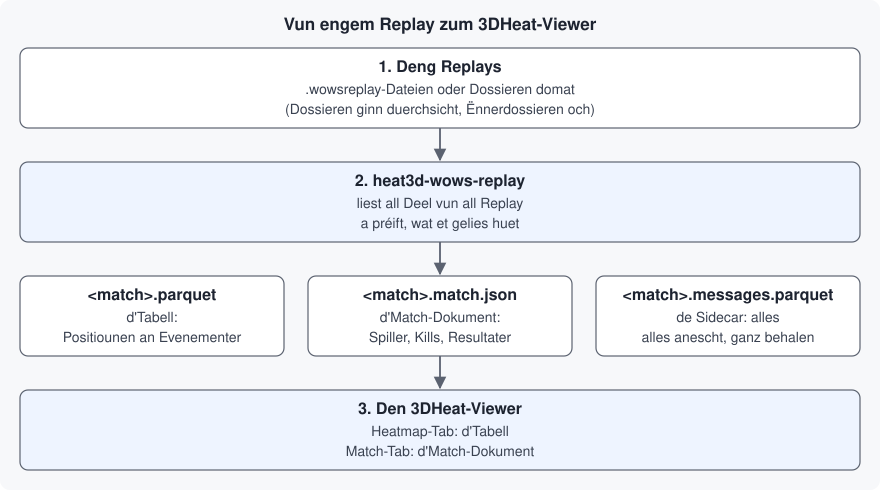

# 3DHeat World of Warships Replays {#dheat-world-of-warships-replays}

**Wat ass dat?** World of Warships kann all Gefecht, dat s du spills, als Replay-
Datei späicheren. Dëst Tool mécht aus dëse Dateien eng Tabell an e Match-Dokument (d'
Zesummefaassung vum Gefecht), déi den
[3DHeat-Viewer](https://holdi601.github.io/3DHeat/) a 3D weist: wou all
Schëff gefuer ass, geschoss huet a getraff gouf.

**Firwat soll ech et benotzen?** Fir e Gefecht nach eng Kéier vun uewen ze kucken, all
Schëff op eemol; fir Heatmaps ze gesinn, wou s du an anerer iwwer Honnerte vu Gefechter fiers, kämpfs a versenks;
fir ze gesinn, wouhin Granaten an Torpedoe gaange sinn; oder fir e Replay mat dengen eegene Skripter ze liesen, well d'
Ausgab einfachen Parquet a JSON ass.

**Beispill:** eng Replay-Datei eragitt, eng Tabell an e Match-Dokument erauskommen:



## Schnellstart {#quick-start}

Nei op der Kommandozeil? Liest fir d'éischt [Ier s du ufänks](before-you-start.md).

```bash
git clone https://github.com/Holdi601/3DHeat-Ext-WoWs.git
cd 3DHeat-Ext-WoWs
pip install -e .
heat3d-wows-replay "<World of Warships>/replays" -o out
```

Du soll eng Zeil pro Replay gesinn, déi mat der Datei ophält, déi geschriwwe gouf:
`... -> out/<map>/<match>.parquet`. Maach déi Datei an déi
`<match>.match.json` niewendrun am 3DHeat-Viewer op.

## Dës Dokumentatioun {#this-documentation}

| Säit | Wat se ofdeckt |
|---|---|
| [Ier s du ufänks](before-you-start.md) | Python, en Terminal, a wéi et ausgesäit, wann et geklappt huet |
| [Installéieren](installing.md) | Installatioun, Kontroll, Updates |
| [Replays émwandelen](converting.md) | Schrëtt fir Schrëtt, all Optioun, Meldungen, Exit-Status |
| [D'Tabell](table.md) | all Kolonn an all Evenement vun `<match>.parquet` |
| [D'Match-Dokument](match-document.md) | all Schlëssel vun `<match>.match.json` |
| [Wéi e Replay gelies gëtt](how-it-reads.md) | d'Format, a wéi d'Liese gepréift gouf |
| [Vollstännegkeet](completeness.md) | de Sidecar an d'Selbstkontroll |
| [Konditiounen a Lizenz](terms.md) | d'Konditioune vu Wargaming, Lizenz, Quellen |
| [Befehlsreferenz](../cli-reference.md), [Kolonnelëscht](../columns.md) | aus dem Code generéiert |

## Deel vun 3DHeat {#part-of-3dheat}

Dëse Konverter ass ee vun den Tools vun [3DHeat](https://github.com/Holdi601/3DHeat),
engem 3D-Telemetrie- a Replay-Viewer a Echtzäit ([Dokumentatioun](https://holdi601.github.io/3DHeat/)).
De Viewer mécht d'Tabell a sengem Heatmap-Tab op an d'Match-Dokument a sengem
Match-Tab. Hie kann d'Dateie vun engem Match an eng Datei paken:
[Eng Datei pro Match](https://holdi601.github.io/3DHeat/container.html). Wat all
Konverter muss behalen: [Konverteren behalen alles](https://holdi601.github.io/3DHeat/converters.html).

De Konverter ass mat Absicht vum 3DHeat Watcher getrennt gehalen: d'Replays
sinn chiffréiert, an d'Konditioune vu Wargaming sinn breet ([Konditiounen a Lizenz](terms.md)).
Wann en eng Kéier muss fort, geet näischt anescht mat. De Watcher léisst en lafen, wann en
installéiert ass, a funktionéiert och ouni en.

| Tool | Wat et mécht | Quell | Dokumentatioun |
|---|---|---|---|
| 3DHeat-Viewer | weist d'Daten a 3D: Heatmaps, Replays, Course-Analys | [3DHeat](https://github.com/Holdi601/3DHeat) | [Site](https://holdi601.github.io/3DHeat/) |
| GameFiles | Streckenverläf a Leveler aus de Dateien, déi Spiller matliwwere | [3DHeat-GameFiles](https://github.com/Holdi601/3DHeat-GameFiles) | [Site](https://holdi601.github.io/3DHeat-GameFiles/) |
| GameCapture | Ronnen-Telemetrie, a Leveler, déi aus Gameplay-Video nogebaut ginn | [3DHeat-GameCapture](https://github.com/Holdi601/3DHeat-GameCapture) | [Site](https://holdi601.github.io/3DHeat-GameCapture/) |
| Unreal Exporter | e Plugin fir den Unreal Editor, dat e Level exportéiert | [3DHeat-UnrealExporter](https://github.com/Holdi601/3DHeat-UnrealExporter) | [Site](https://holdi601.github.io/3DHeat-UnrealExporter/) |
| CS2 | Counter-Strike-2-Demoen a -Kaarten | [3DHeat-CS2](https://github.com/Holdi601/3DHeat-CS2) | [Site](https://holdi601.github.io/3DHeat-CS2/) |
| Watcher | hält fest, wat Spiller wärend dem Spillen publizéieren | [3DHeat-Watcher](https://github.com/Holdi601/3DHeat-Watcher) | [Site](https://holdi601.github.io/3DHeat-Watcher/) |
| War Thunder Replays | `.wrpl`-Replays a War-Thunder-Leveler | [3DHeat-Ext-WarThunder](https://github.com/Holdi601/3DHeat-Ext-WarThunder) | [Site](https://holdi601.github.io/3DHeat-Ext-WarThunder/) |
| World of Tanks Replays | `.wotreplay`-Replays | [3DHeat-Ext-WoT](https://github.com/Holdi601/3DHeat-Ext-WoT) | [Site](https://holdi601.github.io/3DHeat-Ext-WoT/) |
| World of Warships Replays | `.wowsreplay`-Replays | [3DHeat-Ext-WoWs](https://github.com/Holdi601/3DHeat-Ext-WoWs) | [Site](https://holdi601.github.io/3DHeat-Ext-WoWs/) |
| Squad-Demoen | Squad-Server-Demoen | [3DHeat-Ext-Squad](https://github.com/Holdi601/3DHeat-Ext-Squad) | [Site](https://holdi601.github.io/3DHeat-Ext-Squad/) |
| DCS-Kaarten | DCS-World-Kaarten als 3D-Leveler | [3DHeat-Ext-DCS](https://github.com/Holdi601/3DHeat-Ext-DCS) | [Site](https://holdi601.github.io/3DHeat-Ext-DCS/) |
| IL-2-Kaarten | IL-2-Great-Battles-Kaarten als 3D-Leveler | [3DHeat-Ext-IL2](https://github.com/Holdi601/3DHeat-Ext-IL2) | [Site](https://holdi601.github.io/3DHeat-Ext-IL2/) |

---

Quell: [3DHeat-Ext-WoWs](https://github.com/Holdi601/3DHeat-Ext-WoWs).
