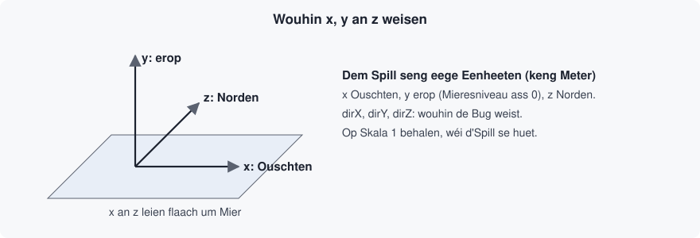

# D'Tabell {#the-table}

Eng Zeil pro Echantillon oder Evenement, an `<match>.parquet`: 31 Kolonnen
([Kolonnelëscht](../columns.md), aus dem Code generéiert).

| Kolonn | Wat |
|---|---|
| `match`, `map` | d'ID vum Gefecht; d'Kaart (`spaces/99_testmap` op de Biller) |
| `time` | Sekonne vum Ufank vun der Opnam un (de Countdown ass dran) |
| `battleTime` | Sekonne vum Ufank vum Gefecht un; negativ während dem Countdown |
| `event` | wat d'Zeil ass (ënnen) |
| `player`, `team`, `own` | den Numm vum Spiller; `ally` oder `enemy` vum opuelende Spiller; `1` op den Zeile vum opuelende Spiller |
| `vehicle`, `type` | dem opuelende Spiller säi Schëff mam Numm (`PASB018-Iowa-1944`), d'anert mat der Schëffsnummer vum Spill (`4253956080`), ausser `--ship-names` nennt se; `battleship`, `cruiser`, `destroyer`, `aircraft carrier`, `submarine`, wou den Numm et seet, soss `ship` |
| `x`, `y`, `z` | d'Weltenheeten vum Spill: x Ouschten, y erop (Mieresniveau 0), z Norden |
| `dirX`, `dirY`, `dirZ` | wouhin de Bug weist, en Eenheetsvecteur am selwechte System (`dirY` 0: nëmmen Heading); bei enger Granat oder engem Torpedo de Wee, deen et gaangen ass |
| `other`, `reason` | dat anert Schëff vun engem Evenement (Killer, Affer, Ugräifer); d'Ursaachnummer vum Spill fir eng Versenkung (net benannt), den Treffertyp bei engem Opschlag, de Kanal beim Chat |
| `value`, `health` | d'Zuel vum Evenement (Schued, d'Geschwindegkeet vun enger Granat oder engem Torpedo a Weltenheeten d'Sekonn); d'Liewe vum Schëff no engem Treffer |
| `text` | eng Chat-Zeil |
| `shot`, `params` | d'ID vun enger Salv; den Typ vun der Granat oder dem Torpedo, als Parameternummer vum Spill |
| `entity` | d'ID vum Schëff am Replay |
| `otherVehicle`, `otherType` | bei engem `impact` op e Schëff: dat Schëff a seng Klass |
| `hitLocalX`, `hitLocalY`, `hitLocalZ` | bei engem `impact` op e Schëff: wou d'Granat opgehalen huet am eegene System vun deem Schëff, a Meter (Weltenheeten mal 15): x no vir, y erop vum Mier, z no riets |
| `pitch`, `roll` | bei enger Positioun, dem Schëff seng Pitch a Roll (Radianten), wéi d'Spill se schéckt: e Schëff neigt sech an enger Kéier |

| `event` | Op der Zeil vun | Wat |
|---|---|---|
| `position` | all Schëff | solaang de Client et gesinn huet |
| `death`, `kill` | dem Affer, dem Killer | all Versenkung zweemol: wou d'Schëff versonk ass, a wou säi Killer war |
| `hurt`, `damage` | dem Affer, dem Ugräifer | en Treffer: `value` de Schued, `health` wat bleift |
| `shot` | dem Schëtze | eng Zeil pro Granat, bei der Kanoun, an der Richtung, an där se geflunn ass |
| `torpedo` | dem Schëtze | eng Zeil pro Torpedo, wou et lancéiert gouf, an der Richtung, an där et gelaf ass |
| `impact` | dem Schëtze | wou eng Granat opgehalen huet (Treffer, Feelschoss an d'Waasser, ...); `reason` d'Treffertypnummer; bei engem Schëff (all Typ ausser 0 Waasser, 8, 32, 64 Land, bannent 6 Eenheeten vun engem Schëff) `other`/`otherVehicle`/`otherType` d'Schëff an `hitLocalX/Y/Z` de Punkt a sengem System (uewen) |
| `chat` | dem Sender | `text` d'Zeil, `reason` de Kanal (`battle_team`, `battle_common`) |

**Eenheeten.** Eng Weltenheet ass kee Meter. E Schluechtschëff bei Vollfahrt leet ongeféier 2.4
dovun d'Sekonn zeréck, an eng Kaart ass ongeféier 1,200 breet. Un der Rumpfgeometrie vun de Schëffer
gemooss, ass eng Eenheet 15 m; dem Spill seng eege Reechwäitenzuele maachen se 30 m
(landaire/wows-toolkit, `crates/wows-core/src/units.rs`, MIT, wat déi zwee
net ofstëmmt). D'Tabell hält d'Weltenheeten op Skala 1, sou wéi all 3DHeat-Quell
dem Spill seng eege Eenheeten hält, sou datt e Level, dee an deenselwechten Eenheeten exportéiert gëtt, dru passt. D'
`heat3d`-Hiweiser am Fouss: Y erop, Z ëmgedréint (sou datt d'Kaart net gespigelt ass),
e Schëff 12 Eenheeten laang, `player` als Persoun, `team` als Grupp, `match` als
Sessioun.

---

Deel vun [3DHeat](https://github.com/Holdi601/3DHeat) ([Dokumentatioun](https://holdi601.github.io/3DHeat/)). Quell: [3DHeat-Ext-WoWs](https://github.com/Holdi601/3DHeat-Ext-WoWs).
