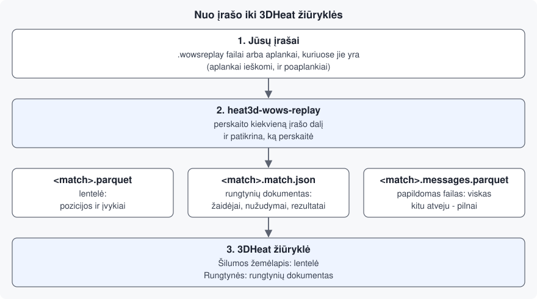

# 3DHeat World of Warships įrašai {#dheat-world-of-warships-replays}

**Kas tai?** World of Warships gali išsaugoti kiekvieną jūsų žaidžiamą mūšį kaip pakartojimo failą. Šis
įrankis paverčia tuos failus lentele ir rungtynių dokumentu (mūšio santrauka), kuriuos
[3DHeat žiūryklė](https://holdi601.github.io/3DHeat/) rodo 3D: kur kiekvienas laivas plaukė, šaudė ir
buvo pataikytas.

**Kam tai naudoti?** Kad mūšį galėtumėte žiūrėti dar kartą iš viršaus, visus laivus vienu metu; kad
pamatytumėte šilumos žemėlapius, rodančius, kur jūs ir kiti plaukiate, kaunatės ir skandinate per šimtus
mūšių; kad sužinotumėte, kur nukeliavo sviediniai ir torpedos; arba kad skaitytumėte įrašą savo skriptais,
nes rezultatas yra paprastas Parquet ir JSON.

**Pavyzdys:** vienas įrašo failas įeina, lentelė ir rungtynių dokumentas išeina:



## Greita pradžia {#quick-start}

Nesate dirbę su komandine eilute? Pirma perskaitykite [Prieš pradedant](before-you-start.md).

```bash
git clone https://github.com/Holdi601/3DHeat-Ext-WoWs.git
cd 3DHeat-Ext-WoWs
pip install -e .
heat3d-wows-replay "<World of Warships>/replays" -o out
```

Turėtumėte matyti po vieną eilutę kiekvienam įrašui, o eilutė baigiasi failu, kurį jis įrašė:
`... -> out/<map>/<match>.parquet`. Atidarykite tą failą ir šalia esantį `<match>.match.json` 3DHeat
žiūryklėje.

## Ši dokumentacija {#this-documentation}

| Puslapis | Ką aprašo |
|---|---|
| [Prieš pradedant](before-you-start.md) | Python, terminalas ir kaip atrodo sėkmė |
| [Diegimas](installing.md) | diegimas, patikrinimas, atnaujinimai |
| [Įrašų konvertavimas](converting.md) | žingsnis po žingsnio, kiekvienas parametras, pranešimai, išėjimo statusas |
| [Lentelė](table.md) | kiekvienas `<match>.parquet` stulpelis ir įvykis |
| [Rungtynių dokumentas](match-document.md) | kiekvienas `<match>.match.json` raktas |
| [Kaip įrankis skaito įrašą](how-it-reads.md) | formatas ir tai, kaip skaitymas patikrintas |
| [Pilnumas](completeness.md) | papildomas failas ir savikontrolė |
| [Sąlygos ir licencija](terms.md) | Wargaming sąlygos, licencija, šaltiniai |
| [Komandų nuoroda](../cli-reference.md), [Stulpelių sąrašas](../columns.md) | sugeneruota iš kodo |

## Dalis 3DHeat {#part-of-3dheat}

Šis konverteris yra vienas [3DHeat](https://github.com/Holdi601/3DHeat) įrankių - realaus laiko 3D
telemetrijos ir įrašų žiūryklės ([dokumentacija](https://holdi601.github.io/3DHeat/)). Žiūryklė atidaro
lentelę jos Šilumos žemėlapio skirtuke, o rungtynių dokumentą - Rungtynių skirtuke. Ji gali supakuoti
rungtynių failus į vieną failą:
[Vienas failas rungtynėms](https://holdi601.github.io/3DHeat/container.html). Ką privalo išsaugoti kiekvienas
konverteris: [Konverteriai išsaugo viską](https://holdi601.github.io/3DHeat/converters.html).

Konverteris tyčia laikomas atskirai nuo 3DHeat Watcher: įrašai užšifruoti, o Wargaming sąlygos platios
([Sąlygos ir licencija](terms.md)). Jei jį reikės pašalinti, su juo nieko daugiau nedingsta. Watcher jį
paleidžia, kai jis įdiegtas, ir veikia be jo.

| Įrankis | Ką daro | Šaltinis | Dokumentacija |
|---|---|---|---|
| 3DHeat žiūryklė | rodo duomenis 3D: šilumos žemėlapius, įrašus, lenktynių analizę | [3DHeat](https://github.com/Holdi601/3DHeat) | [svetainė](https://holdi601.github.io/3DHeat/) |
| GameFiles | trasos ir lygiai iš failų, kuriuos žaidimai pateikia | [3DHeat-GameFiles](https://github.com/Holdi601/3DHeat-GameFiles) | [svetainė](https://holdi601.github.io/3DHeat-GameFiles/) |
| GameCapture | ratų telemetrija ir lygiai, atkurti iš žaidimo vaizdo | [3DHeat-GameCapture](https://github.com/Holdi601/3DHeat-GameCapture) | [svetainė](https://holdi601.github.io/3DHeat-GameCapture/) |
| Unreal Exporter | Unreal Editor papildinys, eksportuojantis lygį | [3DHeat-UnrealExporter](https://github.com/Holdi601/3DHeat-UnrealExporter) | [svetainė](https://holdi601.github.io/3DHeat-UnrealExporter/) |
| CS2 | Counter-Strike 2 demonstracijos ir žemėlapiai | [3DHeat-CS2](https://github.com/Holdi601/3DHeat-CS2) | [svetainė](https://holdi601.github.io/3DHeat-CS2/) |
| Watcher | įrašo, ką žaidimai skelbia, kol žaidžiate | [3DHeat-Watcher](https://github.com/Holdi601/3DHeat-Watcher) | [svetainė](https://holdi601.github.io/3DHeat-Watcher/) |
| War Thunder įrašai | `.wrpl` įrašai ir War Thunder lygiai | [3DHeat-Ext-WarThunder](https://github.com/Holdi601/3DHeat-Ext-WarThunder) | [svetainė](https://holdi601.github.io/3DHeat-Ext-WarThunder/) |
| World of Tanks įrašai | `.wotreplay` įrašai | [3DHeat-Ext-WoT](https://github.com/Holdi601/3DHeat-Ext-WoT) | [svetainė](https://holdi601.github.io/3DHeat-Ext-WoT/) |
| World of Warships įrašai | `.wowsreplay` įrašai | [3DHeat-Ext-WoWs](https://github.com/Holdi601/3DHeat-Ext-WoWs) | [svetainė](https://holdi601.github.io/3DHeat-Ext-WoWs/) |
| Squad demonstracijos | Squad serverio demonstracijos | [3DHeat-Ext-Squad](https://github.com/Holdi601/3DHeat-Ext-Squad) | [svetainė](https://holdi601.github.io/3DHeat-Ext-Squad/) |
| DCS žemėlapiai | DCS World žemėlapiai kaip 3D lygiai | [3DHeat-Ext-DCS](https://github.com/Holdi601/3DHeat-Ext-DCS) | [svetainė](https://holdi601.github.io/3DHeat-Ext-DCS/) |
| IL-2 žemėlapiai | IL-2 Great Battles žemėlapiai kaip 3D lygiai | [3DHeat-Ext-IL2](https://github.com/Holdi601/3DHeat-Ext-IL2) | [svetainė](https://holdi601.github.io/3DHeat-Ext-IL2/) |

---

Šaltinis: [3DHeat-Ext-WoWs](https://github.com/Holdi601/3DHeat-Ext-WoWs).
