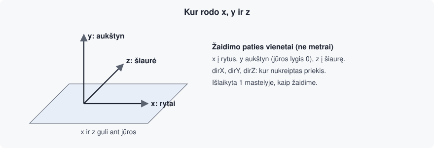

# Lentelė {#the-table}

Viena eilutė kiekvienam pavyzdžiui ar įvykiui `<match>.parquet` faile: 31 stulpelis
([Stulpelių sąrašas](../columns.md), sugeneruotas iš kodo).

| Stulpelis | Ką reiškia |
|---|---|
| `match`, `map` | mūšio id; žemėlapis (paveikslėliuose - `spaces/99_testmap`) |
| `time` | sekundės nuo įrašymo pradžios (jame yra atskaita) |
| `battleTime` | sekundės nuo mūšio pradžios; atskaitos metu - neigiamos |
| `event` | kas yra eilutė (žr. žemiau) |
| `player`, `team`, `own` | žaidėjo vardas; `ally` arba `enemy` įrašančio žaidėjo atžvilgiu; `1` įrašančio žaidėjo eilutėse |
| `vehicle`, `type` | įrašančio žaidėjo laivas pagal vardą (`PASB018-Iowa-1944`), kiti - pagal žaidimo laivo numerį (`4253956080`), nebent `--ship-names` juos įvardija; `battleship`, `cruiser`, `destroyer`, `aircraft carrier`, `submarine`, kai vardas tai nurodo, kitu atveju `ship` |
| `x`, `y`, `z` | žaidimo pasaulio vienetai: x - į rytus, y - aukštyn (jūros lygis 0), z - į šiaurę |
| `dirX`, `dirY`, `dirZ` | kur nukreiptas priekis (laivo denis), vienetinis vektorius tame pačiame rėmelyje (`dirY` 0: tik kryptis); sviedinyje ar torpedoje - kaip ji nuskrido |
| `other`, `reason` | kito laivo įvykyje (žudikas, auka, atakuotojas); žaidimo priežasties numeris nuskandinimui (nepavadintas), pataikymo tipas smūgiui, kanalas pokalbiui |
| `value`, `health` | įvykio skaičius (žala, sviedinio ar torpedos greitis pasaulio vienetais per sekundę); laivo sveikata po pataikymo |
| `text` | pokalbio eilutė |
| `shot`, `params` | salvės id; sviedinio ar torpedos tipas, kaip žaidimo parametro numeris |
| `entity` | laivo id įraše |
| `otherVehicle`, `otherType` | `impact` ant laivo: tas laivas ir jo klasė |
| `hitLocalX`, `hitLocalY`, `hitLocalZ` | `impact` ant laivo: kur sviedinys baigėsi to laivo paties rėmelyje, metrais (pasaulio vienetai, padauginti iš 15): x - pirmyn, y - aukštyn nuo jūros, z - dešinėn |
| `pitch`, `roll` | pozicijoje - laivo kėlimas ir posūkis (radianais), kaip juos siunčia žaidimas: laivas posūkyje pasvyra |

| `event` | Kurios eilutės | Ką reiškia |
|---|---|---|
| `position` | kiekvienas laivas | kol klientas jį matė |
| `death`, `kill` | auka, žudikas | kiekvienas nuskandinimas dukart: kur laivas nuskendo ir kur buvo jo žudikas |
| `hurt`, `damage` | auka, atakuotojas | pataikymas: `value` - žala, `health` - kas liko |
| `shot` | šaulys | viena eilutė vienam sviediniui, prie pabūklo, kryptimi, kuria jis skrido |
| `torpedo` | šaulys | viena eilutė vienai torpedai, kur ji buvo paleista, kryptimi, kuria ji bėgo |
| `impact` | šaulys | kur sviedinys baigėsi (pataikė, nukrito į vandenį ir pan.); `reason` - pataikymo tipo numeris; ant laivo (bet koks tipas, išskyrus 0 - vanduo, 8, 32, 64 - sausuma, per 6 vienetus nuo laivo) `other`/`otherVehicle`/`otherType` - laivas, o `hitLocalX/Y/Z` - taškas jo rėmelyje (aukščiau) |
| `chat` | siuntėjas | `text` - eilutė, `reason` - kanalas (`battle_team`, `battle_common`) |

**Vienetai.** Pasaulio vienetas nėra metras. Laivas greičiu nukeliauja apie 2,4 vieneto per sekundę, o žemėlapis yra
apie 1 200 vienetų per visą plotį. Lyginant su laivų korpuso geometrija, vienetas yra 15 m; žaidimo paties nuotolio
skaičiai daro jį 30 m (landaire/wows-toolkit, `crates/wows-core/src/units.rs`, MIT, kuris jų nesuderina). Lentelėje
pasaulio vienetai išlaikomi 1 mastelio, kaip visi 3DHeat šaltiniai išlaiko savo žaidimo vienetus, todėl lygis,
eksportuotas tais pačiais vienetais, sutampa. Poraštės `heat3d` užuominos: Y aukštyn, Z apverstas (kad žemėlapis
nebūtų veidrodinis), laivas 12 vienetų ilgio, `player` kaip asmuo, `team` kaip grupė, `match` kaip sesija.

---

Dalis [3DHeat](https://github.com/Holdi601/3DHeat) ([dokumentacija](https://holdi601.github.io/3DHeat/)). Šaltinis: [3DHeat-Ext-WoWs](https://github.com/Holdi601/3DHeat-Ext-WoWs).
