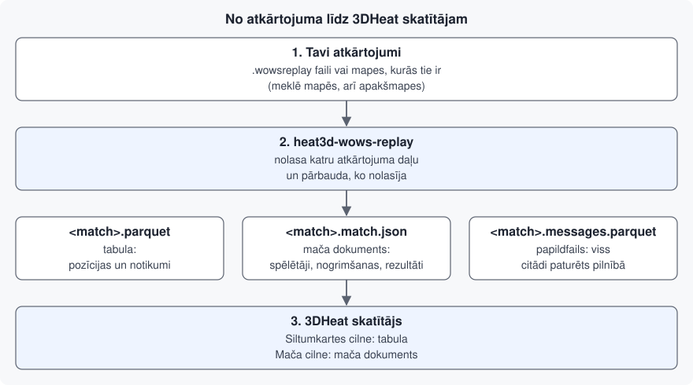

# 3DHeat World of Warships atkārtojumi {#dheat-world-of-warships-replays}

**Kas tas ir?** World of Warships var saglabāt katru kauju, ko spēlē, kā atkārtojuma failu. Šis rīks pārvērš šos failus tabulā un mača dokumentā (kaujas kopsavilkumā), ko [3DHeat skatītājs](https://holdi601.github.io/3DHeat/) rāda 3D: kur katrs kuģis brauca, šāva un tika trāpīts.

**Kāpēc to izmantot?** Lai redzētu kauju atkārtoti no augšas, visus kuģus reizē; lai redzētu siltumkartes, kur jūs un citi kuģojat, cīnāties un grimstat simtiem kauju laikā; lai redzētu, kur gāja šāviņi un torpēdas; vai lai lasītu atkārtojumu ar saviem skriptiem, jo rezultāts ir vienkāršs Parquet un JSON.

**Piemērs:** viens atkārtojuma fails ienāk, tabula un mača dokuments iziet:



## Ātrais sākums {#quick-start}

Jauns komandrindā? Vispirms izlasiet [Pirms sākat](before-you-start.md).

```bash
git clone https://github.com/Holdi601/3DHeat-Ext-WoWs.git
cd 3DHeat-Ext-WoWs
pip install -e .
heat3d-wows-replay "<World of Warships>/replays" -o out
```

Katram atkārtojumam redzēsiet vienu rindu, kas beidzas ar failu, kuru tas uzrakstīja: `... -> out/<map>/<match>.parquet`. Atveriet šo failu un blakus esošo `<match>.match.json` 3DHeat skatītājā.

## Šī dokumentācija {#this-documentation}

| Lappuse | Ko tā aptver |
|---|---|
| [Pirms sākat](before-you-start.md) | Python, termināls un kā izskatās veiksme |
| [Uzstādīšana](installing.md) | uzstādīšana, pārbaude, atjauninājumi |
| [Atkārtojumu pārvēršana](converting.md) | solis pa solim, katra iespēja, ziņojumi, izejas statuss |
| [Tabula](table.md) | katra `<match>.parquet` kolonna un notikums |
| [Mača dokuments](match-document.md) | katra `<match>.match.json` atslēga |
| [Kā tas nolasa atkārtojumu](how-it-reads.md) | formāts un kā lasīšana pārbaudīta |
| [Pilnība](completeness.md) | papildfails un pašpārbaude |
| [Noteikumi un licence](terms.md) | Wargaming noteikumi, licence, avoti |
| [Komandu atsauce](../cli-reference.md), [Kolonnu saraksts](../columns.md) | ģenerēts no koda |

## Daļa no 3DHeat {#part-of-3dheat}

Šis konvertētājs ir viens no [3DHeat](https://github.com/Holdi601/3DHeat) rīkiem, reāllaika 3D telemetrijas un atkārtojumu skatītāja ([dokumentācija](https://holdi601.github.io/3DHeat/)). Skatītājs atver tabulu tās Siltumkartes cilnē un mača dokumentu tās Mača cilnē. Tas var iepakot mača failus vienā failā: [Viens fails vienam mačam](https://holdi601.github.io/3DHeat/container.html). Ko katram konvertētājam jāsaglabā: [Konvertētāji saglabā visu](https://holdi601.github.io/3DHeat/converters.html).

Konvertētājs ir atdalīts no 3DHeat Watcher ar nolūku: atkārtojumi ir šifrēti, un Wargaming noteikumi ir plaši ([Noteikumi un licence](terms.md)). Ja tas kādreiz būs jāizņem, nekas cits līdz ar to nepazudīs. Watcher to palaiž, ja tas ir uzstādīts, un darbojas arī bez tā.

| Rīks | Ko tas dara | Avots | Dokumentācija |
|---|---|---|---|
| 3DHeat skatītājs | rāda datus 3D: siltumkartes, atkārtojumus, sacīkšu analīzi | [3DHeat](https://github.com/Holdi601/3DHeat) | [vietne](https://holdi601.github.io/3DHeat/) |
| GameFiles | trases un līmeņi no failiem, ko spēles piegādā | [3DHeat-GameFiles](https://github.com/Holdi601/3DHeat-GameFiles) | [vietne](https://holdi601.github.io/3DHeat-GameFiles/) |
| GameCapture | apļu telemetrija un līmeņi, kas atjaunoti no spēles video | [3DHeat-GameCapture](https://github.com/Holdi601/3DHeat-GameCapture) | [vietne](https://holdi601.github.io/3DHeat-GameCapture/) |
| Unreal Exporter | Unreal Editor spraudnis, kas eksportē līmeni | [3DHeat-UnrealExporter](https://github.com/Holdi601/3DHeat-UnrealExporter) | [vietne](https://holdi601.github.io/3DHeat-UnrealExporter/) |
| CS2 | Counter-Strike 2 demo un kartes | [3DHeat-CS2](https://github.com/Holdi601/3DHeat-CS2) | [vietne](https://holdi601.github.io/3DHeat-CS2/) |
| Watcher | ieraksta to, ko spēles publicē, kamēr jūs spēlējat | [3DHeat-Watcher](https://github.com/Holdi601/3DHeat-Watcher) | [vietne](https://holdi601.github.io/3DHeat-Watcher/) |
| War Thunder atkārtojumi | `.wrpl` atkārtojumi un War Thunder līmeņi | [3DHeat-Ext-WarThunder](https://github.com/Holdi601/3DHeat-Ext-WarThunder) | [vietne](https://holdi601.github.io/3DHeat-Ext-WarThunder/) |
| World of Tanks atkārtojumi | `.wotreplay` atkārtojumi | [3DHeat-Ext-WoT](https://github.com/Holdi601/3DHeat-Ext-WoT) | [vietne](https://holdi601.github.io/3DHeat-Ext-WoT/) |
| World of Warships atkārtojumi | `.wowsreplay` atkārtojumi | [3DHeat-Ext-WoWs](https://github.com/Holdi601/3DHeat-Ext-WoWs) | [vietne](https://holdi601.github.io/3DHeat-Ext-WoWs/) |
| Squad demo | Squad servera demo | [3DHeat-Ext-Squad](https://github.com/Holdi601/3DHeat-Ext-Squad) | [vietne](https://holdi601.github.io/3DHeat-Ext-Squad/) |
| DCS kartes | DCS World kartes kā 3D līmeņi | [3DHeat-Ext-DCS](https://github.com/Holdi601/3DHeat-Ext-DCS) | [vietne](https://holdi601.github.io/3DHeat-Ext-DCS/) |
| IL-2 kartes | IL-2 Great Battles kartes kā 3D līmeņi | [3DHeat-Ext-IL2](https://github.com/Holdi601/3DHeat-Ext-IL2) | [vietne](https://holdi601.github.io/3DHeat-Ext-IL2/) |

---

Avots: [3DHeat-Ext-WoWs](https://github.com/Holdi601/3DHeat-Ext-WoWs).
