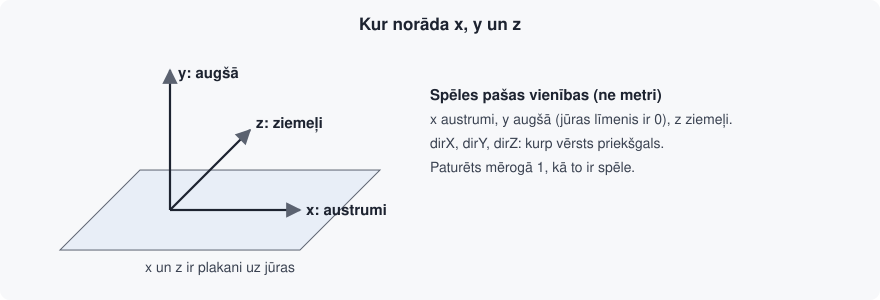

# Tabula {#the-table}

Viena rinda katram paraugam vai notikumam `<match>.parquet` failā: 31 kolonna ([Kolonnu saraksts](../columns.md), ģenerēts no koda).

| Kolonna | Ko tā nozīmē |
|---|---|
| `match`, `map` | kaujas ID; karte (`spaces/99_testmap` attēlos) |
| `time` | sekundes kopš ieraksta sākuma (skaitīšana atpakaļ ir iekļauta) |
| `battleTime` | sekundes kopš kaujas sākuma; negatīvas skaitīšanas laikā |
| `event` | kas ir šī rinda (zemāk) |
| `player`, `team`, `own` | spēlētāja vārds; `ally` vai `enemy` no ierakstošā spēlētāja viedokļa; `1` ierakstošā spēlētāja rindās |
| `vehicle`, `type` | ierakstošā spēlētāja kuģis pēc nosaukuma (`PASB018-Iowa-1944`), pārējie pēc spēles kuģa numura (`4253956080`), ja `--ship-names` tos nenosauc; `battleship`, `cruiser`, `destroyer`, `aircraft carrier`, `submarine`, kur to nosaka nosaukums, citādi `ship` |
| `x`, `y`, `z` | spēles pasaules vienības: x austrumi, y uz augšu (jūras līmenis 0), z ziemeļi |
| `dirX`, `dirY`, `dirZ` | kurp vērsts priekšgals, vienības vektors tajā pašā koordinātu sistēmā (`dirY` 0: tikai virziens); uz čaulas vai torpēdas — kurp tā gāja |
| `other`, `reason` | notikuma cits kuģis (slepkava, upuris, uzbrucējs); spēles nogrimšanas iemesla numurs (nav nosaukts), trāpījuma tips ietekmei, kanāls tērzēšanai |
| `value`, `health` | notikuma skaitlis (bojājums, čaulas vai torpēdas ātrums vienībās sekundē); kuģa veselība pēc trāpījuma |
| `text` | tērzēšanas rinda |
| `shot`, `params` | salvas ID; čaulas vai torpēdas tips kā spēles parametru numurs |
| `entity` | kuģa ID atkārtojumā |
| `otherVehicle`, `otherType` | `impact` uz kuģa: šis kuģis un tā klase |
| `hitLocalX`, `hitLocalY`, `hitLocalZ` | `impact` uz kuģa: kur čaula beidzās šī kuģa pašā koordinātu sistēmā, metros (pasaules vienības reizināts ar 15): x uz priekšu, y uz augšu no jūras, z pa labi |
| `pitch`, `roll` | pozīcijā — kuģa pitch un roll (radiānos), kā tos sūta spēle: kuģis sašķiebjas pagriezienā |

| `event` | Rindā, kas attiecas uz | Ko nozīmē |
|---|---|---|
| `position` | katru kuģi | kamēr klients to redzēja |
| `death`, `kill` | upuri, slepkavu | katra nogrimšana divreiz: kur kuģis nogrima un kur stāvēja tā slepkava |
| `hurt`, `damage` | upuri, uzbrucēju | trāpījums: `value` bojājums, `health` kas atlicis |
| `shot` | šāvēju | viena rinda uz čaulu, pie lielgabala, virzienā, kurā tā lidoja |
| `torpedo` | šāvēju | viena rinda uz torpēdu, kur tā tika palaista, virzienā, kurā tā skrēja |
| `impact` | šāvēju | kur čaula beidzās (trāpījums, kritiens ūdenī, ...); `reason` trāpījuma tipa numurs; uz kuģa (jebkurš tips, izņemot 0 ūdens, 8, 32, 64 zeme, 6 vienību robežās no kuģa) `other`/`otherVehicle`/`otherType` kuģis un `hitLocalX/Y/Z` punkts tā koordinātu sistēmā (skat. augstāk) |
| `chat` | sūtītāju | `text` rinda, `reason` kanāls (`battle_team`, `battle_common`) |

**Vienības.** Pasaules vienība nav metrs. Kaujas kuģis ātrumā nobrauc apmēram 2,4 no tām sekundē, un karte ir apmēram 1200 pāri. Novietota pret kuģu korpusu ģeometriju, vienība ir 15 m; spēles pašu diapazonu skaitļi to padara par 30 m (landaire/wows-toolkit, `crates/wows-core/src/units.rs`, MIT; tas abus nesaskaņo). Tabula paliek pasaules vienībās ar mērogu 1, kā katrs 3DHeat avots paliek pie savām spēles vienībām, tāpēc līmenis, kas eksportēts tajās pašās vienībās, sakrīt. Kājenes `heat3d` norādes: Y uz augšu, Z apgriezts (lai karte nebūtu spoguļattēls), kuģis 12 vienības garš, `player` kā cilvēks, `team` kā grupa, `match` kā sesija.

---

Daļa no [3DHeat](https://github.com/Holdi601/3DHeat) ([dokumentācija](https://holdi601.github.io/3DHeat/)). Avots: [3DHeat-Ext-WoWs](https://github.com/Holdi601/3DHeat-Ext-WoWs).
