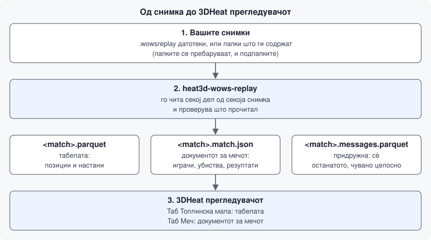

# 3DHeat World of Warships снимки {#dheat-world-of-warships-replays}

**Што е тоа?** World of Warships може да ја зачува секоја битка што ја играте како датотека со снимка (replay). Оваа алатка ги претвора тие датотеки во табела и документ за меч (резимето на битката) што [3DHeat прегледувачот](https://holdi601.github.io/3DHeat/) ги прикажува во 3D: каде секој брод пловел, пукал и бил погоден.

**Зошто би ја користел?** За да ја гледате битката повторно одозгора, сите бродови одеднаш; за топлински мапи на тоа каде вие и другите пловите, се борите и тонете низ стотици битки; за да видите каде отишле проектилите и торпедата; или за да читате снимка со свои скрипти, бидејќи излезот е обичен Parquet и JSON.

**Пример:** една датотека со снимка влегува, табела и документ за меч излегуваат:



## Брз почеток {#quick-start}

Нови сте со командната линија? Прво прочитајте [Пред да започнете](before-you-start.md).

```bash
git clone https://github.com/Holdi601/3DHeat-Ext-WoWs.git
cd 3DHeat-Ext-WoWs
pip install -e .
heat3d-wows-replay "<World of Warships>/replays" -o out
```

Треба да видите по една линија за секоја снимка, што завршува со датотеката што ја напишала: `... -> out/<map>/<match>.parquet`. Отворете ја таа датотека и `<match>.match.json` до неа во 3DHeat прегледувачот.

## Оваа документација {#this-documentation}

| Страница | Што опфаќа |
|---|---|
| [Пред да започнете](before-you-start.md) | Python, терминал и како изгледа успехот |
| [Инсталирање](installing.md) | инсталација, проверка, ажурирања |
| [Претворање на снимки](converting.md) | чекор по чекор, секоја опција, пораки, излезен статус |
| [Табелата](table.md) | секоја колона и настан на `<match>.parquet` |
| [Документот за мечот](match-document.md) | секој клуч од `<match>.match.json` |
| [Како чита снимка](how-it-reads.md) | форматот и како беше проверено читањето |
| [Комплетност](completeness.md) | придружната датотека и самопроверката |
| [Услови и лиценца](terms.md) | што чита, лиценца, извори |
| [Упатство за команди](../cli-reference.md), [Список на колони](../columns.md) | генерирани од кодот |

## Дел од 3DHeat {#part-of-3dheat}

Овој конвертор е една од алатките на [3DHeat](https://github.com/Holdi601/3DHeat), 3D прегледувач на телеметрија и снимки во реално време ([документација](https://holdi601.github.io/3DHeat/)). Прегледувачот ја отвора табелата во табот Топлинска мапа, а документот за мечот во табот Меч. Може да ги спакува датотеките на еден меч во една датотека: [Една датотека по меч](https://holdi601.github.io/3DHeat/container.html). Што мора да чува секој конвертор: [Конверторите чуваат сè](https://holdi601.github.io/3DHeat/converters.html).

Секој читач на игра е посебен мал проект со своја датотека за лиценца, свои
изданија и свој систем за следење проблеми, па може да се инсталира, ажурира,
одржува - или повлече на барање на носител на права - засебно, без да влијае
врз прегледувачот или другите алатки. Watcher го извршува овој конвертор кога
е инсталиран и работи и без него. Што чита конверторот: [Услови и
лиценца](terms.md).

| Алатка | Што прави | Извор | Документација |
|---|---|---|---|
| 3DHeat прегледувач | ги прикажува податоците во 3D: топлински мапи, снимки, анализа на трки | [3DHeat](https://github.com/Holdi601/3DHeat) | [страница](https://holdi601.github.io/3DHeat/) |
| GameFiles | патеки и нивоа од датотеките што ги испорачуваат игрите | [3DHeat-GameFiles](https://github.com/Holdi601/3DHeat-GameFiles) | [страница](https://holdi601.github.io/3DHeat-GameFiles/) |
| GameCapture | телеметрија на кругови и нивоа реконструирани од видео од играње | [3DHeat-GameCapture](https://github.com/Holdi601/3DHeat-GameCapture) | [страница](https://holdi601.github.io/3DHeat-GameCapture/) |
| Unreal Exporter | додаток за Unreal Editor што извезува ниво | [3DHeat-UnrealExporter](https://github.com/Holdi601/3DHeat-UnrealExporter) | [страница](https://holdi601.github.io/3DHeat-UnrealExporter/) |
| CS2 | демоа и мапи од Counter-Strike 2 | [3DHeat-CS2](https://github.com/Holdi601/3DHeat-CS2) | [страница](https://holdi601.github.io/3DHeat-CS2/) |
| Watcher | снима што игрите објавуваат додека играте | [3DHeat-Watcher](https://github.com/Holdi601/3DHeat-Watcher) | [страница](https://holdi601.github.io/3DHeat-Watcher/) |
| War Thunder снимки | `.wrpl` снимки и нивоа од War Thunder | [3DHeat-Ext-WarThunder](https://github.com/Holdi601/3DHeat-Ext-WarThunder) | [страница](https://holdi601.github.io/3DHeat-Ext-WarThunder/) |
| World of Tanks снимки | `.wotreplay` снимки | [3DHeat-Ext-WoT](https://github.com/Holdi601/3DHeat-Ext-WoT) | [страница](https://holdi601.github.io/3DHeat-Ext-WoT/) |
| World of Warships снимки | `.wowsreplay` снимки | [3DHeat-Ext-WoWs](https://github.com/Holdi601/3DHeat-Ext-WoWs) | [страница](https://holdi601.github.io/3DHeat-Ext-WoWs/) |
| Squad демоа | серверски демоа од Squad | [3DHeat-Ext-Squad](https://github.com/Holdi601/3DHeat-Ext-Squad) | [страница](https://holdi601.github.io/3DHeat-Ext-Squad/) |
| DCS мапи | мапи од DCS World како 3D нивоа | [3DHeat-Ext-DCS](https://github.com/Holdi601/3DHeat-Ext-DCS) | [страница](https://holdi601.github.io/3DHeat-Ext-DCS/) |
| IL-2 мапи | мапи од IL-2 Great Battles како 3D нивоа | [3DHeat-Ext-IL2](https://github.com/Holdi601/3DHeat-Ext-IL2) | [страница](https://holdi601.github.io/3DHeat-Ext-IL2/) |

---

Извор: [3DHeat-Ext-WoWs](https://github.com/Holdi601/3DHeat-Ext-WoWs).
