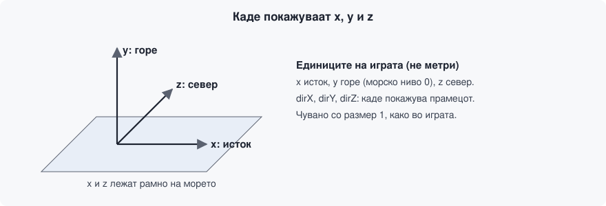

# Табелата {#the-table}

Еден ред за секој примерок или настан, во `<match>.parquet`: 31 колона ([Список на колони](../columns.md), генериран од кодот).

| Колона | Што |
|---|---|
| `match`, `map` | идот на битката; мапата (`spaces/99_testmap` на сликите) |
| `time` | секунди од почетокот на снимањето (одбројувањето е вклучено) |
| `battleTime` | секунди од почетокот на битката; негативно за време на одбројувањето |
| `event` | што е редот (подолу) |
| `player`, `team`, `own` | името на играчот; `ally` или `enemy` на снимачкиот играч; `1` на редовите на снимачкиот играч |
| `vehicle`, `type` | бродот на снимачкиот играч по име (`PASB018-Iowa-1944`), другите по бројот на бродот во играта (`4253956080`) освен ако `--ship-names` не ги именува; `battleship`, `cruiser`, `destroyer`, `aircraft carrier`, `submarine` каде што името кажува, инаку `ship` |
| `x`, `y`, `z` | светските единици на играта: x исток, y горе (морско ниво 0), z север |
| `dirX`, `dirY`, `dirZ` | каде покажува прамецот, единичен вектор во истиот систем (`dirY` 0: само насока); на проектил или торпедо патот по кој отишло |
| `other`, `reason` | другиот брод на настан (убиец, жртва, напаѓач); бројот на причината на играта за потопување (не е именуван), типот на погодок за удар, каналот за разговор |
| `value`, `health` | бројот на настанот (штета, брзина на проектил или торпедо во светски единици во секунда); здравјето на бродот по погодок |
| `text` | линија од разговор |
| `shot`, `params` | идот на салва; типот на проектилот или торпедото, како број на параметар на играта |
| `entity` | идот на бродот во снимката |
| `otherVehicle`, `otherType` | на `impact` врз брод: тој брод и неговата класа |
| `hitLocalX`, `hitLocalY`, `hitLocalZ` | на `impact` врз брод: каде завршил проектилот во системот на тој брод, во метри (светски единици пати 15): x напред, y горе од морето, z десно |
| `pitch`, `roll` | на позиција, pitch и roll на бродот (радијани) како што ги праќа играта: бродот се накосува во свиок |

| `event` | На редот на | Што |
|---|---|---|
| `position` | секој брод | додека го гледал клиентот |
| `death`, `kill` | жртвата, убиецот | секое потопување двапати: каде потонал бродот, и каде бил неговиот убиец |
| `hurt`, `damage` | жртвата, напаѓачот | погодок: `value` штетата, `health` што останало |
| `shot` | стрелецот | еден ред за секој проектил, кај топот, во насоката во која летал |
| `torpedo` | стрелецот | еден ред за секое торпедо, каде е лансирано, во насоката во која одело |
| `impact` | стрелецот | каде завршил проектил (погодок, промашување во водата, ...); `reason` бројот на типот на погодок; врз брод (кој и да е тип освен 0 вода, 8, 32, 64 копно, во рок од 6 единици од брод) `other`/`otherVehicle`/`otherType` бродот и `hitLocalX/Y/Z` точката во неговиот систем (погоре) |
| `chat` | испраќачот | `text` линијата, `reason` каналот (`battle_team`, `battle_common`) |

**Единици.** Светската единица не е метар. Борбен брод со брзина изминува околу 2.4 од нив во секунда, а мапата е широка околу 1,200. Поставена наспроти геометријата на трупот на бродовите, една единица е 15 m; сопствените бројки за домет на играта ја прават 30 m (landaire/wows-toolkit, `crates/wows-core/src/units.rs`, MIT, кој ги остава двете неусогласени). Табелата ги чува светските единици со размер 1, како што секој 3DHeat извор ги чува сопствените единици на својата игра, па ниво извезено во истите единици се совпаѓа. Упатствата `heat3d` во подножјето: Y горе, Z превртено (за мапата да не е огледана), брод долг 12 единици, `player` како лице, `team` како група, `match` како сесија.

---

Дел од [3DHeat](https://github.com/Holdi601/3DHeat) ([документација](https://holdi601.github.io/3DHeat/)). Извор: [3DHeat-Ext-WoWs](https://github.com/Holdi601/3DHeat-Ext-WoWs).
