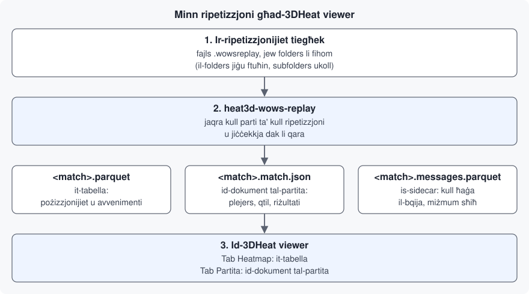

# Ripetizzjonijiet tad-3DHeat World of Warships {#dheat-world-of-warships-replays}

**X'inhu?** World of Warships jista' jsejvja kull battalja li tilgħab bħala fajl
ta' ripetizzjoni. Din l-għodda tibdel dawn il-fajls f'tabella u f'dokument tal-partita
(is-sommarju tal-battalja) li d-[3DHeat viewer](https://holdi601.github.io/3DHeat/)
juri bi 3D: fejn salpa kull vapur, fejn spara u fejn ġie milqut.

**Għaliex nużah?** Biex terġa' tara battalja minn fuq, bil-vapuri kollha
f'daqqa; biex tara heatmaps ta' fejn tbaħħar, tiġġieled u tegħreq int u oħrajn f'mijiet
ta' battalji; biex tara fejn marru l-qxur u t-torpidnijiet; jew biex taqra ripetizzjoni bis-scripts tiegħek, għax il-ħruġ huwa
Parquet u JSON sempliċi.

**Eżempju:** fajl wieħed ta' ripetizzjoni jidħol, tabella u dokument tal-partita joħorġu:



## Bidu veloċi {#quick-start}

Ġdid fil-linja tal-kmandi? Aqra [Qabel ma tibda](before-you-start.md) l-ewwel.

```bash
git clone https://github.com/Holdi601/3DHeat-Ext-WoWs.git
cd 3DHeat-Ext-WoWs
pip install -e .
heat3d-wows-replay "<World of Warships>/replays" -o out
```

Għandek tara linja waħda għal kull ripetizzjoni, li tispiċċa bil-fajl li nkiteb:
`... -> out/<map>/<match>.parquet`. Iftaħ dak il-fajl u l-fajl
`<match>.match.json` ħdejh fid-3DHeat viewer.

## Din id-dokumentazzjoni {#this-documentation}

| Paġna | X'tkopri |
|---|---|
| [Qabel ma tibda](before-you-start.md) | Python, terminal, u kif tkun taf li ħadem |
| [Installazzjoni](installing.md) | installa, iċċekkja, aġġornamenti |
| [Il-konverżjoni tar-ripetizzjonijiet](converting.md) | pass pass, kull għażla, messaġġi, status tal-ħruġ |
| [It-tabella](table.md) | kull kolonna u avveniment ta' `<match>.parquet` |
| [Id-dokument tal-partita](match-document.md) | kull ċavetta ta' `<match>.match.json` |
| [Kif taqra ripetizzjoni](how-it-reads.md) | il-format, u kif inċċekkjat il-qari |
| [Kompletezza](completeness.md) | is-sidecar u l-awto-kontroll |
| [Termini u liċenzja](terms.md) | it-termini ta' Wargaming, il-liċenzja, is-sorsi |
| [Referenza tal-kmandi](../cli-reference.md), [Lista tal-kolonni](../columns.md) | iġġenerati mill-kodiċi |

## Parti mid-3DHeat {#part-of-3dheat}

Dan il-konvertitur huwa wieħed mill-għodod tad-[3DHeat](https://github.com/Holdi601/3DHeat),
viewer 3D ta' telemetrija u ripetizzjoni fil-ħin reali ([dokumentazzjoni](https://holdi601.github.io/3DHeat/)).
Il-viewer jiftaħ it-tabella fit-tab Heatmap tiegħu u d-dokument tal-partita fit-tab
Partita tiegħu. Jista' jpakkja l-fajls ta' partita f'fajl wieħed:
[Fajl wieħed għal kull partita](https://holdi601.github.io/3DHeat/container.html). X'għandu jżomm
kull konvertitur: [Il-konvertituri jżommu kollox](https://holdi601.github.io/3DHeat/converters.html).

Il-konvertitur inżamm separat mid-3DHeat Watcher apposta: ir-ripetizzjonijiet
huma ċifrati, u t-termini ta' Wargaming huma wiesgħa ([Termini u liċenzja](terms.md)).
Jekk xi darba jkollu jitneħħa, ma jitneħħa xejn ieħor miegħu. Il-Watcher iħaddmu
meta jkun installat u jaħdem mingħajru.

| Għodda | X'tagħmel | Sors | Dokumentazzjoni |
|---|---|---|---|
| 3DHeat viewer | juri d-data bi 3D: heatmaps, ripetizzjonijiet, analiżi tat-tellieqa | [3DHeat](https://github.com/Holdi601/3DHeat) | [sit](https://holdi601.github.io/3DHeat/) |
| GameFiles | korsijiet u livelli mill-fajls li jiġu mal-logħob | [3DHeat-GameFiles](https://github.com/Holdi601/3DHeat-GameFiles) | [sit](https://holdi601.github.io/3DHeat-GameFiles/) |
| GameCapture | telemetrija tal-gir, u livelli mibnija mill-vidjo tal-logħob | [3DHeat-GameCapture](https://github.com/Holdi601/3DHeat-GameCapture) | [sit](https://holdi601.github.io/3DHeat-GameCapture/) |
| Unreal Exporter | plugin tal-Unreal Editor li jesporta livell | [3DHeat-UnrealExporter](https://github.com/Holdi601/3DHeat-UnrealExporter) | [sit](https://holdi601.github.io/3DHeat-UnrealExporter/) |
| CS2 | demos u mapep ta' Counter-Strike 2 | [3DHeat-CS2](https://github.com/Holdi601/3DHeat-CS2) | [sit](https://holdi601.github.io/3DHeat-CS2/) |
| Watcher | jirrekordja dak li l-logħob jippubblika waqt li tilgħab | [3DHeat-Watcher](https://github.com/Holdi601/3DHeat-Watcher) | [sit](https://holdi601.github.io/3DHeat-Watcher/) |
| Ripetizzjonijiet ta' War Thunder | ripetizzjonijiet `.wrpl` u livelli ta' War Thunder | [3DHeat-Ext-WarThunder](https://github.com/Holdi601/3DHeat-Ext-WarThunder) | [sit](https://holdi601.github.io/3DHeat-Ext-WarThunder/) |
| Ripetizzjonijiet ta' World of Tanks | ripetizzjonijiet `.wotreplay` | [3DHeat-Ext-WoT](https://github.com/Holdi601/3DHeat-Ext-WoT) | [sit](https://holdi601.github.io/3DHeat-Ext-WoT/) |
| Ripetizzjonijiet ta' World of Warships | ripetizzjonijiet `.wowsreplay` | [3DHeat-Ext-WoWs](https://github.com/Holdi601/3DHeat-Ext-WoWs) | [sit](https://holdi601.github.io/3DHeat-Ext-WoWs/) |
| Demos ta' Squad | demos tas-server ta' Squad | [3DHeat-Ext-Squad](https://github.com/Holdi601/3DHeat-Ext-Squad) | [sit](https://holdi601.github.io/3DHeat-Ext-Squad/) |
| Mapep ta' DCS | mapep ta' DCS World bħala livelli 3D | [3DHeat-Ext-DCS](https://github.com/Holdi601/3DHeat-Ext-DCS) | [sit](https://holdi601.github.io/3DHeat-Ext-DCS/) |
| Mapep ta' IL-2 | mapep ta' IL-2 Great Battles bħala livelli 3D | [3DHeat-Ext-IL2](https://github.com/Holdi601/3DHeat-Ext-IL2) | [sit](https://holdi601.github.io/3DHeat-Ext-IL2/) |

---

Sors: [3DHeat-Ext-WoWs](https://github.com/Holdi601/3DHeat-Ext-WoWs).
