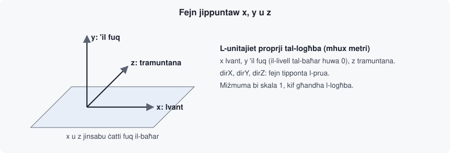

# It-tabella {#the-table}

Ringiela waħda għal kull kampjun jew avveniment, f'`<match>.parquet`: 31 kolonna
([Lista tal-kolonni](../columns.md), iġġenerata mill-kodiċi).

| Kolonna | X'inhi |
|---|---|
| `match`, `map` | l-id tal-battalja; il-mappa (`spaces/99_testmap` fl-istampi) |
| `time` | sekondi minn meta bdiet ir-reġistrazzjoni (il-countdown hu inkluż) |
| `battleTime` | sekondi minn meta bdiet il-battalja; negattiv waqt il-countdown |
| `event` | x'inhi r-ringiela (hawn taħt) |
| `player`, `team`, `own` | isem il-plejer; `ally` jew `enemy` tal-plejer li rreġistra; `1` fuq ir-ringieli tal-plejer li rreġistra |
| `vehicle`, `type` | il-vapur tal-plejer li rreġistra bl-isem (`PASB018-Iowa-1944`), l-oħrajn bin-numru tal-vapur tal-logħba (`4253956080`) sakemm `--ship-names` ma jsemmihomx; `battleship`, `cruiser`, `destroyer`, `aircraft carrier`, `submarine` fejn l-isem jgħid, inkella `ship` |
| `x`, `y`, `z` | l-unitajiet tad-dinja tal-logħba: x lvant, y 'il fuq (il-livell tal-baħar 0), z tramuntana |
| `dirX`, `dirY`, `dirZ` | fejn tipponta l-prua, vettur unità fl-istess qafas (`dirY` 0: direzzjoni biss); fuq qoxra jew torpidni t-triq li marret |
| `other`, `reason` | l-vapur l-ieħor ta' avveniment (qattiel, vittma, attakkant); in-numru tal-kawża tal-logħba għal għerq (mhux imsemmi), it-tip ta' daqqa għal impact, il-kanal għaċ-chat |
| `value`, `health` | in-numru tal-avveniment (ħsara, veloċità ta' qoxra jew torpidni f'unitajiet tad-dinja fit-tieni); is-saħħa tal-vapur wara daqqa |
| `text` | linja taċ-chat |
| `shot`, `params` | l-id ta' salvo; it-tip ta' qoxra jew torpidni, bħala n-numru tal-parametru tal-logħba |
| `entity` | l-id tal-vapur fir-ripetizzjoni |
| `otherVehicle`, `otherType` | fuq `impact` fuq vapur: dak il-vapur u l-klassi tiegħu |
| `hitLocalX`, `hitLocalY`, `hitLocalZ` | fuq `impact` fuq vapur: fejn spiċċat il-qoxra fil-qafas ta' dak il-vapur stess, f'metri (unitajiet tad-dinja darbiet 15): x 'il quddiem, y 'il fuq mill-baħar, z lejn il-lemin |
| `pitch`, `roll` | fuq pożizzjoni, il-pitch u r-roll tal-vapur (radjani) kif jibagħthom il-logħba: vapur jimtedd f'dawra |

| `event` | Fuq ir-ringiela ta' | X'inhu |
|---|---|---|
| `position` | kull vapur | waqt li l-klijent ra |
| `death`, `kill` | il-vittma, il-qattiel | kull għerq darbtejn: fejn għereq il-vapur, u fejn kien il-qattiel tiegħu |
| `hurt`, `damage` | il-vittma, l-attakkant | daqqa: `value` il-ħsara, `health` dak li fadal |
| `shot` | ix-xutter | ringiela waħda għal kull qoxra, fil-kanun, fid-direzzjoni li marret |
| `torpedo` | ix-xutter | ringiela waħda għal kull torpidni, fejn ġiet imnissla, fid-direzzjoni li ġrat |
| `impact` | ix-xutter | fejn spiċċat qoxra (daqqa, nieqsa fl-ilma, ...); `reason` in-numru tat-tip ta' daqqa; fuq vapur (kull tip minbarra 0 ilma, 8, 32, 64 art, fi ħdan 6 unitajiet minn vapur) `other`/`otherVehicle`/`otherType` il-vapur u `hitLocalX/Y/Z` il-punt fil-qafas tiegħu (hawn fuq) |
| `chat` | min bagħat | `text` il-linja, `reason` il-kanal (`battle_team`, `battle_common`) |

**Unitajiet.** Unità tad-dinja mhix metru. Korazzata bil-veloċità tgħaddi madwar 2.4
minnhom fit-tieni, u mappa hija madwar 1,200 wiesgħa. Imqabbla mal-ġeometrija tal-iskossijiet
tal-vapuri, unità hija 15 m; il-figuri tal-firxa tal-logħba nnifisha jagħmluha 30 m
(landaire/wows-toolkit, `crates/wows-core/src/units.rs`, MIT, li jħalli
ż-żewġ valuri mhux irranġati). It-tabella żżomm l-unitajiet tad-dinja bi skala 1, bħalma kull
sors tad-3DHeat iżomm l-unitajiet proprji tal-logħba tiegħu, biex livell esportat fl-istess
unitajiet jaqbel. Is-suġġerimenti `heat3d` tat-tarf: Y 'il fuq, Z maqlub (biex il-mappa
ma tkunx mirja), vapur twil 12-il unità, `player` bħala persuna, `team` bħala grupp, `match`
bħala sessjoni.

---

Parti mid-[3DHeat](https://github.com/Holdi601/3DHeat) ([dokumentazzjoni](https://holdi601.github.io/3DHeat/)). Sors: [3DHeat-Ext-WoWs](https://github.com/Holdi601/3DHeat-Ext-WoWs).
