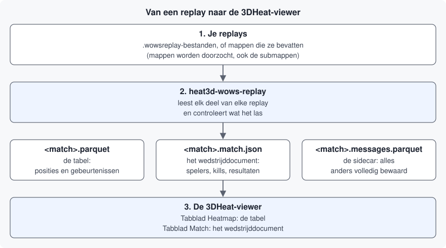

# 3DHeat World of Warships-replays {#dheat-world-of-warships-replays}

**Wat is het?** World of Warships kan elk gevecht dat je speelt opslaan als replaybestand. Deze tool
maakt van die bestanden een tabel en een wedstrijddocument (de samenvatting van het gevecht) die de
[3DHeat-viewer](https://holdi601.github.io/3DHeat/) in 3D toont: waar elk schip voer, vuurde en
geraakt werd.

**Waarom zou ik het gebruiken?** Om een gevecht van bovenaf nog eens te bekijken, alle schepen tegelijk;
om heatmaps te zien van waar jij en anderen varen, vechten en zinken, over honderden gevechten heen;
om te zien waar granaten en torpedo's terechtkwamen; of om een replay met je eigen scripts te lezen, want de
uitvoer is gewoon Parquet en JSON.

**Voorbeeld:** één replaybestand erin, een tabel en een wedstrijddocument eruit:



## Snelle start {#quick-start}

Nieuw met de opdrachtregel? Lees eerst [Voordat je begint](before-you-start.md).

```bash
git clone https://github.com/Holdi601/3DHeat-Ext-WoWs.git
cd 3DHeat-Ext-WoWs
pip install -e .
heat3d-wows-replay "<World of Warships>/replays" -o out
```

Je ziet één regel per replay, eindigend met het bestand dat hij schreef:
`... -> out/<map>/<match>.parquet`. Open dat bestand en het
`<match>.match.json` ernaast in de 3DHeat-viewer.

## Deze documentatie {#this-documentation}

| Pagina | Wat erin staat |
|---|---|
| [Voordat je begint](before-you-start.md) | Python, een terminal en wat succes betekent |
| [Installeren](installing.md) | installeren, controleren, updates |
| [Replays omzetten](converting.md) | stap voor stap, elke optie, berichten, afsluitstatus |
| [De tabel](table.md) | elke kolom en elke gebeurtenis van `<match>.parquet` |
| [Het wedstrijddocument](match-document.md) | elke sleutel van `<match>.match.json` |
| [Hoe het een replay leest](how-it-reads.md) | het formaat, en hoe de lezing gecontroleerd is |
| [Volledigheid](completeness.md) | de sidecar en de zelfcontrole |
| [Voorwaarden en licentie](terms.md) | de voorwaarden van Wargaming, licentie, bronnen |
| [Opdrachtreferentie](../cli-reference.md), [Kolomlijst](../columns.md) | gegenereerd uit de code |

## Onderdeel van 3DHeat {#part-of-3dheat}

Deze converter is een van de tools van [3DHeat](https://github.com/Holdi601/3DHeat),
een realtime 3D-viewer voor telemetrie en replays ([documentatie](https://holdi601.github.io/3DHeat/)).
De viewer opent de tabel in zijn tabblad Heatmap en het wedstrijddocument in zijn
tabblad Match. Hij kan de bestanden van een wedstrijd in één bestand inpakken:
[Eén bestand per wedstrijd](https://holdi601.github.io/3DHeat/container.html). Wat elke
converter moet bewaren: [Converters bewaren alles](https://holdi601.github.io/3DHeat/converters.html).

De converter staat bewust los van de 3DHeat Watcher: de replays zijn versleuteld, en de
voorwaarden van Wargaming zijn breed ([Voorwaarden en licentie](terms.md)).
Moet hij ooit weg, dan gaat er niets anders mee. De Watcher draait hem als hij
geïnstalleerd is en werkt ook zonder hem.

| Tool | Wat hij doet | Bron | Documentatie |
|---|---|---|---|
| 3DHeat-viewer | toont de gegevens in 3D: heatmaps, replays, Race-analyse | [3DHeat](https://github.com/Holdi601/3DHeat) | [site](https://holdi601.github.io/3DHeat/) |
| GameFiles | banen en levels uit de bestanden die games meeleveren | [3DHeat-GameFiles](https://github.com/Holdi601/3DHeat-GameFiles) | [site](https://holdi601.github.io/3DHeat-GameFiles/) |
| GameCapture | rondetelemetrie, en levels die uit gameplayvideo zijn nagebouwd | [3DHeat-GameCapture](https://github.com/Holdi601/3DHeat-GameCapture) | [site](https://holdi601.github.io/3DHeat-GameCapture/) |
| Unreal Exporter | een plug-in voor de Unreal Editor die een level exporteert | [3DHeat-UnrealExporter](https://github.com/Holdi601/3DHeat-UnrealExporter) | [site](https://holdi601.github.io/3DHeat-UnrealExporter/) |
| CS2 | Counter-Strike 2-demo's en -kaarten | [3DHeat-CS2](https://github.com/Holdi601/3DHeat-CS2) | [site](https://holdi601.github.io/3DHeat-CS2/) |
| Watcher | legt vast wat games publiceren terwijl je speelt | [3DHeat-Watcher](https://github.com/Holdi601/3DHeat-Watcher) | [site](https://holdi601.github.io/3DHeat-Watcher/) |
| War Thunder-replays | `.wrpl`-replays en War Thunder-levels | [3DHeat-Ext-WarThunder](https://github.com/Holdi601/3DHeat-Ext-WarThunder) | [site](https://holdi601.github.io/3DHeat-Ext-WarThunder/) |
| World of Tanks-replays | `.wotreplay`-replays | [3DHeat-Ext-WoT](https://github.com/Holdi601/3DHeat-Ext-WoT) | [site](https://holdi601.github.io/3DHeat-Ext-WoT/) |
| World of Warships-replays | `.wowsreplay`-replays | [3DHeat-Ext-WoWs](https://github.com/Holdi601/3DHeat-Ext-WoWs) | [site](https://holdi601.github.io/3DHeat-Ext-WoWs/) |
| Squad-demo's | demo's van Squad-servers | [3DHeat-Ext-Squad](https://github.com/Holdi601/3DHeat-Ext-Squad) | [site](https://holdi601.github.io/3DHeat-Ext-Squad/) |
| DCS-kaarten | DCS World-kaarten als 3D-levels | [3DHeat-Ext-DCS](https://github.com/Holdi601/3DHeat-Ext-DCS) | [site](https://holdi601.github.io/3DHeat-Ext-DCS/) |
| IL-2-kaarten | IL-2 Great Battles-kaarten als 3D-levels | [3DHeat-Ext-IL2](https://github.com/Holdi601/3DHeat-Ext-IL2) | [site](https://holdi601.github.io/3DHeat-Ext-IL2/) |

---

Bron: [3DHeat-Ext-WoWs](https://github.com/Holdi601/3DHeat-Ext-WoWs).
